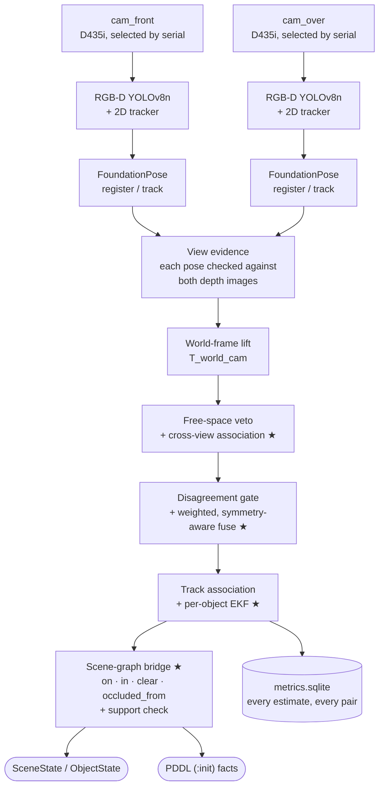
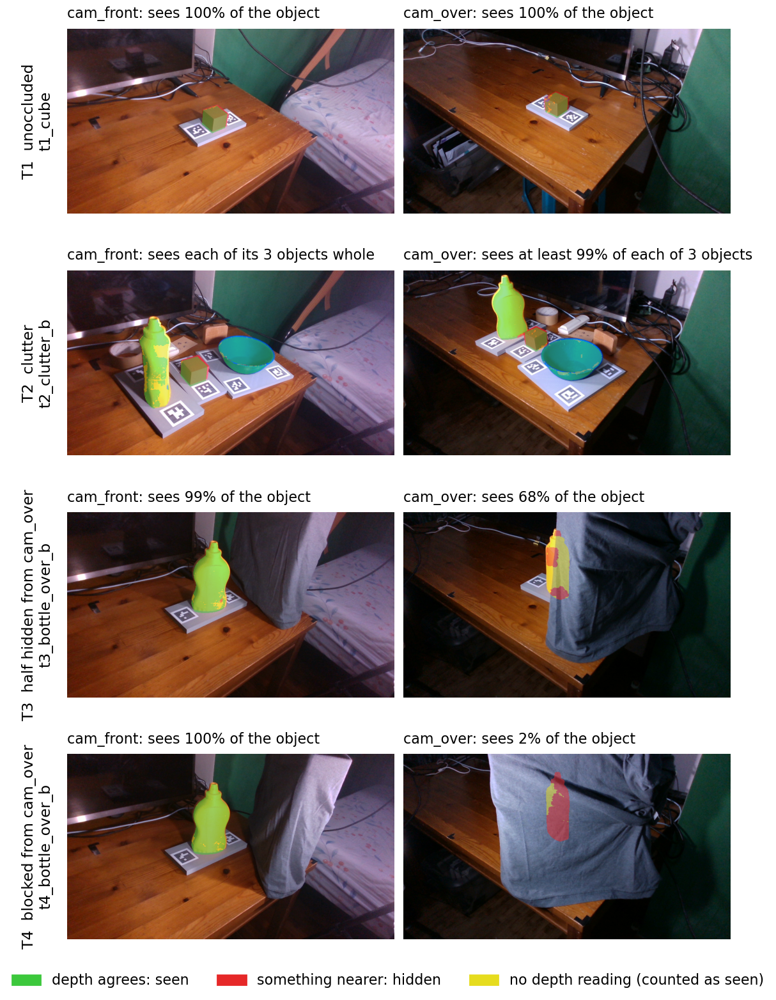
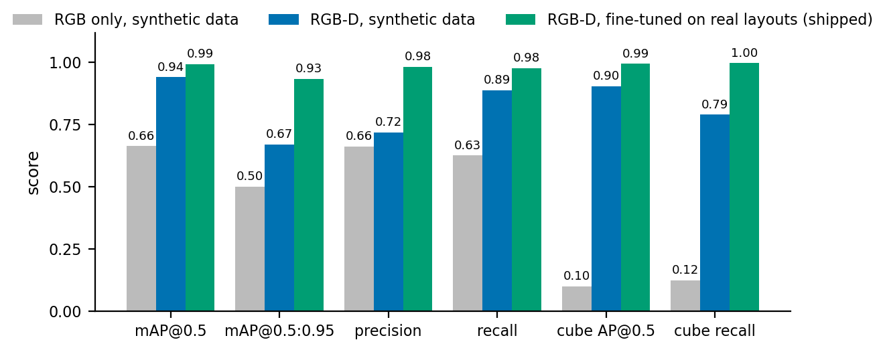
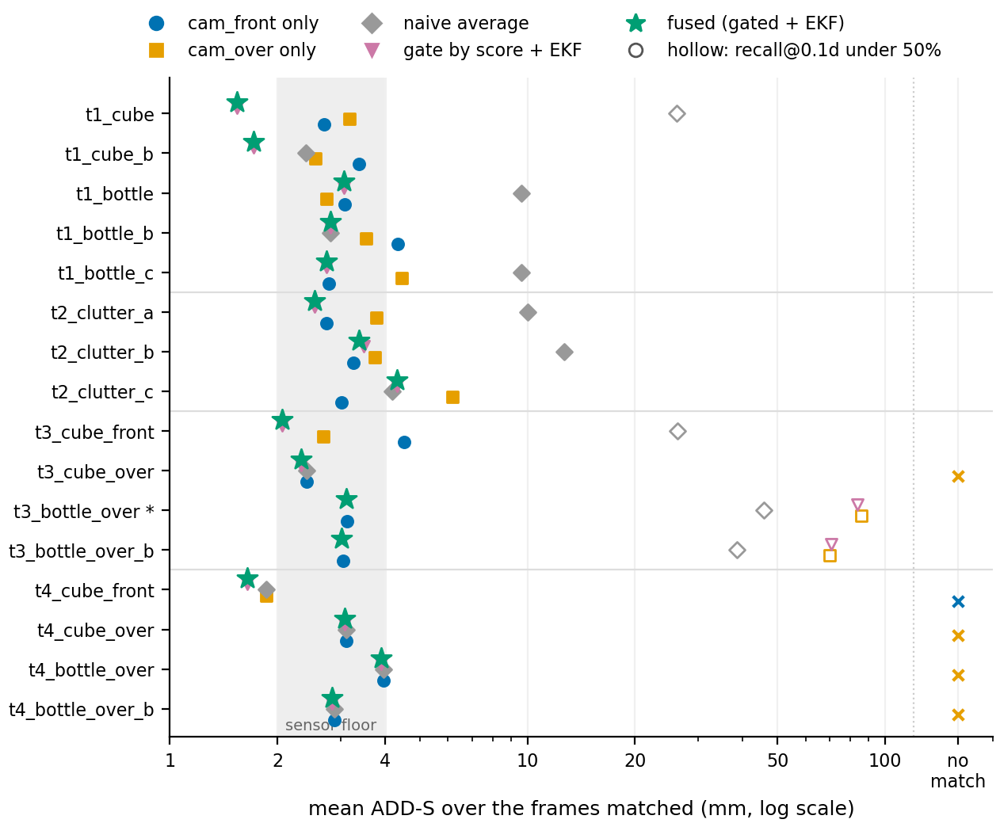
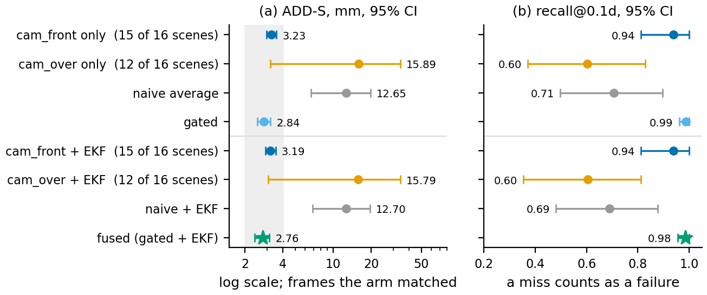
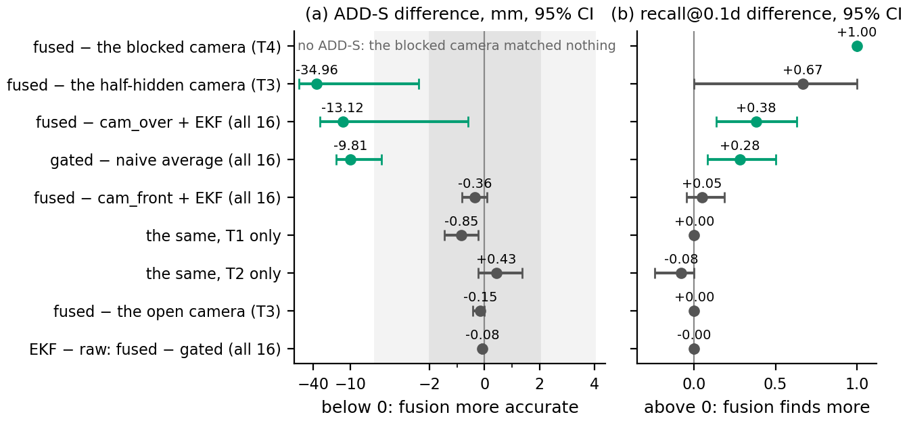
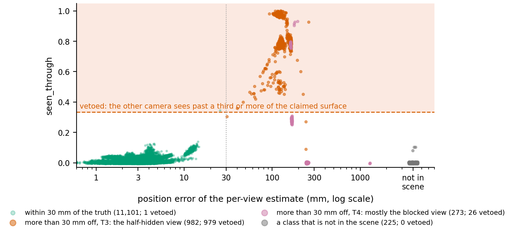
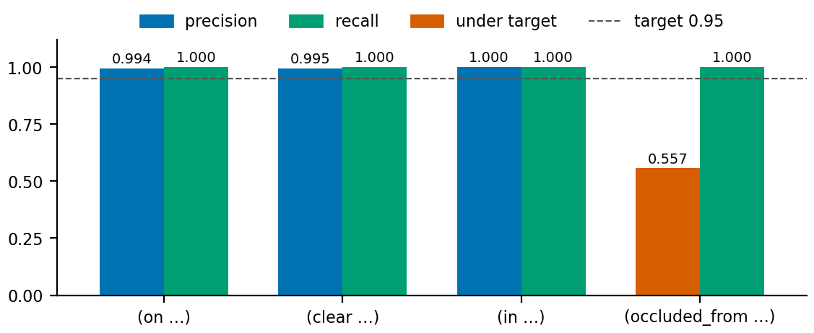
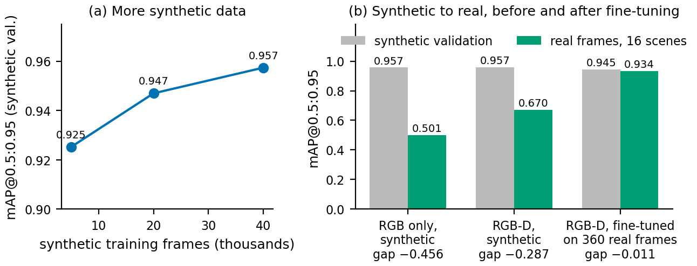

# THE EYES

## Multi-View Perception and Scene Understanding for Robot Manipulation

### NUS-ISS Pattern Recognition Systems Practice Module — Final Report

| Field | Detail |
|---|---|
| Project Title | The Eyes — Multi-View Perception and Scene Understanding for Robot Manipulation |
| Group ID / Cohort | Group 12 / AIS08 |
| Team Members | Chan Wai Jye (A0340644J) |
| Submission Type | Solo submission — AI-assisted development (Appendix E) |
| Status | **Draft 2, 17 October 2026.** Every figure comes from a recorded run; the few items still open are marked `[VERIFY]` |
| Repository | <https://github.com/chanwaijye/PRS-PM-2026-09-15-AIS08-GRP-12-TheEyes> |
| Companion documents | Proposal (15 Sep 2026), Interim Report (6 Sep 2026), video, slides, individual report |

---

## 1. Executive Summary

*The Eyes* is a real-time perception system for a robot workbench. Two Intel RealSense D435i RGB-D cameras watch a tabletop from viewpoints 80° apart. In each view, a 4-channel RGB-D YOLOv8 detector finds the known objects and FoundationPose estimates each object's 6-DoF pose. A C++ fusion module, written from first principles, combines the per-view estimates into one tracked object per physical object. A C++ scene-graph bridge then turns the fused poses into symbolic facts, `on`, `in`, `clear` and `occluded_from`, emitted as PDDL `(:init …)` facts that a task planner can use. The whole runtime is one C++ process; FoundationPose runs beside it as a pose server on a Unix socket.

The proposal fixed the main experiment before any data was seen: an **occlusion ablation** that scores the same recordings with each camera alone, with a plain average of the two, and with the gated fusion, each with and without the temporal filter. Sixteen scored scenes were recorded on the real rig, 300 frame pairs each, with ground truth from printed marker trays. The results, with 95% bootstrap intervals that resample scenes:

| Question | Measured answer |
|---|---|
| Does a second camera find what one camera cannot? | **Yes.** In the four scenes where one camera is fully blocked, that camera finds the object on no frame; the fused output has it on every frame (recall difference +1.00 [1.00, 1.00]) |
| How accurate is the fused pose? | **2.76 mm ADD-S [2.39, 3.12]** over all 16 scenes; recall within a tenth of the object's diameter 0.98 [0.95, 1.00] |
| Is fused more accurate than the better single camera? | **Not resolvable on this rig:** −0.36 mm [−0.83, 0.08], below the 2–4 mm depth-noise floor |
| Does the gating policy beat a plain average of the two views? | **Yes:** −9.81 mm [−16.96, −3.75], beyond the floor. The negative outcome stated in the proposal did not happen |
| How good is the detector on real frames? | mAP@0.5:0.95 **0.670** trained on synthetic data alone; **0.934** after fine-tuning on 360 real frames |
| Does the depth channel earn its place? | Not on synthetic data (+0.00076). **On real frames it does:** 0.501 → 0.670, and the cube's AP@0.5 goes from 0.099 to 0.905 |
| Are the symbolic facts right? | `on`, `clear`, `in`: precision ≥ 0.994, recall 1.000. `occluded_from`: recall 1.000, precision 0.557 |

Two findings shaped the system more than any parameter. First, **the pose estimator's own score does not say which view is right**: a half-hidden camera placed the bottle at the occluder's distance with a score of 0.99, while the clear camera was right with 0.85. Fusion now decides between two disagreeing views by checking each pose against both depth images. That fixed the two scenes where it failed (fused error 90 → 3.2 mm and 34 → 3.1 mm) and changed no other scene. Second, **objects that are not there are best removed by reasoning about the scene, not by thresholds**: false detections outscored true ones, but every false object floated or sat under the table. A support check in the scene graph removed 2,770 of 2,771 false object-frames and lost none of the 2,100 real ones.

The system covers all four PRS technique groups (§5). The fusion and scene-graph modules are the project's own technical contribution. The code was written with Claude Code under my design and review (Appendix E).

---

## 2. Problem Background and Motivation

### 2.1 The problem

A robot that plans tabletop tasks needs to know *what* objects are present, *where* they are in full 6-DoF, and *how* they relate to each other. My previous practice module, *The Planner* (Intelligent Reasoning Systems), turned natural-language goals into robot plans, but it read object poses from the simulator's ground truth. *The Eyes* replaces that ground truth with real sensing.

One camera is not enough. Whatever stands in front of an object hides it, and a hidden object is missing from the world state, so the planner plans as if it were not there. A second camera at another angle usually keeps the line of sight, but it produces a second estimate of every object, and the two disagree. On the first real run of this rig the two views of a printed cube disagreed by 11 mm. Turning two disagreeing views into one usable world state raises three questions that a single camera never has to answer:

1. **Association:** which estimate in one view is the same object as which estimate in the other.
2. **Arbitration:** whether a disagreement is noise to average or one view being confidently wrong. With two cameras there is no majority vote to settle it.
3. **Symbolisation:** turning noisy poses into facts such as `on` and `in`, where a pose a centimetre low can put a cube *inside* a 20 mm table.

### 2.2 Where this module sits

This is the second of four practice modules in the programme. Two are fundamental modules and two are specialist modules, and the MANIP-WM capstone runs alongside the specialist pair.

| Module | Graduate certificate | System | What it contributes |
|---|---|---|---|
| PM1 (done) | Intelligent Reasoning Systems | *The Planner* | Natural language → PDDL → action plan |
| **PM2 (this report)** | **Pattern Recognition Systems** | ***The Eyes*** | **RGB-D → fused 6-DoF poses → scene graph → PDDL facts** |
| PM3 / PM4 | Intelligent Robotic Systems; Intelligent Sensing Systems | — | Manipulation; extended sensing |
| Capstone | — | MANIP-WM | A world model over the object state produced here |

The object state defined here (`ObjectState`, §6.2) is the state the capstone's world model will read, so its fields may be added to but never removed or retyped.

---

## 3. Project Objectives and Success Measurements

### 3.1 Goals and outcomes

| Goal (proposal §1.1) | Outcome |
|---|---|
| **G1** Supervised detection and 6-DoF pose pipeline (YOLOv8 + FoundationPose) on tabletop objects | **Met.** Runs live on the rig and on replay. Single-view pose within a tenth of the diameter on every frame of the unoccluded scenes (§9.3) |
| **G2** Multi-view fusion of two RGB-D cameras at the object level, to resolve occlusion | **Met.** A fully hidden object is found on every frame (§9.4). A half-hidden camera's wrong pose is rejected by depth evidence (§9.5) |
| **G3** A C++ scene-graph bridge from fused poses to symbolic relations | **Met.** Four predicates as PDDL facts; per-predicate accuracy in §9.7 |
| **G4** A measured sim-to-real gap: train on Isaac Sim data, evaluate on real captures | **Met** (§9.9). The gap is in box tightness, not in finding objects, and 360 real frames close most of it |
| **G5** All four PRS technique groups in one runnable system | **Met**, with the unsupervised half of group ① cut (§5) |

### 3.2 The minimum viable product

| MVP item (proposal §1.3) | State |
|---|---|
| Single-camera pipeline on a real camera | Done |
| Second camera, fusion, and the occlusion ablation | Done: eight arms (ten with depth evidence) on 16 real scenes, significance test applied (§9.4) |
| Scene-graph bridge emitting PDDL facts | Done |
| Evaluation numbers: mAP, ADD-S single vs fused, predicate accuracy | Done (§9) |

Items above the MVP were cut in the order the proposal fixed: (1) the Jetson Orin Nano test, (2) the DBSCAN unknown-object path and (4) the digital-twin viewport were not built. Item (3), live integration with *The Planner*, was replaced on 8 September by a logged run: real fused poses from this rig, fed to the planner unchanged, produced valid plans on the first try with no code changed on either side (`docs/PM1_INTEGRATION.md`). Only `clear` of the planner's eleven predicates matches this project's vocabulary, so a live bridge would need a mapping layer.

### 3.3 Success measurements

The proposal's evaluation plan (§7) lists nine metrics. Section 9.10 reports each with its value and confidence interval, or says why it was not measured.

---

## 4. Literature Review and Related Systems

**Object detection with depth.** YOLOv8 (Jocher et al., 2023) is a single-stage, anchor-free detector with a CSPDarknet backbone, a PAN-FPN neck and a decoupled head. RGB-D detection has used two families of design: separate branches for colour and depth fused late, as in FuseNet (Hazirbas et al., 2016), and depth encoded as extra input channels, as in the HHA encoding of Gupta et al. (2014). This project uses early fusion: it widens YOLOv8's first convolution from 3 to 4 input channels and initialises the depth filter from the pretrained colour filters. Early fusion keeps the whole COCO-pretrained backbone usable with 144 extra parameters, where a separate depth branch would have to be trained from scratch.

**6-DoF pose estimation.** FoundationPose (Wen et al., 2024) estimates and tracks the pose of an object it has never been trained on, given its CAD mesh. It renders pose hypotheses, refines them with a transformer network and picks the best with a learned scorer; tracking refines the previous pose. Pose accuracy is scored with ADD, the mean distance between corresponding model points (Hinterstoisser et al., 2012), or ADD-S, the mean distance to the nearest model point, which does not penalise a pose that differs only by an object symmetry (Xiang et al., 2018).

**Multi-view fusion.** Combining independent estimates of one state is the Kalman setting (Kalman, 1960). Rotations cannot be averaged component-wise. Markley et al. (2007) give the weighted average quaternion as the principal eigenvector of the summed outer products, which is also insensitive to the sign ambiguity of quaternions. An error-state Kalman filter keeps the orientation error in three tangent-space dimensions, avoiding the singular covariance of a 4-vector formulation (Solà, 2017). CosyPose (Labbé et al., 2020) is the closest published system: it matches single-view object hypotheses across views and refines a global scene by bundle adjustment. This project instead fuses per object and per frame with a disagreement gate and an EKF, which runs in real time on two views and leaves each step visible to the ablation.

**Scene graphs for robotics.** 3D scene graphs represent objects as nodes and relations as edges (Armeni et al., 2019; Rosinol et al., 2020). Relations such as `on`, `in` and `clear` are the state language of PDDL planning (McDermott et al., 1998), so deriving them from poses connects perception to a planner.

**Synthetic data.** Randomising textures, lighting and viewpoint in simulation lets networks transfer to real images without real labels (Tobin et al., 2017). Here all three object classes are 3D-printed from their meshes and rendered in their filament colours, so the measured gap is about geometry, sensing and light more than about appearance.

**Scope.** None of these techniques is new, and this project makes no novelty claim for them, alone or combined. Its contribution is applying them to a concrete two-camera rig, measuring the result against a test fixed in advance, and writing the fusion and scene-graph modules from first principles in C++ rather than configuring a library.

---

## 5. Tools and Techniques Applied

The module asks for at least three of the four PRS technique groups. *The Eyes* uses all four.

| # | Technique group | Where it is in the system |
|---|---|---|
| ① | Supervised / unsupervised learning | **Supervised:** the RGB-D YOLOv8 detector, trained on 40,012 labelled synthetic frames and fine-tuned on 360 labelled real frames whose labels come from measured ground truth (§7.6). *The unsupervised half, DBSCAN clustering of unexplained depth points to flag objects with no CAD model, was cut second in the fixed order and not built* |
| ② | Machine learning / deep learning | Multimodal RGB-D YOLOv8n (4-channel early-fusion stem, COCO weights inflated to the depth channel), deployed in C++ through ONNX Runtime with the CUDA provider. FoundationPose's transformer refiner and scorer (pretrained, frozen) behind a pose server |
| ③ | Hybrid / ensemble | Two independent per-view estimators fused by a gate that decides between disagreeing views on depth evidence, weighted by confidence, with symmetry handling. A learned front end (detector, pose network) feeding a classical back end (per-object error-state EKF) |
| ④ | Intelligent sensing / sense-making | Two calibrated RGB-D cameras; depth checks of each pose against both cameras' depth images; poses turned into relational predicates, with a support check that removes objects resting on nothing |

**Tools.** C++17 (all runtime code) · Python 3.11 (training and dataset tools) · Ultralytics YOLOv8 · FoundationPose (PyTorch) · ONNX Runtime C++ API · Eigen · OpenCV (ChArUco, ArUco) · yaml-cpp · SQLite · GoogleTest · NVIDIA Isaac Sim 5.1 with Omniverse Replicator · librealsense (RSUSB backend) · Ubuntu 24.04 on an RTX 5070 Ti 16 GB.

---

## 6. System Design and Models

### 6.1 Architecture



*Figure 1. The runtime pipeline: one C++ process per run, with FoundationPose beside it as a pose server.*

★ = written from first principles in C++, with no fusion, pose-averaging, filtering or scene-graph library. Eigen is used for linear algebra only.

The stages are, in order:

1. Each camera is opened **by serial number**, never by device path, because USB enumeration order changes between reboots.
2. A frame pairer pairs colour and aligned depth from the two cameras.
3. Each view runs the detector, and a 2D IoU tracker gives each detection a track id.
4. The pose client asks the pose server to **register** an object it has not seen (a global search, about 1.1 s) or to **track** one it has (refinement from the last pose, about 11 ms).
5. Every per-view pose is rendered into both views and compared with the measured depth (§6.5).
6. Fusion lifts the poses into the world frame, fuses them per object, and filters each object over time (§6.6).
7. The scene-graph bridge derives the facts (§6.7).

### 6.2 Runtime process model and interface contract

The runtime is **one C++ process, not ROS2**. The stages pass the structs defined in `INTERFACES.md` by function call. For a fixed pipeline on one machine this avoids serialisation on the hot path and a second build system, and nothing downstream needs ROS2: *The Planner* ships none. A ROS2 publisher would be a thin adapter over the same structs.

```
the_eyes_run check  [--live]     configs, model, pose server (and cameras, by serial)
the_eyes_run live   [--record]   cameras -> detector -> pose -> evidence -> fusion -> scene graph
the_eyes_run replay <session>    the same pipeline from a recording, bit-exact
```

FoundationPose has no C++ implementation, so it runs **out of process** as a Python server on a Unix domain socket with a length-prefixed byte protocol (`SystemCode/pose/README.md`). Every line of the project's own runtime logic stays in C++. A FoundationPose crash disconnects a socket instead of killing the perception process, and the client re-registers every object after a reconnect, because the server's per-object state is lost.

The output contract (`INTERFACES.md` §5) is the per-object state the capstone will consume:

```cpp
struct ObjectState {
  std::string id;               // stable instance id, e.g. "red_cube_01"
  std::string cls;              // detector class
  Eigen::Isometry3d pose_w;     // fused 6-DoF pose, world frame
  double confidence;            // fused confidence [0,1]
  std::vector<std::string> relations;   // filled by the scene graph
  uint32_t visible_views;       // views fused into the pose (bit0 cam_front, bit1 cam_over)
  Eigen::Vector3d extent;       // world-axis-aligned half-extents
  uint64_t stamp_ns;
  double position_sigma_m;      // belief from the EKF
  double orientation_sigma_rad;
  Eigen::Vector3d velocity_w;
  uint32_t observed_views;      // added 11 Oct: every view with an estimate, fused or gated out
};
```

Fields may be added but never removed or retyped. One field was added during the project: `observed_views`, which fixed the `occluded_from` fact (§6.7).

### 6.3 Detector: RGB-D YOLOv8n

| Item | Value |
|---|---|
| Network | YOLOv8n with a 4-channel input stem: RGB plus aligned metric depth (0.20–1.50 m, encoded to the image range) |
| Parameters | 3,011,577. The RGB-only control has 3,011,433, so depth costs **144 parameters** |
| Initialisation | COCO weights. The depth filter is set to the mean of the pretrained RGB filters (the library would otherwise leave it random) |
| Input → output | ONNX `1×4×640×640` → `1×7×8400`, opset 17 |
| Deployment | ONNX Runtime C++ API, CUDA execution provider. p50 **3.60 / 3.43 ms per view** on the GPU (12.6 / 12.4 ms on the CPU) |
| Classes | `mustard_bottle`, `red_cube`, `bowl` |
| Shipped weights | `yolov8_the_eyes_ft_real_v1.onnx`: trained on synthetic data, then fine-tuned on real frames (§9.2). The synthetic-only model ships beside it for comparison |

A **brightness floor** sits in front of the detector: a frame whose mean luma is under 45 is scaled up to 45 for the detector only, and the recording is left untouched. It is a floor and not a target because brightening further loses the cube. At a target of 60, cam_over dropped it on 7 of 60 pairs.

### 6.4 Pose estimation: FoundationPose behind a socket

FoundationPose ships two frozen networks: a refiner of 17.0 M parameters and a scorer of 16.0 M parameters (Interim Report §2.4). In the runtime's 36.0 M parameters, 3.0 M (8.4%) are trained in this project. Registration runs **6 refinement iterations**, not upstream's 5. On the mustard0 sequence, one frame in 30 registered 121 mm and 162° from the true pose at 2, 3, 4 and 5 iterations, and only 6 escaped that wrong basin. TensorRT was considered and declined. The PyTorch autocast path already reaches 48.9% of the card's fp16 peak, and NVIDIA ships the engines in fp32 only, which would make even a perfect engine 1.46× slower (`docs/TRT_PLAN.md`).

The client decides, per camera, class and 2D track id, whether to register or track. Tracking only refines the previous pose, so a pose that has gone wrong while its detection box stays right never recovers by itself. Replays of the live video takes showed three ways this happens: a 2D track carried from the red print on an occluding card onto the real cube; an object registered while a hand was still setting it down; and a cube lifted out of the bowl faster than tracking follows, leaving `(in red_cube bowl)` true for 21 s after the cube had left. Two rules in `config/pose.yaml` send such a track back to registration:

- **Box size:** the detection box's area has changed more than 3× since the last registration.
- **Box cover:** on 5 estimates in a row, the bounding rectangle of the mesh's projected corners covers less than 0.3 of the detection box. The count doubles after each forced registration. A box on the visible part of a half-hidden object lies inside the object's projected footprint, so an occluder that stays put does not trigger the rule.

With both rules, every fault in the takes is gone, and **all 22 recorded scenes replay pair for pair as before**, so no number in this report moves. A third rule, re-registering after 15 refusals by the depth check, was tried and dropped: it moved four half-hidden scenes and hid true occlusions.

### 6.5 View evidence: what the depth images say about each pose

The pose estimator's score does not rank the two views (§9.5). So every per-view pose is checked against measurements instead. The runner renders the object's mesh at the estimated pose into its own view and into the other view, and compares the rendering with the measured depth (`runtime/view_evidence.hpp`). Each estimate then carries two numbers:

- **`depth_support`:** the share of its silhouette where its own camera's depth agrees with the rendered surface (within 20 mm).
- **`seen_through`:** the share of its silhouette where the *other* camera measures a surface more than 40 mm *beyond* the object. That camera is looking through the place where the object is claimed to be.

The asymmetry is the core of the design. A surface *in front of* the object is an occluder and is evidence of nothing; so is a pixel with no depth. Only a surface *behind* the claimed object contradicts it. So a camera that cannot see an object never vetoes it, and a camera that sees past it always does. The evidence stage costs 3–11 ms a pair.

### 6.6 Multi-view fusion ★

Every threshold lives in `config/fusion.yaml`, not in a library's defaults.

| Step | What it does | Setting |
|---|---|---|
| World-frame lift | `T_world_cam · pose_cam`, with the extrinsics checked at start-up | Refuses to start above 0.5 px reprojection RMSE |
| **Free-space veto** | An estimate seen through by one third or more of its silhouette is dropped before association, so it cannot found an object or a track of its own | `max_seen_through: 0.3333` |
| Cross-view association | Greedy nearest neighbour within a class in the world frame; at most one estimate per camera per cluster; deterministic order | 150 mm |
| **Disagreement gate** | With two views and no majority, the views are compared with each other. Beyond the gate it is a conflict: the estimate with the larger `depth_support × (1 − seen_through)` is kept if the two differ by 0.15 or more, otherwise the higher score. Confidence is halved to record that the system guessed | 50 mm / 30°; margin 0.15 |
| Weighted fuse | Score-weighted centroid; **Markley eigenvector average** of the quaternions, `M = Σ wᵢ qᵢ qᵢᵀ`, after mapping every view onto the symmetry-equivalent orientation nearest the best view | Symmetry groups from the mesh registry: `cubic` (24 rotations), `axial_z` (bowl) |
| Track association | Each fused cluster is matched to an existing track | 100 mm |
| **Error-state EKF** | Nominal `(p, v, q)`; error state `[δp, δv, δθ] ∈ ℝ⁹`; constant-velocity position, random-walk orientation; Joseph-form covariance update; measurement noise scaled by 1/confidence; each measurement moved to the symmetry equivalent nearest the track | Coast 1.0 s, then the id is retired |

Three design decisions matter most:

- **The association radius must exceed the gate.** Association asks "could these be the same object?", and the gate then asks "do they agree well enough to average?". A gate wider than the association radius can never fire, because the views it should judge have already been split into separate objects. The config loader refuses such a file. This was a real bug in the first config, caught by the tests.
- **Symmetric objects are compared with their symmetry removed.** On the rig, the two views of the cube were 88° and 178° apart, which are the same cube. Before this change, the fused orientation jumped whenever one view dropped out, and on the 4 October rehearsal recording gate + EKF scored 8.54 mm with 58% of frames inside the threshold. After it, the same recording scored 1.90 mm with 100% inside.
- **The filter and the policy are separate switches.** In the first ablation harness the naive arm meant "plain average *and* no filter". On a still object the EKF is a running average, so the measured fused-versus-naive gain was really the filter's. With the two separated, the policy's gain on symmetric Gaussian noise is 0.01 mm, as it must be. A unit test pins this, so the confound cannot return (Interim Report §4.1).

### 6.7 Scene-graph bridge ★

All geometry is on world-axis-aligned boxes (`pose_w` translation ± `extent`), so rotation never enters a predicate. Tolerances come from `config/predicates.yaml`; a missing or out-of-range value throws an error rather than falling back to a default.

| Predicate | Rule |
|---|---|
| `(on a b)` | `a`'s base within 15 mm of `b`'s top, at least 25% of `a`'s footprint over `b`, and `a` not `in` anything |
| `(in a b)` | `b`'s class is a declared container (`[bowl]`); `a`'s centroid inside `b`'s box inset by 5 mm; `vol(a) ≤ 0.5 · vol(b)` |
| `(clear a)` | nothing is `on` `a` |
| `(occluded_from a v)` | camera `v` has no estimate of `a` this frame (`observed_views` bit unset) |

- **Containers are declared, not inferred.** A table is a wide, thin box. On an early live run, a cube pose low by more than half the 20 mm table thickness put its centroid inside the slab, and `(in red_cube_01 table_01)` was emitted 26 times. Geometry alone cannot tell a container from a slab, so `in` is default-deny. A false `in` is the costly error, because containment is exclusive: it suppresses every true `on` fact for the object.
- **The support check.** An object is reported only if it rests on something: a chain of `on` / `in` relations that ends at a ground class (the table). Grounding is computed as a least fixed point, so support passes through stacks and containers, and resting on something unsupported is not support. The check is decided before containment is made exclusive, so a false container does not take its real contents with it. Why it exists, and what it removed, is in §9.7.
- **`occluded_from` means "this camera has no estimate of the object".** Until 11 October it was read from `visible_views`, the views *fused* into the pose. A view dropped by the gate in a conflict therefore read as "hidden", even though it saw the object. Reading `observed_views` instead removed the fact from four scenes where nothing hid the object (300 frames each → 0), with no other fact and no pose changed.

### 6.8 What training and inference must agree on

Four things must match between the Python training side and the C++ runtime, and a mismatch in any of them fails silently. Each is checked:

| | Item | Check |
|---|---|---|
| A | Depth encoding: invalid-depth value, 0.20–1.50 m clip, letterbox padding | The Python and C++ copies verified as an exact round trip |
| B | Class list and order in the labels, `detector.yaml` and `meshes.yaml` | C++ test against the mesh registry |
| C | One re-centred mesh set renders the training data, registers FoundationPose and scores ADD-S | Mesh tests re-derive extents and diameters from the files |
| D | Detector numerics | C++ ONNX output checked against the Ultralytics reference |

---

## 7. Data Collection and Datasets

### 7.1 Objects

Three classes: `mustard_bottle` (YCB 006), `bowl` (YCB 024) and an authored 50 mm `red_cube`. Each mesh is re-centred so the object frame's origin is its bounding-box centre; the raw YCB bowl's origin sat 43.7 mm off centre. **All three are 3D-printed from their meshes**, so no object-to-mesh mismatch hides inside the pose error. (The YCB bottle is a 20 oz product that is not sold in Singapore, and the common 14 oz bottle would have added exactly that mismatch.) The printed cube is within 0.30% of CAD on every axis. Accuracy thresholds are 10% of each diameter: cube 8.66 mm, bowl 16.20 mm, bottle 19.65 mm.

The cost: every class is controlled-appearance, printed in the colours the training renders use. The sim-to-real gap measured here therefore tests geometry, sensing and lighting more than appearance transfer, which is a weaker test of G4 than a purchased, textured object would give.

### 7.2 Rig, calibration and sensor

The two D435i cameras stream 848 × 480 colour and aligned depth at 30 fps. Their placement was derived from the measured intrinsics and the depth-noise law rather than chosen by eye: about 0.7 m standoff, 35° elevation, 80° apart. Measured on 4 October: baseline 738.4 mm, relative rotation 80.17°, a shared field of view of 460 × 370 mm on the table.

- **Calibration.** A 324 mm ChArUco board, captured at 1920 × 1080: at the streaming resolution its markers do not decode at the board's far corner (Interim Report Appendix A.2). Every calibration used by a scored scene has a reprojection RMSE of **0.254–0.311 px** for cam_front and **0.296–0.327 px** for cam_over, against a 0.5 px gate.
- **Session re-registration.** The cameras stand on floor tripods beside a shared desk, and the rig drifted between sessions even when untouched (10.7 mm over two idle weeks). Each session therefore starts with a re-registration from one board view per camera. A check makes it safe: `T_camA_camB` does not depend on the world frame, so the tool tells "the table moved" (recoverable) from "a camera moved" (recalibrate), and refuses in the second case.
- **Depth scale.** cam_front reads about 1% short. Each day's empty-table recording fits its scale (×1.0089 to ×1.0102). cam_over's error grows with range and is not a scale, so it is left alone.
- **Sensor floor.** Depth noise was measured against a flat wall, holding the physical wall patch constant: 0.98 / 0.75 mm at 0.4 m, 2.69 / 2.44 mm at 0.7 m, 4.77 / 4.27 mm at 1.0 m (cam_front / cam_over). At the mounted distances that is **2–4 mm**, the floor below which a difference between arms is not resolvable on this rig.
- **Hardware sync.** The cameras were hardware-synced (master and slave) from 27 August. The sync cable was later broken and lost, and when it stopped working is not known: probably after 6 October. Every pair in every scored scene is within 16.7 ms (half a frame), but the logged skew reads the same with and without the cable, so the recordings cannot settle it. Nothing on the table moves during a scored scene, so no accuracy figure depends on it.

### 7.3 Ground truth

Each object sits in a printed tray whose socket is cut from that object's own mesh, with ArUco marker seats in the same plate. The object-to-marker offset therefore comes from CAD, not from callipers, and the objects stay unmodified:

`T_cam_object = T_cam_marker · T_marker_tray · T_tray_object`

Only `T_cam_marker` is observed. Since 4 October each tray is solved on the table plane: marker corners are dropped onto the plane the tray lies in, and x, y and yaw are fitted, with height from CAD. On the same stills, this cut the cube's cross-camera disagreement from 9.6 mm to 0.6 mm. **The two cameras' independent ground truths agree to 0.6–0.7 mm with one tray in view, and to 0.3–1.4 mm with three (the bottle the widest).** That is the practical bound on ground-truth error; the worst socket clearance, 0.23 mm, is the theoretical one. Ground truth is used for evaluation and labelling only, never at inference.

Each scene's visibility tier is **measured, not declared**. `visibility_from_gt` renders each object at its ground-truth pose and counts the share of its silhouette that the measured depth does not show hidden. T3 is 25–75% visible from one camera, and T4 is under 25%.

### 7.4 Synthetic training set

`synth50k_v2` was rendered in Isaac Sim 5.1 with Omniverse Replicator: 50,000 RGB-D frames (40,012 training, 9,988 validation, 88 GB) at the rig's derived geometry and measured intrinsics, with the D435i depth-noise model applied. It randomises light, materials, object pose, viewpoint and eight distractors drawn from the targets' own colour palette, so colour alone cannot decide a class. Mean occlusion is 31–35%, measured from Replicator's visible-to-full box ratio. Two scene defects first produced output that looked correct and was not: a 1 m default near-clipping plane and a missing room. Fixing them took depth validity from 4–15% to 100% (Interim Report Appendix A.3).

### 7.5 Real captures

Every scene is recorded once as 300 frame pairs and then **replayed bit-exactly** for every arm, model and fix. The 16 scored scenes were shot on 5–7 October:

| Tier | Scenes | Content | Hidden view sees (measured) |
|---|---|---|---|
| T1, alone | `t1_cube`, `t1_cube_b`, `t1_bottle`, `t1_bottle_b`, `t1_bottle_c` | One object, unoccluded, in different placements | — |
| T2, clutter | `t2_clutter_a`, `_b`, `_c` | Cube, bowl and bottle on their trays, four distractors | All views see all objects (least: 82%) |
| T3, half hidden | `t3_cube_front`, `t3_cube_over`, `t3_bottle_over_b` | One object behind a card or cover from one camera | 60%, 44%, ≤ 68% |
| T3, not certified | `t3_bottle_over` | As above; the tool reads 88% visible because the cover's draped edge has no depth | — |
| T4, fully hidden | `t4_cube_front`, `t4_cube_over`, `t4_bottle_over`, `t4_bottle_over_b` | One object hidden from one camera | 0%, 0%, 6%, 2% |

Figure 2 shows one scene of each tier as the two cameras recorded it.



*Figure 2. One scene per tier, pair 30 of each. Each object is drawn at its ground-truth pose and tinted by what that camera's depth shows at each pixel of it. The share seen is the median over the scene's 300 pairs (`visibility_from_gt`).*

Six more scenes are recorded but not in the scored set. Two have the cube **inside** the bowl (`t2_in_a`, `t2_in_b`, 10 Oct), because no scored scene held a true `in` fact. Four were shot in light too dim to score: `dim_t1_cube`, `dim_t1_bottle_gain128`, `dim_t3_bottle_over`, and the 6 October attempt at `t2_clutter_a`. All 22 scenes (6,600 pairs) are used for predicate accuracy and as regression checks. On top of these: twelve **training layouts** (7 Oct, 90 pairs each, two with the trays empty and two with the occluding card in view), and the live video takes of 10 October.

**Deviations from the proposal's capture plan:**

- The plan was ten scenes; there are 16 scored scenes plus six others.
- Clutter scenes have **four** distractors, not eight.
- Light was the constraint on every day. At a frame mean of 28, cam_over found an unoccluded cube on 0 of 300 pairs. Camera exposure cannot rise past about 300 device units without dropping below 30 fps, so light had to come from lamps.

### 7.6 The real-frame detector dataset

No box was drawn by hand. Each object's mesh is rendered into each camera at its measured tray pose, and the part of its silhouette that nothing nearer hides gives the box: the visible extent, as in the synthetic labels. An object under 25% visible gets no box.

| Split | Source | Frames | Boxes |
|---|---|---|---|
| Train | 10 training layouts, every 5th pair | 360 | 864 |
| Validation | 2 layouts (three objects; empty trays) | 72 | 108 |
| **Test** | **the 16 scored scenes**, every 10th pair | 960 | 1,200 |
| Test, dim | the four dim scenes | 240 | 360 |

No test scene is in training. All of it is one table, one room and one pair of cameras, and the clutter scenes were shot the same evening as the training layouts, so this measures the detector on this rig, not in general.

---

## 8. System Implementation

### 8.1 Modules and tests

| Module | Role | Tests |
|---|---|---|
| `camera` | D435i by serial, colour controls pinned and recorded, frame pairing | 31 |
| `calibration` | ChArUco intrinsics and extrinsics, session re-registration with the baseline check | 68 |
| `detector` | RGB-D preprocessing, ONNX Runtime, 2D IoU tracker | 46 |
| `pose` | Mesh registry, ROI derivation, FoundationPose client, mock estimator | 58 |
| `fusion` ★ | Veto, association, gate, Markley average, symmetry, EKF, ablation harness | 99 |
| `scenegraph` ★ | Predicates, support check, PDDL output | 42 |
| `runtime` | Live and replay runner, view evidence, brightness floor, SQLite log, ground-truth and visibility tools | 120 |
| integration | The whole chain on synthetic input | 15 |

**479 tests in 8 suites** pass. Every target, tests and tools included, compiles with `-Wall -Wextra -Wpedantic`, and a clean build gives no warnings. Every module has a mock mode, so fusion and the scene graph were built and tested with no hardware while calibration was still pending.

### 8.2 Record, replay and the metrics log

`the_eyes_run live --record` writes both cameras' frames losslessly at 30 pairs a second with no drops. `replay` feeds a recording back through the identical pipeline. Replay is **bit-exact**: every fix in this report was checked by replaying all scenes into fresh databases and comparing pair by pair (0.000 mm on the scenes a change should not touch). Every run logs every per-view estimate, every evidence value, every fused object and every fact to `metrics.sqlite`, with the commit and the full config. `ablation_from_log` rebuilds all arms from that log, so **every number in §9 regenerates from a recording**. The figures are drawn from the same files by `scripts/report_figures.py`.

### 8.3 Capture-day routine

`scripts/capture_day.sh` makes a capture day mechanical:

- `begin` checks the rig, re-registers it and records the empty table.
- `scene` shoots ground-truth stills with the occluder out of view, checks the trays at once, puts the occluder in and records 300 pairs.
- `process` solves ground truth, measures the tier, replays with the calibration the scene was shot on, and writes the ablation table.

Each scene carries its own extrinsics and depth correction, so a camera knocked between scenes moves only the scenes after it.

### 8.4 How it was built

I designed the architecture, the interfaces, the evaluation and each fix, and decided every trade-off in this report. The code, including the fusion and scene-graph modules, was written with Claude Code under my design and review (Appendix E). The order of work was: the environment and FoundationPose on the GPU (to mid July); the perception baseline (to early August); fusion, the scene graph and the cameras (to early September); the synthetic dataset and detector (September); then the real captures and evaluation (October). The rig work had to finish by 10 October, before two weeks away; everything after that was done from recordings.

---

## 9. System Performance and Evaluation

### 9.1 Sensor error budget

Depth noise is 2–4 mm at the mounted distances (§7.2). The two cameras follow the stereo error law (`RMS ≈ 4.9·z²` and `4.4·z²` mm) and agree with each other to 9–10%. **Any difference between arms smaller than 2–4 mm is reported as not resolvable on this rig.**

### 9.2 Detection

**On synthetic validation** (9,988 frames), the shipped RGB-D model reaches mAP@0.5:0.95 **0.957**. mAP@0.5 is not used to compare models: it saturated at 0.994 after one epoch on the first dataset, and moves 0.006 across an 8× change in training data.

**On real frames** (the 16 scored scenes, 960 frames, 1,200 boxes):

| Model | mAP@0.5 | mAP@0.5:0.95 | Precision | Recall | Cube AP@0.5 | Cube recall |
|---|---|---|---|---|---|---|
| RGB only, synthetic data | 0.664 | 0.501 | 0.662 | 0.625 | 0.099 | 0.12 |
| **RGB-D, synthetic data** | 0.941 | 0.670 | 0.719 | 0.889 | 0.905 | 0.79 |
| **RGB-D, fine-tuned on real layouts (shipped)** | **0.994** | **0.934** | **0.983** | **0.978** | 0.995 | 1.00 |

Per class, the fine-tuned model's mAP@0.5:0.95 is: bottle 0.915, cube 0.894, bowl 0.995.



*Figure 3. The three detectors on the real frames of the 16 scored scenes (the table above). Depth is what finds the cube; fine-tuning on 360 real frames tightens the boxes and lifts precision.*

- **The modality ablation reverses on real frames.** On synthetic validation, depth added +0.00076 mAP@0.5:0.95, which is nothing (Interim Report §4.4). On real frames, the same two models differ by **+0.169 mAP@0.5:0.95**, and depth is what finds the cube: AP@0.5 0.099 without it, 0.905 with it. The interim report kept the early-fusion stem for exactly this case, real depth on real frames, and the result bears that out.
- **Dataset size** (synthetic validation, same split): 5,001 / 20,006 / 40,012 training frames give mAP@0.5:0.95 0.925 / 0.947 / 0.957. Recall saturates at 20k; box precision does not.
- **Fine-tuning.** The fine-tune started from the shipped weights. Each epoch used the 360 real frames three times, with 2,000 synthetic frames beside them. The validation layouts saturated at once, training stopped at epoch 17, and the kept weights are the validation's best, from epoch 2. They were not chosen on the test scenes: the last epoch scores 0.937 there. Synthetic validation drops only 0.957 → 0.945. By tier, mAP@0.5:0.95 is T1 0.945, T2 0.964, half-hidden T3 0.727, the open camera of T4 0.974. On the four dim scenes it is 0.921.
- **Detector precision is what reaches the facts.** Replaying all 22 scenes with each model, false objects reported in the scene graph fall from **731 to 0**. Per-view pose estimates fall from 27,684 to 19,872, because every false detection costs a pose registration.

### 9.3 Single-view pose accuracy

The proposal's target is ADD-S under 10% of the object's diameter for one unoccluded view. On the five T1 scenes, both cameras meet it on every frame:

| T1, 5 scenes | ADD-S mm [95% CI] | `recall@0.1d` [95% CI] |
|---|---|---|
| cam_front | 3.26 [2.81, 3.85] | 1.00 [1.00, 1.00] |
| cam_over | 3.29 [2.76, 3.90] | 1.00 [1.00, 1.00] |

A camera that sees only half of the object is a different matter. In the half-hidden scenes, cam_over's pose sits at the occluder's range: 36.4 mm ADD-S [2.7, 70.1] where it matches at all, recall 0.33. That is the case §9.5 is about.

### 9.4 The occlusion ablation (main experiment)

**Protocol (proposal §7.1, fixed before any data was seen):**

- The same recordings run through each arm; only the arm changes.
- **Arms:** {cam_front, cam_over, naive average, gated} × {raw, EKF}. *Gated + EKF* is the system, called "fused". With depth evidence on, the gate is also run without it ("gate by score"), so the evidence's effect is isolated.
- **Metrics:** ADD-S over matched frames, and `recall@0.1d`. Recall counts a missed object as a failure, so an arm that sees nothing scores 0 instead of dropping out.
- **Significance:** 95% bootstrap intervals (10,000 resamples) that resample *scenes*, not frames, because the 300 frames of a scene are one arrangement seen 300 times. A difference counts only if its interval excludes zero **and** it is larger than the 2–4 mm sensor floor.

**Per scene**, current pipeline, ADD-S in mm · `recall@0.1d`. A scene with several objects is pooled. "0/300" means no estimate matched the object.

| Scene | cam_front | cam_over | naive | gated | gate by score + EKF | **fused** |
|---|---|---|---|---|---|---|
| `t1_cube` | 2.70 · 100% | 3.18 · 100% | 26.12 · 0% | 1.78 · 100% | 1.54 · 100% | **1.54 · 100%** |
| `t1_cube_b` | 3.39 · 100% | 2.55 · 100% | 2.40 · 100% | 1.84 · 100% | 1.72 · 100% | **1.72 · 100%** |
| `t1_bottle` | 3.09 · 100% | 2.75 · 100% | 9.61 · 100% | 3.09 · 100% | 3.07 · 100% | **3.07 · 100%** |
| `t1_bottle_b` | 4.35 · 100% | 3.54 · 100% | 2.81 · 100% | 2.82 · 100% | 2.81 · 100% | **2.81 · 100%** |
| `t1_bottle_c` | 2.79 · 100% | 4.45 · 100% | 9.63 · 100% | 2.79 · 100% | 2.74 · 100% | **2.74 · 100%** |
| `t2_clutter_a` | 2.75 · 100% | 3.79 · 96.8% | 10.04 · 66.7% | 2.68 · 100% | 2.54 · 100% | **2.54 · 100%** |
| `t2_clutter_b` | 3.27 · 100% | 3.75 · 100% | 12.65 · 66.7% | 3.40 · 100% | 3.48 · 100% | **3.39 · 100%** |
| `t2_clutter_c` | 3.02 · 100% | 6.16 · 66.7% | 4.18 · 93.7% | 4.36 · 79.1% | 4.33 · 75.7% | **4.33 · 75.7%** |
| `t3_cube_front` | 4.53 · 100% | 2.69 · 100% | 26.27 · 0% | 2.17 · 100% | 2.06 · 100% | **2.06 · 100%** |
| `t3_cube_over` | 2.41 · 100% | 0/300 | 2.41 · 100% | 2.41 · 100% | 2.33 · 100% | **2.33 · 100%** |
| `t3_bottle_over_b` | 3.06 · 100% | 70.07 · 0% | 38.62 · 0% | 3.06 · 100% | 70.75 · 0% | **3.03 · 100%** |
| `t3_bottle_over` (not certified) | 3.14 · 100% | 85.90 · 0% | 45.76 · 2.3% | 3.14 · 100% | 83.72 · 2.3% | **3.12 · 100%** |
| `t4_cube_front` | 0/300 | 1.86 · 100% | 1.86 · 100% | 1.86 · 100% | 1.65 · 100% | **1.65 · 100%** |
| `t4_cube_over` | 3.12 · 100% | 0/300 | 3.12 · 100% | 3.12 · 100% | 3.08 · 100% | **3.08 · 100%** |
| `t4_bottle_over` | 3.96 · 100% | 0/300 | 3.96 · 100% | 3.96 · 100% | 3.91 · 100% | **3.91 · 100%** |
| `t4_bottle_over_b` | 2.89 · 100% | 0/300 | 2.89 · 100% | 2.89 · 100% | 2.85 · 100% | **2.85 · 100%** |
| *`t2_in_a` (cube in bowl; bowl and bottle scored)* | 2.94 · 100% | 3.18 · 100% | 2.77 · 100% | 2.77 · 100% | 2.77 · 100% | 2.77 · 100% |
| *`t2_in_b`* | 2.91 · 100% | 4.07 · 100% | 6.45 · 100% | 3.83 · 100% | 3.02 · 100% | 3.84 · 100% |



*Figure 4. The per-scene table as a chart, for the 16 scored scenes. A cross is an arm that matched the object on no frame; a hollow marker, one inside a tenth of the diameter on under half of the frames. The fused star is at 4.33 mm or better in every scene. The naive average fails where the two views hold different but equivalent cube orientations, and where one view is half hidden. Gating by the pose score fails on the two half-hidden bottles. The scene marked with an asterisk is not certified.*

**Over the scenes, with intervals** (`docs/results/ablation_ci.json`; all 16 scenes, each counted once):

| Arm | ADD-S mm [95% CI] | Scenes matched | `recall@0.1d` [95% CI] |
|---|---|---|---|
| cam_front | 3.23 [2.96, 3.55] | 15 of 16 | 0.94 [0.81, 1.00] |
| cam_over | 15.89 [3.19, 33.99] | 12 of 16 | 0.60 [0.37, 0.83] |
| naive | 12.65 [6.67, 19.77] | 16 | 0.71 [0.50, 0.90] |
| gated | 2.84 [2.51, 3.20] | 16 | 0.99 [0.96, 1.00] |
| cam_front + EKF | 3.19 [2.92, 3.51] | 15 of 16 | 0.94 [0.81, 1.00] |
| cam_over + EKF | 15.79 [3.04, 33.92] | 12 of 16 | 0.60 [0.35, 0.81] |
| naive + EKF | 12.70 [6.90, 19.63] | 16 | 0.69 [0.48, 0.88] |
| **fused** | **2.76 [2.39, 3.12]** | **16** | **0.98 [0.95, 1.00]** |



*Figure 5. Each arm over the 16 scenes, with 95% bootstrap intervals over scenes. The single cameras' ADD-S counts only the scenes where they matched anything; recall counts a miss as a failure, so a blocked camera pulls it down. Grey band: the 2–4 mm sensor floor.*

**The pre-registered comparisons**, paired scene by scene:

| Difference | Group | ADD-S mm [95% CI] | Counts? | Recall [95% CI] |
|---|---|---|---|---|
| **fused − the blocked camera** | T4, 4 scenes | — (the blocked camera matches nothing) | — | **+1.00 [1.00, 1.00]**, excludes 0 |
| fused − the open camera | T4 | 0.00 [0.00, 0.00] | no | 0.00 |
| fused − the half-hidden camera | T3, 2 scenes with a match | −34.96 [−67.54, −2.39] | yes, at 2 and 4 mm | +0.67 [0.00, 1.00] |
| fused − the open camera | T3, 3 scenes | −0.15 [−0.44, 0.00] | no | 0.00 |
| **gated − naive** (raw) | all 16 | **−9.81 [−16.96, −3.75]** | **yes, at 2 and 4 mm** | +0.28 [0.08, 0.50], excludes 0 |
| fused − cam_over + EKF | all 16 (12 matched) | −13.12 [−31.06, −0.60] | yes | +0.38 [0.14, 0.63], excludes 0 |
| **fused − cam_front + EKF** (the better camera) | all 16 (15 matched) | **−0.36 [−0.83, 0.08]** | **no** | +0.05 [−0.05, 0.19] |
| fused − cam_front + EKF | T1 only | −0.85 [−1.48, −0.22] | no: real, under the floor | 0.00 |
| fused − cam_front + EKF | T2 only | +0.43 [−0.22, 1.37] | no | −0.08 [−0.24, 0.00] |
| EKF − raw (fused − gated) | all 16 | −0.08 [−0.11, −0.04] | no: real, far under the floor | 0.00 |



*Figure 6. The pre-registered comparisons, paired scene by scene. Green: the interval excludes zero and, for ADD-S, the difference is beyond the 2 mm floor (dark band; light band to 4 mm). Grey: not resolvable. The large gains are in finding the object and in refusing a wrong view; against the better single camera the difference sits inside the floor.*

**Verdicts:**

1. **The primary claim holds.** A camera that cannot see an object finds it on no frame; the fused output has it on every frame, at the open camera's accuracy. The same holds with the synthetic-only detector (fused 3.04 mm [2.55, 3.55], recall 0.98).
2. **The negative outcome stated in advance did not happen.** The proposal said that if the gate did not beat the naive average on real captures, FoundationPose rarely produces confidently wrong views on this rig. It does: the gate beats the average by 9.8 mm, beyond the floor. Two things drive the naive arm's error. It averages the cube's symmetry-equivalent orientations into a rotation neither view saw (about 26 mm on `t1_cube` and `t3_cube_front`). And it averages in a half-hidden view placed at the occluder's range (39–46 mm on the half-hidden bottles).
3. **Against the better single camera, fusion is not resolvably more accurate.** Over all 16 scenes the difference is −0.36 mm with an interval that includes zero. On unoccluded T1 scenes, fused is 0.85 mm better with an interval clear of zero, but that is under the floor. In clutter it is 0.43 mm *worse*, not significantly. The cause is `t2_clutter_c`: cam_over's cube is 6 mm off, close enough to cam_front's to be averaged in, not gated out. Which camera is better also depends on the scene: cam_front is the better one overall (3.19 against 15.79 mm), and cam_over is better in three of the five T1 scenes. A system that picked one camera in advance would not know which.
4. **The EKF's gain is real but tiny** (0.08 mm, interval clear of zero). On still scenes there is little for a filter to do.

With 3–5 scenes per tier, the per-tier intervals are coarse. Per-tier tables for every arm are in the JSON file.

### 9.5 When the two views disagree: deciding by depth, not by score

The first half-hidden bottle scenes (6 Oct) were the fused system failing. cam_over saw half of the bottle and FoundationPose placed it 125 mm from the truth, at the cover's range, with a pose score of **0.94**. cam_front had it to 2.6 mm with **0.84**. The two estimates were close enough to be one cluster, the gate kept the higher score, and the fused bottle floated 35 mm above the table. With the synthetic-only detector, gate + EKF scored **90.21 mm** (0% inside) on `t3_bottle_over` and **33.99 mm** (0.3%) on the certified retake, `t3_bottle_over_b`.

The same pattern appeared in every case where a pose was confidently wrong:

| Case | Wrong estimate's score | Right estimate's score |
|---|---|---|
| Half-hidden cube at the occluder's range (`t3_cube_over`) | 0.86 | 0.64 |
| Cube fitted to the red print on the card (`t3_cube_front`) | 0.90 | — |
| Half-hidden bottle at the cover's range (`t3_bottle_over_b`) | 0.99 | 0.85 |
| Grey tray taken for a bowl, under the table top | 0.87–0.97 | — |

**The score is the estimator's opinion of its own answer, and it does not rank the views.** The two measurements of §6.5 do. The threshold was set on 8 October, on that day's replays with the synthetic-only detector. Then, the 10,843 estimates within 30 mm of the truth were seen through by 0.13 at most, and the four wrong ones by 0.46–0.54, 0.69–0.76, 0.85–0.94 and 0.96–1.00. One third had none of either on the wrong side. Nothing in the rule is tuned per class.

Figure 7 shows the same measurement on the current replays, with the fine-tuned detector, for every per-view estimate of the 16 scenes:

- **Right estimates stay low.** Of the 11,101 within 30 mm of the truth, all but one are seen through by 0.14 at most. The exception is a half-hidden bottle estimate 25.5 mm off, at 0.35; the veto drops it.
- **The case the veto is for is caught.** A half-hidden view (T3) produced 982 wrong estimates, and 979 of them are vetoed.
- **Depth cannot refute a pose where the other camera sees no free space.** In the T4 scenes, 270 of the 273 wrong estimates come from the blocked camera, and only 26 are vetoed. The rest are placed where the other camera sees a surface, or no depth, rather than free space. The 225 estimates of a class that is not in the scene are not vetoed either. None of these reaches the scene graph. The wrong-class ones cannot be associated with a real object at all, and the others lie 165 mm or more from it, beyond the 150 mm association radius. So they never mix with the right view. They form objects of their own, which float above the table or sit under its top, and the support check (§9.7) removes them.



*Figure 7. Every per-view estimate of the 16 scored scenes (current replays), by its position error and by how much of it the other camera sees past. Right estimates stay near zero; the half-hidden views' wrong ones sit above the veto line. Most of a blocked camera's wrong estimates are placed where the other camera sees no free space, so depth cannot refute them; the support check removes them instead.*

| Effect, all 20 scenes of 5–7 Oct replayed | |
|---|---|
| `t3_bottle_over`, gate + EKF | 90.21 → **3.15 mm**, 0% → 100% inside |
| `t3_bottle_over_b` | 33.99 → **3.10 mm**, 0.3% → 100% |
| The other 18 scenes | identical to 0.01 mm |
| Veto fired on | the four wrong estimates (300, 291, 300, 255 pairs) and 3 pairs of a tray taken for a bowl; on **no correct estimate** in 4,800 pairs |
| The bottle in the scene graph, both half-hidden scenes | 28 and 0 of 300 pairs → 300 and 300 |

The current per-scene table (§9.4) shows the same with the shipped detector: gate by score 70.75 / 83.72 mm, with depth evidence 3.03 / 3.12 mm.

**What depth evidence cannot settle** is a pose that is wrong but occupies the right space. In two of three placements, cam_front read the bottle "back to front": 171–178° from the ground truth, with the higher score. The YCB bottle mesh turned half a turn about its upright axis is the same surface to 1.35 mm on average and 4.6 mm at worst, and the printed bottle is one plain yellow. No sensor on this rig can tell its front from its back, and its tray seats it either way. So the ground truth itself fixes the bottle's yaw only up to 180°, and rotation error (§9.6) is scored modulo that half-turn.

### 9.6 Rotation and translation error

These are the fused poses the scene graph reported, matched to ground truth within 50 mm, over the 16 scored scenes (`scripts/pose_error.py`). Rotation error is computed modulo each object's symmetry, including the bottle's half-turn.

| Object | Scenes | Rotation, median of scene medians [range] | Translation [range] |
|---|---|---|---|
| `red_cube` | 9 | 2.5° [1.5, 5.7] | 1.9 mm [0.9, 8.5] |
| `mustard_bottle` | 10 | 3.3° [1.0, 4.3] | 2.4 mm [1.0, 3.8] |
| `bowl` (tilt only) | 3 | 0.6° [0.4, 1.1] | 3.1 mm [2.0, 4.0] |

The proposal also listed ADD, the corresponding-point metric. It is not reported. The cube and the bowl are symmetric, so ADD would score symmetry-equivalent poses as errors. The bottle's yaw is ambiguous to 180° in the ground truth itself. Rotation error modulo symmetry, above, is the honest version of what ADD was meant to show.

### 9.7 Predicate accuracy, and objects that are not there

**Against hand labels.** `docs/predicate_labels.yaml` gives the true facts for each scene. The labels were drafted from ground truth and checked scene by scene by me. The table covers all 22 scenes and 6,600 frame pairs (`scripts/predicate_accuracy.py`):

| Predicate | Precision | Recall | Target ≥ 0.95 |
|---|---|---|---|
| `on` | 0.994 | 1.000 | met |
| `clear` | 0.995 | 1.000 | met |
| `in` | 1.000 | 1.000 | met |
| `occluded_from` | **0.557** | 1.000 | **precision not met** |



*Figure 8. Predicate precision and recall over all 22 scenes, 6,600 pairs, against the hand labels.*

- The 0.6% of false `on` and `clear` facts are one duplicate bottle in `dim_t3_bottle_over`, where the fine-tuned detector now finds the bottle in both views and the two estimates are not always matched.
- `in` is right on every pair of both `in` scenes.
- **`occluded_from` precision is a definitional mismatch more than an error.** The proposal defines "occluded" as under 25% of the silhouette visible. On the three half-hidden scenes (44–68% visible), the system says the object is occluded from the camera whose estimate the depth check refused, which is true in the sense the system uses ("this camera has no usable estimate") and false by the proposal's definition. The fact also cannot tell a camera that is blocked from a camera whose detector missed: the cube of `t2_clutter_c` read as hidden from cam_front on 208 pairs with the synthetic-only detector. The depth images could separate the two cases; that is not built.

**False objects.** In the first processed cube scenes, the scene graph held the real object on 2,100 object-pairs and things that were not there on 2,771. Neither the detector threshold nor the pose score separated them: they outscored the real object (§9.5). What separated them was geometry. All 2,100 real ones rested on the table; 1 of the 2,771 others did. The rest floated or sat under the table top. Hence the support check (§6.7):

| Seven single-object scenes of 5 Oct | Without the check | With it |
|---|---|---|
| The real object, in the scene graph | 2,100 of 2,100 | 2,100 of 2,100 |
| Objects that are not there, in the scene graph | 2,771 | **1** |
| Facts naming an object that is not there | 5,543 of 10,690 | **3 of 5,150** |
| ADD-S of every arm | — | identical |

On clutter (7 Oct), the three real objects were reported on 2,700 of 2,700 object-pairs, and 0 of 6,210 facts named an object that was not there. The check cannot catch a false object that happens to sit at table height. The fine-tuned detector removed the remaining cases at the source: **0 false objects reported over the 22 scenes**.

### 9.8 Runtime

On the RTX 5070 Ti, from the live take of 10 October. That take ran the synthetic-only detector, before the re-registration rules.

| Objects tracked in each view | Pairs | Per pair, p50 | Rate between registrations |
|---|---|---|---|
| 0 | 162 | 7.5 ms | 30 pairs/s |
| 1 | 767 | 34.0 ms | 30 pairs/s |
| 2 | 1,308 | 63.8 ms | 15 pairs/s |
| 3 | 281 | 90.7 ms | 10 pairs/s |

- **Registration is what costs time.** Every new detection costs a FoundationPose registration of about 1.1 s in that view, and nothing is processed meanwhile. The 185 s take had 23 such pauses (37.5 s), so its overall rate was 12.1 pairs a second.
- Because each false detection is a registration, a better detector is also a faster system. Replaying `t1_bottle`, the mean pair falls from 92 ms to 45 ms with the fine-tuned detector.
- The detector costs 3.4–3.6 ms per view, and the depth-evidence stage 3–11 ms per pair.
- Recording runs at 30 pairs a second with no drops.
- `[VERIFY]` Live speed with the fine-tuned detector and the re-registration rules, from the 25 October reshoot.
- **Jetson Orin Nano: not measured.** It was the first item in the cut order and was cut.

### 9.9 The sim-to-real gap

| | Synthetic validation | Real, 16 scenes | Gap |
|---|---|---|---|
| mAP@0.5 (synthetic-only RGB-D) | 0.994 | 0.941 | −0.053 |
| mAP@0.5:0.95 (synthetic-only RGB-D) | 0.957 | 0.670 | **−0.287** |
| mAP@0.5:0.95 after fine-tuning on 360 real frames | 0.945 | 0.934 | −0.011 |



*Figure 9. (a) More synthetic data still helps on synthetic validation. (b) The model trained on all of it still loses 0.287 on real frames; fine-tuning on 360 real frames closes most of that gap. The RGB-only model's gap is the largest.*

- **The gap is in the box, not in the finding.** The detector trained on synthetic data still finds the objects (recall 0.889). Its boxes are loose (the bottle's mAP@0.5:0.95 is 0.455), and it takes things that are not there for objects (precision 0.719: the grey tray as a bowl, and other false objects).
- **The input gap is light.** On 9 September, only 1% of the training images' pixels were darker than 132 (of 255); 82–93% of the real cameras' pixels were. The camera cannot close this: past about 300 exposure units it drops below 30 fps. Lamps closed it partly. The brightness floor (§6.3) handles the rest.
- **360 real frames close most of it.** The fine-tuned model loses 0.012 on synthetic validation and gains 0.264 on real frames.

Because all three objects are printed in their render colours, this gap is a statement about geometry, depth and light on this rig, not about appearance transfer in general (§7.1).

### 9.10 Every evaluation-plan metric, with its status

| Metric (proposal §7) | Status | Value |
|---|---|---|
| Detection mAP@0.5:0.95, per class, recall | **Measured** | Real: 0.934 (bottle 0.915, cube 0.894, bowl 0.995), recall 0.978. Synthetic: 0.957 |
| Modality ablation, RGB vs RGB-D | **Measured** | Synthetic +0.00076; real **+0.169** (0.501 → 0.670), cube AP@0.5 0.099 → 0.905 |
| Dataset-size ablation | **Measured** | 0.925 / 0.947 / 0.957 at 5k / 20k / 40k |
| Single-view ADD-S < 10% of diameter | **Met, unoccluded** | T1 recall 1.00 in both cameras; fails for a half-hidden view (§9.3) |
| Rotation and translation error | **Measured** | §9.6. ADD not reported, for the reason given there |
| Fusion gain, occlusion suite | **Measured, significance test applied** | Recall +1.00 when a camera is blocked; gated − naive −9.81 mm; fused vs better camera not resolvable (§9.4) |
| Predicate accuracy ≥ 95%, per predicate | **Met for `on`, `clear`, `in`; not for `occluded_from` precision** | §9.7 |
| Runtime, RTX 5070 Ti | **Measured** | §9.8. `[VERIFY]` the fine-tuned detector, live |
| Runtime, Jetson Orin Nano | **Not measured** | Cut first in the fixed cut order |
| Sim-to-real deltas | **Measured** | §9.9 |
| Sensor error budget | **Measured** | 2–4 mm (§9.1) |

---

## 10. Findings and Discussion

**F1. The second camera's value on this rig is coverage, not precision.** When one camera is blocked, fusion turns 0% recall into 100% at the open camera's accuracy. When both see the object, the fused pose is within a millimetre of the better camera, and that difference is under the sensor floor. That is still useful: which camera is better changes from scene to scene, and the fused output never needs to know.

**F2. With two cameras, deciding which view to believe is the core problem, and the estimator's score cannot decide it.** Every confidently wrong pose in the dataset outscored the right one. A half-hidden view is wrong in a predictable way: it fits the visible part at the occluder's depth. The other camera's depth contradicts exactly that, by seeing the space behind where the object is claimed to be. A depth check took two failing scenes to 3 mm and changed nothing else. It cannot refute a pose placed where the other camera sees no free space, such as most of a blocked camera's wrong estimates; the support check removes those (Figure 7). This is the strongest argument in this project for the second camera: it does not only add a view, it can refute the first.

**F3. The gate beats the plain average, but partly for a mundane reason.** Of the 9.8 mm, much comes from symmetry: a naive average of two equivalent orientations of a cube is a rotation neither camera saw. The rest comes from refusing the half-hidden view. Both are real effects of the policy, and the eight-arm design is what keeps them apart from the filter's effect.

**F4. The depth channel was worth nothing on synthetic data and decisive on real frames.** The interim report recorded a negative modality result on synthetic validation and kept the RGB-D stem for the real-capture condition it was chosen for. On real frames, RGB alone finds the small brown-red cube 12% of the time; with depth, 79% of the time, before any fine-tuning. A benchmark rendered at 100% depth validity, with clean colours, could not show this.

**F5. Objects that are not there are a scene-level fact.** Thresholds on the detector or the pose score could not remove them, because they scored higher than the real objects. Asking "does this rest on anything?" removed all but one. The scene graph is the first stage that reasons about the scene as a whole, so this belongs there.

**F6. Several failures were silent, and each was caught by a cross-check rather than by any confidence value:**

- a stale fixed box on which FoundationPose returned confident poses of a mouse (caught by the 181 mm inter-view disagreement);
- a moved camera that looked like a moved table (caught by the baseline invariant);
- a 1 m near-clipping plane that produced plausible-looking empty renders;
- a single sub-pixel corner snap that failed a calibration while the pose was fine;
- poses left behind by tracking, which only replaying the live takes against the detection boxes exposed.

**F7. On still scenes the EKF does little.** Its 0.08 mm gain is real and far below the floor. Its value is in keeping identities and supplying the uncertainty fields the capstone needs, not in accuracy on a static table. It was not evaluated on moving objects against ground truth.

**F8. `occluded_from` needs a sharper definition.** "Has no estimate" covers blocked cameras, detector misses and refuted estimates. Telling them apart needs the depth image at the fused pose, which the evidence stage could supply.

---

## 11. Limitations

- **One rig, one room, one table.** The detector's test scenes share the room and cameras with its training layouts, and the clutter scenes were shot the same evening as those layouts. Nothing here measures transfer to another setting.
- **Few scenes per tier.** With 3–5 scenes per tier, the per-tier intervals are wide. Sixteen scenes support the pooled verdicts, not fine per-tier claims.
- **Still scenes only.** All accuracy figures are from static arrangements. The live takes show the system tracking objects moved by hand, but they carry no ground truth.
- **Hardware sync is uncertain for the scored set** (§7.2). No accuracy figure depends on it, because nothing moves.
- **One half-hidden scene is not certified** (`t3_bottle_over`): its cover's edge has no depth, so its tier could not be measured. It is kept out of the T3 group.
- **Four distractors, not eight**, in clutter.
- **Controlled-appearance objects** (§7.1) make the sim-to-real gap a weaker test of appearance transfer.
- **The hand labels were drafted from ground truth** and then checked by me. They are not independent annotations.
- **Registration stalls the pipeline** for about 1.1 s per new object per view.
- **Not built:** the unsupervised DBSCAN path, the Jetson test and the digital-twin viewport.
- **USB links failed** on both cameras during capture days and were recovered only by reseating the cable. Each such event forced a re-registration and is recorded with the scene.

---

## 12. Conclusions and Recommendations

*The Eyes* runs from two real cameras to symbolic facts in one C++ process. On real recordings scored against measured ground truth, it delivers what the proposal set out:

- a fused pose at **2.76 mm** ADD-S;
- objects that one camera cannot see, found on **every frame**;
- a gating policy that beats a plain average by **9.8 mm**;
- `on`, `in` and `clear` facts at precision ≥ 0.994 and recall 1.000.

It does not make the fused pose more accurate than the better camera by a margin this rig can resolve, and it reports that as measured. The two changes that mattered most came from looking at failures on real data: deciding between views by depth instead of by score, and removing objects that rest on nothing.

**Recommendations**, in order of value:

1. **Make registration asynchronous.** A new object should not stop the pipeline for a second. This is the largest live-speed gain available.
2. **Declare the bottle's two-fold symmetry** to fusion, as the cube's is declared, so its "back to front" reading stops being a coin flip.
3. **Use depth to define `occluded_from`.** Tell "blocked" from "missed" by checking the camera's depth at the fused pose.
4. **Render only the object's bounding box** in the evidence stage, to cut its 3–11 ms.
5. **Replace the sync cable** before any recording with motion, and shoot more scenes per tier, with moving objects, to evaluate the EKF where it should matter.
6. **For the capstone:** keep `ObjectState` additive, and carry the per-object `supported` flag and the evidence values into it if the world model needs to know how far to trust each object.

---

## Appendix A — Project Proposal

The proposal was submitted on 15 September 2026: `ProjectReport/PRS-PM-2026-AIS08-GRP-12-TheEyes-Proposal.pdf`. Its evaluation plan (§7) and the test protocol for the main experiment (§7.1) are the ones this report follows. The Interim Report (`…-InterimReport-DRAFT.pdf`) holds the network tables, the rig derivation and the synthetic ablations referred to above.

## Appendix B — System Functionalities Mapped to the Courses

| Course | Techniques in *The Eyes* |
|---|---|
| Problem Solving Using Pattern Recognition (PSUPR) | Problem framing (closed-set detection, tiers of occlusion); evaluation design fixed before the data (eight arms, scene-level bootstrap, sensor floor); metric choice (mAP@0.5:0.95 over a saturated mAP@0.5; ADD-S and rotation error modulo symmetry); labels generated from measured ground truth |
| Pattern Recognition and Machine Learning Systems (PRMLS) | Transfer learning of a CNN detector with a widened input stem; modality and dataset-size ablations; synthetic-to-real fine-tuning; transformer pose estimation; ensemble fusion of two estimators with gating; ONNX Runtime deployment in C++ |
| Intelligent Sensing and Sense Making (ISSM) | Dual RGB-D sensing, calibration and session re-registration; depth-noise characterisation; depth evidence for and against each pose; error-state EKF; relational predicates and the support check |

## Appendix C — Installation and User Guide

**Requirements:**

- Ubuntu 24.04, an NVIDIA GPU (developed on an RTX 5070 Ti 16 GB) and GCC 12.
- CMake 3.22+, Eigen3, OpenCV with the aruco module, yaml-cpp, SQLite3 and GoogleTest.
- ONNX Runtime 1.29 (GPU build).
- librealsense 2.x built with the RSUSB backend. The DKMS package does not build on the 6.14 kernel.
- For live use: two D435i cameras and a FoundationPose checkout with its Python environment.

**Build and test:**

```bash
git clone https://github.com/chanwaijye/PRS-PM-2026-09-15-AIS08-GRP-12-TheEyes.git
cd PRS-PM-2026-09-15-AIS08-GRP-12-TheEyes
cmake -S SystemCode -B build -DCMAKE_BUILD_TYPE=Release \
      -DTHE_EYES_ONNXRUNTIME_ROOT=$HOME/opt/onnxruntime-linux-x64-gpu_cuda13-1.29.0
cmake --build build -j"$(nproc)"
ctest --test-dir build --output-on-failure      # 8 suites, 479 tests, no hardware needed
```

**Run on the rig:**

```bash
# 1. Cameras are selected by serial (config/cameras.yaml):
#    cam_front 261722073945, cam_over 261822074567.
# 2. Start the pose server from the repository root:
~/venvs/the-eyes-r1/bin/python SystemCode/pose/server/foundationpose_server.py \
    --foundationpose-root ~/src/FoundationPose
# 3. Check everything, then run:
build/runtime/the_eyes_run check --live
build/runtime/the_eyes_run live --pose foundationpose --record demo --show
```

**Without hardware:**

```bash
build/runtime/the_eyes_run replay captures/runtime/<session> --pose foundationpose   # needs the pose server
build/runtime/the_eyes_run replay captures/runtime/<session> --detector mock:<fixture> --pose mock
build/fusion/fusion_ablation_demo config        # synthetic ablation; labelled as synthetic in its output
```

**Reproduce the results:**

```bash
scripts/capture_day.sh process --day 20261005 --force    # replay, ground truth, tiers, ablation table
build/runtime/ablation_from_log runs/scored/20261005/t1_cube/metrics.sqlite
scripts/ablation_ci.py --json out.json                   # §9.4 intervals
scripts/predicate_accuracy.py                            # §9.7
scripts/pose_error.py                                    # §9.6
```

**Calibrate** after the rig is moved: `build/calibration/calibrate run …` for a full calibration, or `capture_day.sh begin` for the per-session re-registration (`docs/CALIBRATION_PROTOCOL.md`).

## Appendix D — Individual Project Report

Submitted separately as required. `[VERIFY]` file name.

## Appendix E — AI Usage Disclosure

**Solo submission.** This is a solo submission under Group 12, AIS08.

**During development,** I used two Anthropic tools:

- **Claude** for architecture review and the drafting of documents.
- **Claude Code**, which wrote the code under my design and review, including the C++ fusion and scene-graph modules.

**My part:**

- I set the architecture, the interfaces, the evaluation protocol and every acceptance criterion.
- I decided each design change in this report.
- I reviewed and tested the code before it was kept.
- I ran the rig and every capture.
- I checked every reported figure against its run.

Claims that could not yet be checked carry a `[VERIFY]` marker until they are.

**"From first principles"** means the fusion and scene-graph modules use no fusion, filtering, pose-averaging or scene-graph library (Eigen for linear algebra only). It does not mean I typed the code.

**At runtime,** the system uses YOLOv8, which I trained and fine-tuned, and FoundationPose (pretrained, NVIDIA). No language model runs in the perception pipeline.

My use of AI tools follows the NUS-ISS Policy for Use of AI in Teaching and Learning (2024).

## Appendix F — List of Abbreviations

| Abbreviation | Meaning |
|---|---|
| ADD / ADD-S | Average distance of model points (corresponding / nearest point) |
| AP, mAP | Average precision, mean over classes; @0.5:0.95 averages IoU thresholds 0.5–0.95 |
| AABB | Axis-aligned bounding box |
| CI | Confidence interval (here, 95% bootstrap over scenes) |
| D435i | Intel RealSense active-stereo RGB-D camera |
| EKF | Extended Kalman filter (here, error-state) |
| GT | Ground truth |
| IoU | Intersection over union |
| ONNX | Open Neural Network Exchange |
| PDDL | Planning Domain Definition Language |
| RGB-D | Colour plus depth |
| RMSE | Root-mean-square error |
| ROI | Region of interest |
| T1–T4 | Visibility tiers: alone, clutter, half hidden, fully hidden |
| 0.1d | A tenth of the object's diameter, the accuracy threshold |

## Appendix G — References

1. Armeni, I., He, Z.-Y., Gwak, J., Zamir, A. R., Fischer, M., Malik, J., & Savarese, S. (2019). 3D Scene Graph: A structure for unified semantics, 3D space, and camera. *ICCV*.
2. Calli, B., Singh, A., Walsman, A., Srinivasa, S., Abbeel, P., & Dollar, A. M. (2015). The YCB object and model set: Towards common benchmarks for manipulation research. *ICAR*.
3. Efron, B., & Tibshirani, R. J. (1993). *An Introduction to the Bootstrap*. Chapman & Hall.
4. Garrido-Jurado, S., Muñoz-Salinas, R., Madrid-Cuevas, F. J., & Marín-Jiménez, M. J. (2014). Automatic generation and detection of highly reliable fiducial markers under occlusion. *Pattern Recognition*, 47(6).
5. Gupta, S., Girshick, R., Arbeláez, P., & Malik, J. (2014). Learning rich features from RGB-D images for object detection and segmentation. *ECCV*.
6. Hazirbas, C., Ma, L., Domokos, C., & Cremers, D. (2016). FuseNet: Incorporating depth into semantic segmentation via fusion-based CNN architecture. *ACCV*.
7. Hinterstoisser, S., Lepetit, V., Ilic, S., Holzer, S., Bradski, G., Konolige, K., & Navab, N. (2012). Model based training, detection and pose estimation of texture-less 3D objects in heavily cluttered scenes. *ACCV*.
8. Jocher, G., Chaurasia, A., & Qiu, J. (2023). *Ultralytics YOLOv8*. GitHub.
9. Kalman, R. E. (1960). A new approach to linear filtering and prediction problems. *Journal of Basic Engineering*, 82(1).
10. Keselman, L., Woodfill, J. I., Grunnet-Jepsen, A., & Bhowmik, A. (2017). Intel RealSense stereoscopic depth cameras. *CVPR Workshops*.
11. Labbé, Y., Carpentier, J., Aubry, M., & Sivic, J. (2020). CosyPose: Consistent multi-view multi-object 6D pose estimation. *ECCV*.
12. Markley, F. L., Cheng, Y., Crassidis, J. L., & Oshman, Y. (2007). Averaging quaternions. *Journal of Guidance, Control, and Dynamics*, 30(4).
13. McDermott, D., et al. (1998). *PDDL — The Planning Domain Definition Language*. Yale Center for Computational Vision and Control.
14. Rosinol, A., Gupta, A., Abate, M., Shi, J., & Carlone, L. (2020). 3D dynamic scene graphs: Actionable spatial perception with places, objects, and humans. *RSS*.
15. Solà, J. (2017). Quaternion kinematics for the error-state Kalman filter. *arXiv:1711.02508*.
16. Tobin, J., Fong, R., Ray, A., Schneider, J., Zaremba, W., & Abbeel, P. (2017). Domain randomization for transferring deep neural networks from simulation to the real world. *IROS*.
17. Wen, B., Yang, W., Kautz, J., & Birchfield, S. (2024). FoundationPose: Unified 6D pose estimation and tracking of novel objects. *CVPR*.
18. Xiang, Y., Schmidt, T., Narayanan, V., & Fox, D. (2018). PoseCNN: A convolutional neural network for 6D object pose estimation in cluttered scenes. *RSS*.
