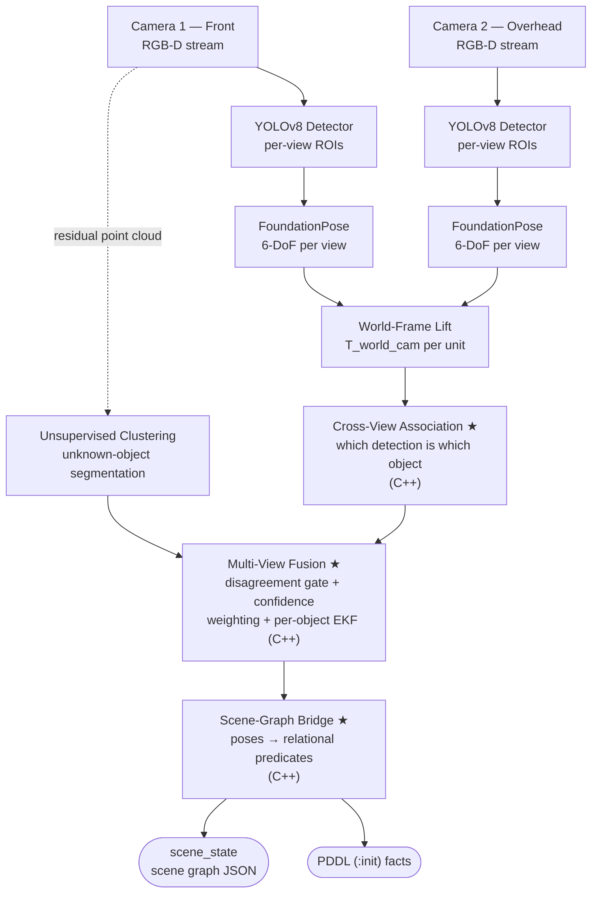
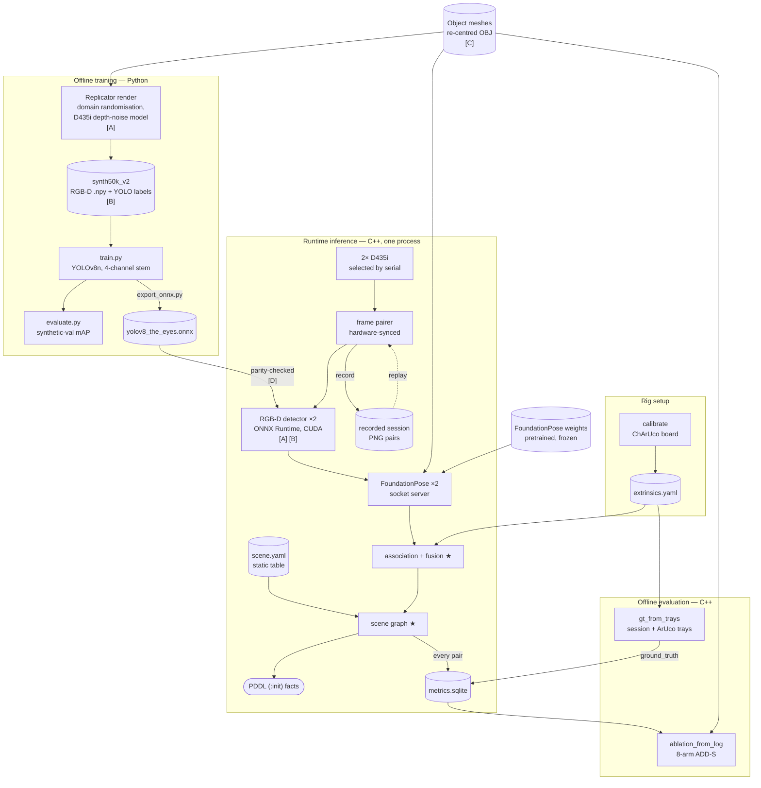

# THE EYES

## Multi-View Perception and Scene Understanding for Robot Manipulation

### NUS-ISS Pattern Recognition Systems Practice Module — Project Proposal

| Field | Detail |
|---|---|
| Date of Proposal | 15 September 2026 |
| Project Title | The Eyes — Multi-View Perception and Scene Understanding for Robot Manipulation |
| Group ID | Group 12 |
| Cohort | AIS08 |
| Team Members | Chan Wai Jye (A0340644J) |
| Sponsor/Client | N/A — self-initiated research project |
| Submission Type | Solo Submission — AI-Assisted Development |

---
---

## 1. Introduction

In the preceding Intelligent Reasoning Systems practice module, I built *The Planner*, which turns natural-language instructions into robot plans using simulator ground-truth poses. *The Eyes* replaces that ground truth with real perception: two RGB-D cameras at different viewpoints, fused into one relational scene graph of object identities, 6-DoF poses and spatial relations (on, in, clear, occluded-from). Real output from this system has already driven *The Planner* to valid plans with no code changed, although only `clear` of its eleven predicates matches ours (`docs/PM1_INTEGRATION.md`).

### 1.1 Project Goals

- **G1:** A supervised detection and 6-DoF pose pipeline (YOLOv8 + FoundationPose) on tabletop objects.
- **G2:** Multi-view fusion of two RGB-D cameras at the object level, to resolve occlusion.
- **G3:** A C++ scene-graph bridge from fused poses to symbolic relations.
- **G4:** A measured sim-to-real gap: train on Isaac Sim data, evaluate on real captures.
- **G5:** All four PRS technique categories in one runnable system.

### 1.2 Scope Statement

Up to 6 rigid, closed-set objects with known CAD models, seen by two Intel RealSense D435i cameras (front and overhead) on one workstation (RTX 5070 Ti, 16 GB VRAM), plus a Jetson Orin Nano test above the MVP. Open-vocabulary detection and articulated or deformable objects are out of scope; the physical SO-ARM101 arm is a stretch demonstration, not graded.

### 1.3 Minimum Viable Product

The MVP covers every graded deliverable and PRS category: the single-camera pipeline on a real camera; the second camera with multi-view fusion ★ and its occlusion ablation (§7.1), which is never cut; the scene-graph bridge ★ emitting PDDL facts; and the evaluation numbers (§11.1).

Above the MVP, items are cut in this order under schedule pressure: (1) Jetson deployment test; (2) unknown-object DBSCAN path, which loses only the unsupervised half of category ①; (3) live PM1 integration demo — **cut 2026-09-08**, discharged by the logged planning output above; (4) digital-twin viewport (§5.7).

---

## 2. Project Background & Motivation

### 2.1 Problem

Tabletop manipulation needs to know *what* objects are present, *where* they are in full 6-DoF, and *how* they relate. A single camera fails under occlusion: a mug behind a cereal box is invisible from the front. A second viewpoint restores visibility but produces two estimates per object that disagree — by 11 mm on a printed cube in this rig's first end-to-end run (§7A). Turning two disagreeing views into one usable world state means answering three questions a single camera never poses:

1. **Association** — which detection in one view is the same object as which in the other, when per-view error can pair the wrong instances.
2. **Arbitration** — whether a disagreement is noise to average or a confidently wrong view to reject, with no majority vote between two cameras.
3. **Symbolisation** — turning noisy poses into facts such as `on` and `in`, where a pose a centimetre low puts an object *inside* a 20 mm table.

The occlusion ablation (§7.1) tests how well the answers hold up on real captures.

### 2.2 Relationship to Prior and Future Modules

This is the second of four practice modules: two fundamental graduate certificates, then two specialist ones, with the MANIP-WM capstone project running alongside the specialist pair.

| Module | Graduate certificate | System | Contribution to the capstone |
|---|---|---|---|
| PM1 — completed | Intelligent Reasoning Systems (fundamental) | The Planner | Task planning: NL → PDDL → action sequence |
| **PM2 — this proposal** | **Pattern Recognition Systems (fundamental)** | **The Eyes** | **Perception: RGB-D → fused 6-DoF poses → scene graph** |
| PM3 / PM4 | Intelligent Robotic Systems (specialist) | — | Manipulation on the SO-ARM101 |
| PM3 / PM4 | Intelligent Sensing Systems (specialist) | — | Extends this project's sensing layer |
| Capstone — alongside PM3 and PM4 | — | MANIP-WM | RSSM world model over the object state produced here |

The capstone runs alongside the specialist modules, so the scene-graph schema defined here must be stable before they start (§5.4).

### 2.3 Why This Technology Stack?

FoundationPose needs only a CAD model per object, not per-object training; YOLOv8 is a fine-tunable real-time detector that gates the costlier pose step; Replicator labels training data automatically; and everything runs on owned hardware without licence fees.

---

## 3. Literature Review

### 3.1 Object Detection — YOLOv8 with RGB-D Early Fusion

YOLOv8 (Ultralytics, 2023) is a single-stage, anchor-free detector. This project widens its input stem from 3 to 4 channels (RGB plus aligned metric depth) and initialises the depth channel from the COCO-pretrained weights, on the hypothesis that depth separates textureless objects from a same-coloured table. Early fusion keeps the whole pretrained backbone usable, where a separate depth branch would train from scratch. On synthetic data the hypothesis does **not** hold (§7A).

### 3.2 6-DoF Pose Estimation — FoundationPose

FoundationPose (Wen et al., NVIDIA 2024) renders pose hypotheses from an object mesh, scores them with a learned comparator and refines them iteratively. New objects need only a CAD model, not retraining.

### 3.3 Multi-View / Multi-Sensor Fusion

Independent estimates of one state are combined by uncertainty weighting (the Kalman formulation), with rotations averaged by the eigendecomposition method of Markley et al. (2007). Object-level fusion resolves occlusion because one view usually keeps line of sight. The association step that must come before averaging is specified in §5.3.

### 3.4 Scene Graphs for Robotics

Scene graphs hold objects as nodes and relations as edges. Relations such as on, in and clear are the state language of PDDL planning, so deriving them from poses connects perception to planning.

### 3.5 Synthetic Data & Domain Randomisation

Randomising textures, lighting and camera pose in simulation lets networks transfer to real images without real labels (Tobin et al., 2017). Here all three classes are printed and rendered in their own filament colours, so the measured gap tests geometry and sensing more than appearance transfer (§6.2).

### 3.6 Related Work and Scope of This Project

The techniques here — object-level fusion, quaternion averaging, Kalman filtering, outlier gating and geometric predicates — are established, and this proposal makes no novelty claim for them, individually or combined. Mature components are adopted where they exist (Isaac ROS FoundationPose, OpenCV, PCL); the project applies the techniques to a concrete two-camera rig and measures the result. The three ★ modules (§5.3) are written in C++ without an off-the-shelf fusion or scene-graph library, so that the techniques are implemented rather than configured.

---

## 4. PRS Technique Coverage

The module requires at least three of the four PRS aspects; *The Eyes* covers all four.

| # | PRS Aspect | Implementation in The Eyes |
|---|---|---|
| ① | Supervised / unsupervised learning scenarios | **Supervised:** YOLOv8 fine-tuned on synthetic labelled data. **Unsupervised:** DBSCAN clustering of residual depth points to flag objects that have no CAD model. |
| ② | Machine learning / deep learning techniques | Multimodal RGB-D YOLOv8n (4-channel stem, COCO inflation) deployed through ONNX Runtime CUDA; FoundationPose transformer networks run as PyTorch checkpoints behind the pose server (§5.5). |
| ③ | Hybrid / ensemble approach | Two per-view estimates fused by confidence weighting with disagreement gating; learned per-view poses smoothed by a classical per-object EKF. |
| ④ | Intelligent sensing / sense-making | Calibrated dual RGB-D sensing; C++ bridge from fused poses to relations (on, in, clear, occluded_from). |

---

## 5. System Design

### 5.1 Architecture Overview



★ = written from first principles in C++; no off-the-shelf fusion or scene-graph library, per §3.6.

**Frames.** Fusion lifts every per-view estimate into the world frame `table_origin`, using `config/extrinsics.yaml`, before association, so association distances and the disagreement gate are metric. It refuses to start if any camera's reprojection RMSE exceeds 0.5 px.

### 5.2 Data Flow: Training and Inference



Solid arrows carry data; the dotted arrow is replay, which feeds a recorded session back into the pipeline in place of the cameras. Four things must agree between training and inference — tagged [A]–[D] where they occur — and a mismatch in any of them fails silently:

- **[A] Depth encoding** — invalid-depth sentinel, 0.20–1.50 m clip and letterbox padding; the Python and C++ copies were verified once as an exact round trip.
- **[B] Class list** — the same names in the same order in the training labels, `detector.yaml` and `meshes.yaml`; a C++ test checks `detector.yaml` against the mesh registry.
- **[C] Meshes** — one re-centred mesh set renders the training data, registers FoundationPose and scores ADD-S.
- **[D] Detector numerics** — the C++ ONNX path is checked against the ultralytics reference.

### 5.3 Component Specifications

| Component | Role | Technology and key design |
|---|---|---|
| Detector (×2) | Per-view detection, ROI gating | YOLOv8n RGB-D, trained in Python on Replicator data; C++ inference through the ONNX Runtime CUDA execution provider |
| Pose estimator (×2) | Per-view 6-DoF pose from RGB-D + CAD mesh | FoundationPose PyTorch checkpoints, out of process behind a byte protocol |
| Unknown-object segmenter | Flag residual depth points no detection explains | DBSCAN (PCL), C++ |
| **Cross-view association ★** | Match detections across views | C++. Greedy nearest neighbour per class in the world frame within 150 mm; at most one estimate per camera per cluster; deterministic order |
| Multi-view fusion ★ | One world-frame estimate per cluster | C++. Markley quaternion averaging, FoundationPose-score weighting, 50 mm / 30° disagreement gate, per-object EKF |
| Scene-graph bridge ★ | Fused poses → relations | C++. Geometric rules on bounding volumes: on, in, clear, occluded_from; emits scene-graph JSON and PDDL facts |
| Calibration suite | Intrinsics, extrinsics, world registration | OpenCV ChArUco; offline, checked by reprojection error |

### 5.4 Interface Contract (PM1 and capstone consumers)

```cpp
// Scene graph output — consumed by The Planner (PM1) and the MANIP-WM capstone.
// Normative definition: INTERFACES.md §3.
struct ObjectState {
  std::string id;              // stable instance id, e.g. "red_cube_01"
  std::string cls;             // YOLO class, or "unknown_object"
  Eigen::Isometry3d pose_w;    // fused 6-DoF pose, world frame
  double confidence;           // fused confidence [0,1]
  std::vector<std::string> relations;  // filled by scenegraph, empty from fusion
  uint32_t visible_views;      // bitmask: bit0 = cam_front, bit1 = cam_over
  Eigen::Vector3d extent;      // bounding volume half-extents (world-axis-aligned)
  uint64_t stamp_ns;           // fusion output time

  // Belief, not just an estimate. ADDITIVE.
  double position_sigma_m;         // 1-sigma RMS position uncertainty; <0 = absent
  double orientation_sigma_rad;    // 1-sigma RMS orientation uncertainty; <0 = absent
  Eigen::Vector3d velocity_w;      // world-frame linear velocity, m/s
};
```

**Fields may be added, never removed or re-typed**, so the capstone can rely on this contract; the belief fields give its world model uncertainty, not just a pose. `relations` is `vector<string>`, so it can never become an enum; its strings are validated against `config/predicates.yaml`. Objects with `visible_views == 0` are dropped, and a single-view object keeps one bit set, so consumers can tell fused poses from unfused ones.

### 5.5 Network Architectures

Three networks run at inference, and only the detector is trained in this project. Figures are read from the shipped checkpoints; layer-by-layer tables are in Interim Report §2.3–2.4.

| Network | Parameters | Structure | Input → output |
|---|---|---|---|
| **Detector** — YOLOv8n, 4-channel stem | 3,011,577 | CSPDarknet backbone, PAN-FPN neck, anchor-free DFL head at strides 8/16/32 | ONNX `1×4×640×640` → `1×7×8400` (8,400 anchors), opset 17 |
| FoundationPose refiner (frozen) | 17,043,797 | CNN encoders, then translation and rotation transformer heads (`d_model` 512); axis-angle rotation, refined iteratively | RGB + XYZ crops, 6 channels, 160×160 |
| FoundationPose scorer (frozen) | 15,986,512 | Same encoders, then self- and cross-attention over the hypotheses; one score each, used by fusion's confidence weighting | As the refiner |

The depth channel adds only **144 parameters** over the RGB-only control (3,011,433) and is initialised from the mean of the pretrained RGB filters, which ultralytics 8.4.123 would otherwise leave random. The change is essentially free, so the negative modality result (§7A) is about the task, not a costly design. Runtime total: **36.0 M parameters, 3.0 M (8.4%) trained here**.

### 5.6 Technology Stack

C++17 (fusion, scene graph, drivers) · Python 3.11 (training pipelines) · YOLOv8 · FoundationPose · ONNX Runtime C++ API (CUDA EP) · PCL · OpenCV · Eigen · Isaac Sim + Omniverse Replicator · Ubuntu 24.04 · SQLite (metric logging).

The runtime is **one C++ process, not ROS2** (decided 2026-09-06): stages pass the `INTERFACES.md` structs by function call. Nothing downstream needs ROS2 — *The Planner* ships none — and a ROS2 publisher remains a thin adapter if the capstone later wants one.

### 5.7 Digital-Twin Reconstruction (stretch deliverable)

Each object's class, CAD mesh and world pose let it be spawned in Isaac Sim as a live digital twin, which also tests whether the scene graph suffices as the capstone's world state. Known-CAD objects only; cut fourth under schedule pressure (§1.3).

---

## 6. Data Collection & Datasets

### 6.1 Synthetic Training Data (primary)

Isaac Sim Replicator renders the object meshes with domain randomisation over lighting, materials, pose, camera viewpoint, distractors and occlusion, and applies the measured D435i depth-noise model. Each frame yields a 4-channel RGB-D array and YOLO box labels. `synth50k_v2` holds 40,012 training and 9,988 validation frames, a size the dataset-size ablation supports (§7A).

### 6.2 Object Models

Three classes were acquired on 2026-09-04: `mustard_bottle` (YCB 006), `bowl` (YCB 024) and an authored 50 mm `red_cube`. Each mesh is re-centred so the object frame's origin is its bounding-box centre, which the scene-graph boxes and symmetry handling rely on; the raw YCB bowl's origin sat 43.7 mm off centre.

All three are **3D printed from their meshes**, so no object/mesh mismatch hides inside ADD-S (the original YCB mustard bottle, a 20 oz product, is not available at retail in Singapore), and training renders use the filament colours. The cost is that every class is controlled-appearance: the sim-to-real gap tests geometry and sensing more than appearance transfer, a weaker test of G4 that §7 reports as such. Full detail: Interim Report §3.3.

### 6.3 Real Evaluation Data

Dual-camera RGB-D sequences of staged tabletop scenes. Ground truth comes from ArUco markers, used only for evaluation and never at inference.

Each object sits in a printed tray whose socket is cut from that object's own mesh, with marker seats in the same plate. The object-to-marker offset therefore comes from CAD rather than callipers, and the objects themselves stay unmodified:

`T_cam_object = T_cam_marker · T_marker_tray · T_tray_object`

Only `T_cam_marker` is observed. The worst measured socket clearance, **0.23 mm**, bounds the ground-truth translation error — 1.2% of the bottle's 19.6 mm ADD-S threshold. Tray dimensions, marker allocation and visibility checks: Interim Report §3.4.

### 6.4 Benchmark Scenes

Ten scenes in four tiers, 300 synchronised pairs each, recorded once and replayed for every ablation arm (§7.1):

| Tier | Scenes | Content | What it tests |
|---|---|---|---|
| T1 isolated | 2 | One object, unoccluded | The single-view accuracy floor |
| T2 clutter | 3 | 3 targets + 8 distractors | Detection and association |
| T3 partial | 3 | ≥1 target 25–75% occluded from one view | Confidence weighting |
| **T4 full** | **2** | **≥1 target <25% visible from one view** | **The multi-view claim; never cut** |

---

## 7. Evaluation Plan

| Component | Metric | Target |
|---|---|---|
| Detection | mAP@0.5:0.95, per class, recall | Synthetic val met (0.956, §7A); real-capture figure outstanding. mAP@0.5 is retired: it saturated at 0.994 |
| Modality ablation | mAP@0.5:0.95 per class, RGB-only vs RGB-D | Negative on synthetic (+0.00076); re-run on real captures, where depth validity is 97.8% |
| Dataset-size ablation | mAP@0.5:0.95 at 5k / 20k / 40k training frames | Run: recall saturates at 20k, localisation does not |
| Pose (single view) | ADD / ADD-S, rotation error (deg), translation error (mm) | ADD-S < 10% of object diameter |
| Fusion gain | ADD-S single-view vs fused, occlusion suite | Measurable improvement on occluded scenes (primary result) |
| Sense-making | Predicate accuracy vs hand labels, per predicate | ≥ 95% |
| Runtime | End-to-end latency, FPS | Reported on RTX 5070 Ti and Jetson Orin Nano |
| Sim-to-real | Metric deltas, synthetic vs real | Reported, no fixed target |
| Sensor error budget | Depth RMS vs a flat wall at 0.4 / 0.7 / 1.0 m | Measured: 2–4 mm at working distance |

Every metric except the sensor error budget depends on the trained detector; ADD-S also needs exact mesh diameters.

### 7.1 Test setup for the main experiment

The main experiment is the **occlusion ablation**: the same captures scored with camera 1 only, camera 2 only, and fused. Its protocol is fixed here, before any data is seen.

- **Captures:** the 10 scenes of §6.4, 300 pairs each, replayed bit-exact for every arm, so all arms see identical input.
- **Occlusion:** a target counts as occluded from a view when under 25% of its projected silhouette is visible, computed from the ground-truth pose and mesh.
- **Arms:** eight — {cam_front, cam_over, naive, gated} × {raw, EKF} — so views, fusion policy and temporal filter each vary independently.
- **Significance:** ADD-S is reported as a mean with a 95% bootstrap confidence interval, resampling scenes rather than frames because frames within a scene are correlated. A single-view-versus-fused difference counts only if the interval excludes zero **and** the difference exceeds the sensor floor below.

| Error source | Magnitude | Consequence |
|---|---|---|
| Ground truth (§6.3) | ≤ 0.23 mm | Cannot move a verdict |
| Depth sensor | 2–4 mm | The floor: a smaller difference is "not resolvable on this rig" |
| Calibration residual | 0.47 / 0.41 px RMSE | A fixed world-frame bias, not scatter |

**The negative outcome is stated in advance:** if the gated policy does not beat `naive` on real captures, FoundationPose rarely produces confidently wrong views on this rig, so the second camera buys recall under occlusion and the EKF buys accuracy.

**Predicate accuracy** is reported per predicate, because rare `in` facts would hide inside a pooled figure; `in` requires a declared container class, and T2 stages the bowl as one. All arms are computed by `ablation_from_log` from each run's SQLite log, so every reported number regenerates from a recorded session.

---

## 7A. Progress to date

Evidence for every row is in the companion **Interim Report** (`PRS-PM-2026-AIS08-GRP-12-TheEyes-InterimReport-DRAFT.md`); *synthetic* figures come from generated input, not evaluation.

| Item | Status | Key figure |
|---|---|---|
| Dual-camera capture | **Hardware verified** | 30 fps each, hardware-synced, pair jitter 0.14–1.1 ms sigma |
| Calibration | **Run on the real rig** | Reprojection RMSE 0.47 / 0.41 px (recalibrated 09 Sep after the cameras moved) |
| Sensor error budget | **Measured** | 2–4 mm depth noise at working distance |
| RGB-D detector | **Trained and deployed** | mAP@0.5:0.95 = 0.956 on synthetic val; GPU p50 3.6 ms per view |
| Modality and dataset-size ablations | **Run** | Depth adds +0.00076 mAP@0.5:0.95; more data still improves localisation |
| Multi-view fusion, 8 arms | **Run (*synthetic*)** | Second camera buys recall (0.352 → 0.485); EKF buys accuracy (~2.7 mm) |
| Whole chain, live | **Run on hardware** | p50 51.7 ms per pair; two views fused on 150/150 pairs of a printed cube |
| **Real-capture ADD-S, mAP, predicate accuracy** | **Not measured** | Needs the printed object set and its ArUco trays |

The remaining dependency is the printed object set and its trays (§6.3), without which no real-capture metric in §7 can be measured.

---

## 8. Project Timeline

| Phase | Period | Milestones |
|---|---|---|
| P0 — Environment | to mid Jul 2026 | **Done.** Ubuntu 24.04; FoundationPose verified on sm_120 |
| P1 — Perception baseline | mid Jul – early Aug | **Done.** FoundationPose in C++; detector parity verified |
| P2 — Fusion + hardware | Aug – early Sep | **Done.** Fusion, scene graph, dual cameras and hardware sync; rig calibrated 06 Sep, recalibrated 09 Sep |
| P3 — Dataset + evaluation | late Aug – Sep | **Largely done.** Dataset, detector and both ablations; real-capture evaluation outstanding |
| P4 — Proposal | by **15 Sep 2026** | This document |
| — First Presentation | **30 Sep 2026**, 6:30–10:30 pm, Zoom | Goals, data resources, techniques, progress |
| P5 — Hardening | Oct | Full evaluation, unknown-object path, Jetson test |
| P6 — Final deliverables | by **31 Oct 2026** | System, datasets, report, 10–15 min video, slides, individual report, peer review |

---

## 9. Budget & Resource Requirements

All amounts are receipted prices in Singapore dollars; CNY purchases are converted at the ECB reference rate for 2026-09-04 (1 CNY = 0.18878 SGD).

| Item | Cost |
|---|---|
| 2 × Intel RealSense D435i | S$862.08 |
| Inter-camera hardware sync cable (SHR-09V-S-B) | S$21.44 (¥113.58) |
| 2 × USB 3.2 Gen 1 cables, 2 m, A-to-C | S$8.76 |
| 2 × tripods with extension rod | S$77.00 |
| Digital angle finder / ruler / protractor | S$18.33 |
| ChArUco board, 324 × 324 mm | S$71.81 (¥380.41) |
| Matte PLA filament, 4 × 1 kg | S$92.39 (¥489.41) |
| **Total project spend** | **S$1,151.81** |

Owned or free: workstation (Ryzen 9700X, RTX 5070 Ti 16 GB), Jetson Orin Nano Super, 3D printer, desk and YCB meshes; training bursts fit an existing ≤ US$100/month cloud budget. The SO-ARM101 is a separate planned purchase. Software is free for this use: YOLOv8 (AGPL-3.0, which Ultralytics names as suitable for coursework), FoundationPose (NVIDIA Source Code License, non-commercial research) and YCB (open research).

---

## 10. Risks & Mitigations

| ID | Risk | Status | Mitigation |
|---|---|---|---|
| R1 | FoundationPose TensorRT engines incompatible with Blackwell (sm_120) | **Retired 2026-08-20** | Premise wrong: FoundationPose uses PyTorch checkpoints, not TensorRT; `run_demo.py` runs 737/737 frames on the RTX 5070 Ti |
| R2 | Camera procurement delay | **Retired 2026-08-20** | Both D435i units in hand, streaming 848×480 aligned depth and colour at 30 fps each |
| R3 | Sim-to-real gap larger than expected | Medium | Broader domain randomisation; a small real fine-tuning set; the gap itself is a reportable finding |
| R4 | FoundationPose too slow for dual-view real time | **Downgraded (measured)** | 17.2 ms per frame for one object, about 9.7 FPS for 3 objects × 2 views; detection gating and alternate-frame scheduling if needed |
| R4b | Each camera's IR projector degrades the other's depth | Medium — mitigated, not yet measured | Hardware sync fitted and confirmed; 80° design separation reduces overlap; measurable now the rig is mounted |
| R5 | Solo workload | Accepted | AI-assisted development (Appendix A), phase gates, and the cut order fixed in §1.3 |

---

## 11. Deliverables & Assessment Alignment

### 11.1 Final Deliverables (due 31 Oct 2026, Canvas, single ZIP + individual report)

| Deliverable | Accepted when |
|---|---|
| Runnable perception system (source, build instructions, model files) | Builds clean under `-Wall -Wextra -Wpedantic` from the ZIP on a fresh checkout; `ctest` passes; `the_eyes_run check --live` passes on the rig; replay reproduces a recorded session bit-exact |
| Datasets | Generator config and seed reproduce `synth50k_v2`; the real capture set ships as recorded sessions with `metrics.sqlite`, so every reported number regenerates via `ablation_from_log` |
| Final report | Every §7 metric is reported with its value and confidence interval, or listed as not measured with the reason; no `[VERIFY]` markers remain |
| Occlusion ablation result ★ | All eight arms on real T4 captures, with the §7.1 significance test applied and the outcome stated either way |
| Video presentation (10–15 min, .mp4) | Shows a live run on hardware |
| Slides, individual report (1–2 pp), peer review | Submitted per Canvas |

Cut order: §1.3. If the occlusion ablation cannot be produced on real captures, that fact and its cause are the reported result.

### 11.2 Assessment Alignment

| Component | Weight | How this project addresses it |
|---|---|---|
| First Presentation | 5% | Goals, data, techniques and progress, with baseline metrics in hand |
| Final Presentation | 10% | Occlusion ablation as the centrepiece |
| Final Report | 15% | The evaluation plan (§7) maps onto the required report sections |
| Final System | 15% | Runnable, documented and reproducible from the ZIP |
| Peer Review | 5% | Solo submission; 5% deduction accepted |

---

## 12. Conclusion

*The Eyes* closes the perception gap left open in PM1: a one-person system covering all four PRS categories, with library-free C++ fusion and scene-graph modules, a pre-specified occlusion ablation, and the object state the MANIP-WM capstone needs.

---

## Appendix A — Solo Submission & AI Usage Disclosure

### A.1 Solo Submission Declaration

This is a solo submission under Group 12, AIS08, with the peer-review deduction accepted, chosen for full control of an architecture that continues across my practice modules and the capstone project.

### A.2 AI Agents as Development Collaborators

**Development time:** Claude and Claude Code (architecture review, supervised code generation, documentation, coding subagents per `AGENTS.md`). I review, test and understand all AI-generated code before including it, and check claims marked [VERIFY] against primary sources.

**Runtime:** YOLOv8 (which I fine-tuned) and FoundationPose (pretrained, NVIDIA). No LLM runs in the perception pipeline.

### A.3 Academic Integrity Statement

My use of AI tools follows the NUS-ISS Policy for Use of AI in Teaching and Learning (2024) and is disclosed above. The system architecture, the C++ fusion and scene-graph modules, the evaluation design and all analysis are my own work.

---

## Appendix B — Technique-to-Course-Module Mapping

| Course Module | Techniques Applied in The Eyes |
|---|---|
| Problem Solving Using Pattern Recognition (PSUPR) | Problem framing (closed-set detection, open-set anomaly path), supervised vs unsupervised design, evaluation methodology (mAP, ADD/ADD-S) |
| Pattern Recognition and Machine Learning Systems (PRMLS) | CNN detector transfer learning, transformer pose estimation, ensemble fusion of independent estimators, ONNX Runtime C++ deployment |
| Intelligent Sensing and Sense Making (ISSM) | Dual RGB-D sensing and calibration, DBSCAN clustering, EKF temporal filtering, relational predicate extraction |
