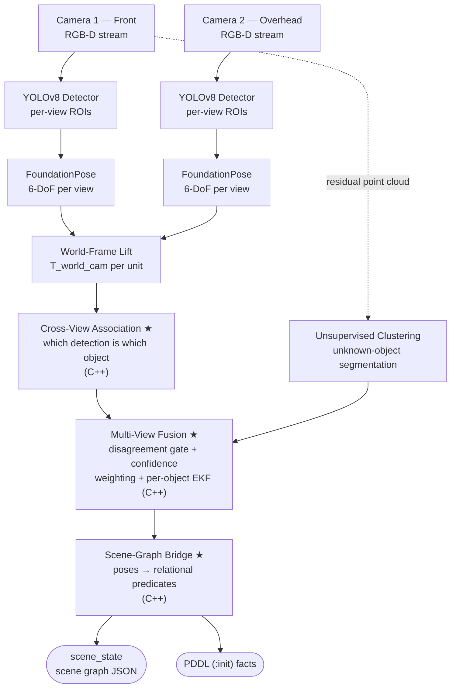

# THE EYES

## Multi-View Perception and Scene Understanding for Robot Manipulation

### NUS-ISS Pattern Recognition Systems Practice Module — Project Proposal

| Field | Detail |
|---|---|
| Date of Proposal | 15 September 2026 |
| Project Title | The Eyes — Multi-View Perception and Scene Understanding for Robot Manipulation |
| Group ID | Group 12 |
| Cohort | AIS08 |
| Team Members | Chan Wai Jye (A0340644J) |
| Sponsor/Client | N/A — self-initiated research project |
| Submission Type | Solo Submission — AI-Assisted Development |

---
---

## 1. Introduction

A robot that plans intelligently but cannot see is blind. In the preceding Intelligent Reasoning Systems practice module, I built *The Planner* — a hybrid symbolic-neural task reasoning system that converts natural language instructions into executed robot motion. That system defined what it needs from perception — object identities, poses and relations — and demonstrated task reasoning against simulator ground-truth poses. *The Eyes* supplies them from real sensing: multi-view fusion, occlusion resilience, and quantified sim-to-real transfer, none of which existed in the prior module.

*The Eyes* is a real-time perception system that takes raw RGB-D streams from two cameras at different vantage points and produces a structured, relational scene graph: which objects are present, their full 6-DoF poses, and their spatial relationships (on, in, clear, occluded-by). Real output from this system, fed to *The Planner*'s world-state ingress, has already produced valid plans with no code changed on either side (`docs/PM1_INTEGRATION.md`). The PDDL vocabularies themselves differ — of *The Planner*'s eleven predicates only `clear` matches — so the scene graph is a perception interface in its own right rather than a drop-in replacement for the planner's state facts.

### 1.1 Project Goals

- **G1:** Build a supervised deep-learning detection and 6-DoF pose estimation pipeline (YOLOv8 + FoundationPose) achieving usable accuracy on tabletop manipulation objects.
- **G2:** Demonstrate multi-view sensor fusion: two RGB-D cameras at different viewpoints, with pose estimates fused at the object level to resolve occlusion and pose ambiguity.
- **G3:** Produce a sense-making layer — a C++ scene-graph bridge that converts fused 6-DoF poses into symbolic relational predicates.
- **G4:** Quantify the sim-to-real gap: train on synthetic data generated in Isaac Sim, evaluate on real camera captures.
- **G5:** Demonstrate all four PRS technique categories in a single coherent, runnable system.

### 1.2 Scope Statement

The system perceives a tabletop manipulation scene containing up to 6 rigid objects with known CAD models (YCB object set plus custom-printed objects). Sensing hardware is two RGB-D cameras (Intel RealSense class) at complementary viewpoints (front + overhead). Deliverables run on a single workstation (RTX 5070 Ti, 16 GB VRAM), with an edge-deployment feasibility test on Jetson Orin Nano. Object categories are closed-set; open-vocabulary detection is out of scope. Articulated and deformable objects are out of scope. Integration with the physical SO-ARM101 arm is a stretch demonstration, not a graded deliverable.

### 1.3 Minimum Viable Product

The MVP is the minimum slice satisfying every graded deliverable and all four PRS technique categories: the **single-camera pipeline** on a real camera; the **second camera + multi-view fusion ★** with its occlusion ablation (§7.1), which *is* the ensemble claim ③ and is non-negotiable; the **scene-graph bridge ★** emitting PDDL init facts; and the **evaluation numbers**. Acceptance criteria for each are in §11.1.

Items above MVP are cut in this order under schedule pressure (Risk R5): (1) Jetson deployment test; (2) unknown-object DBSCAN path — losing the unsupervised half of category ①, though the supervised half still satisfies it; (3) live PM1 integration demo — **cut 2026-09-08** on schedule grounds, and discharged by logged output: real fused poses from two live runs drove *The Planner* to valid plans (`docs/PM1_INTEGRATION.md`); (4) digital-twin viewport (§5.6).

---

## 2. Project Background & Motivation

### 2.1 Problem

Industrial pick-and-place deployments spend a disproportionate share of engineering effort on perception, not motion. Structured environments sidestep the problem with fixtures, presenters, and barcodes — at high capital cost and zero flexibility. Unstructured bin-picking and tabletop manipulation require the robot to answer three questions continuously: *what* objects are present, *where* are they (full 6-DoF, not just 2D), and *how do they relate* (which object is on top, which is blocked)?

Single-camera systems fail predictably under occlusion: a mug behind a cereal box is invisible from the front and its pose unrecoverable. Multi-view sensing solves the *visibility* problem geometrically — at least one viewpoint usually retains line of sight — but it does not solve the perception problem, and it creates two new ones.

**The problem this project solves is turning two disagreeing views into one usable world state.** Two cameras looking at the same table produce two independent estimates per object, and those estimates conflict: measurably so, at 11 mm of inter-view translation disagreement on a real printed cube in this rig's own first end-to-end run (§7A). A system must therefore answer three questions that a single camera never poses:

1. **Association** — which detection in view A is the same physical object as which in view B, when per-view pose error is large enough that nearest-neighbour matching can pair the wrong instances.
2. **Arbitration** — when two views disagree, is this ordinary noise to be averaged, or is one view confidently wrong and to be rejected? With only two cameras there is no majority to appeal to.
3. **Symbolisation** — a continuous 6-DoF pose is not a plan input. `on`, `in` and `clear` are, and deriving them from noisy geometry is where a millimetre of pose error becomes a wrong fact: a pose a centimetre low puts an object *inside* a 20 mm table slab, and the planner then reasons about a scene that does not exist.

Answering those three is the work of this project; the occlusion ablation (§7.1) tests how well the answers hold up on real captures.

### 2.2 Relationship to Prior and Future Modules

This is the second of four practice modules: two fundamental graduate certificates
followed by two specialist ones, with the MANIP-WM capstone project running
alongside the specialist pair.

| Module | Graduate certificate | System | Contribution to the capstone |
|---|---|---|---|
| PM1 — completed | Intelligent Reasoning Systems (fundamental) | The Planner | Symbolic task planning: NL → PDDL → action sequence |
| **PM2 — this proposal** | **Pattern Recognition Systems (fundamental)** | **The Eyes** | **Perception: RGB-D → fused 6-DoF poses → scene graph** |
| PM3 / PM4 | Intelligent Robotic Systems (specialist) | — | Acting on the perceived scene: manipulation on the SO-ARM101 |
| PM3 / PM4 | Intelligent Sensing Systems (specialist) | — | Extends the sensing layer this project establishes |
| Capstone — alongside PM3 and PM4 | — | MANIP-WM | RSSM world model over the object-centric state produced here |

The scene-graph output schema defined here is the state representation the
MANIP-WM world model operates on. Because the capstone runs concurrently with the
specialist modules rather than after them, that schema has to be stable before
either specialist module starts — there is no later stage in which to change it.
Interface stability is therefore a first-class design requirement, not an
afterthought.

### 2.3 Why This Technology Stack?

- **FoundationPose** (NVIDIA, CVPR 2024) is a model-based 6-DoF pose estimator that generalises to novel objects given a CAD model, avoiding per-object training.
- **YOLOv8** provides a mature, fine-tunable real-time detector to gate FoundationPose — pose estimation is expensive, so detection-first cropping keeps the pipeline real-time.
- **Isaac Sim / Omniverse Replicator** generates photorealistic, automatically labelled synthetic training data with domain randomisation — no manual annotation.
- All components run locally on owned hardware; zero recurring licensing cost.

---

## 3. Literature Review

### 3.1 Object Detection — YOLOv8 with RGB-D Early Fusion

The YOLO family performs single-stage detection with a CNN backbone, predicting boxes and classes in one forward pass. YOLOv8 (Ultralytics, 2023) adds an anchor-free decoupled head and improved feature aggregation.

This project extends the standard RGB detector to a **multimodal RGB-D network** via early fusion: the input stem is widened from 3 to 4 channels (R, G, B, aligned metric depth), with the COCO-pretrained stem weights inflated to initialise the depth channel. The hypothesis is that depth is a strong complementary cue here — textureless objects against a same-coloured tabletop are poorly separated by appearance but trivially separated by geometry, the same failure mode that motivated active-depth sensing over passive stereo (§2.3). Early fusion is chosen over late fusion (separate branches merged at the neck) for pretrained-weight reuse: the entire COCO backbone stays usable, whereas a second branch would train from scratch on synthetic data alone.

The hypothesis is tested rather than assumed, and on synthetic data it **does not hold** — the modality ablation is a negative result (§7A). Depth is normalised in metric metres clipped to the working range, and invalid-depth pixels (RealSense returns 0 for stereo holes) carry an explicit sentinel rather than zeros, which the network would read as extremely close geometry.

### 3.2 6-DoF Pose Estimation — FoundationPose

FoundationPose (Wen et al., NVIDIA 2024) unifies model-based pose estimation and tracking using a transformer architecture trained at scale on synthetic data. Given an RGB-D frame and an object mesh, it renders pose hypotheses, scores them with a learned comparator, and refines iteratively. Its key property for this project is novel-object generalisation: new objects require only a CAD model, not retraining.

### 3.3 Multi-View / Multi-Sensor Fusion

Fusing estimates from multiple sensors is classical estimation theory: independent measurements of one latent state combined by uncertainty weighting (Kalman formulation for Gaussian errors). For 6-DoF poses rotation averaging requires care — quaternion averaging via the eigendecomposition of Markley et al. (2007). Object-level multi-view fusion, as opposed to pixel-level stereo, resolves occlusion because at least one viewpoint typically retains line of sight. What the literature does not settle is the *association* step that must precede any averaging: deciding which detection in view A is the same physical object as which in view B, under per-view pose error large enough that naive nearest-neighbour matching fails. §5.2 specifies the approach taken.

### 3.4 Scene Graphs for Robotics

Scene graphs represent a scene as objects (nodes) and spatial/semantic relations (edges). In manipulation, relational predicates (on, in, clear) are precisely the state language of PDDL planning. Deriving symbolic predicates from continuous 6-DoF poses via geometric rules is a sense-making step that turns raw pattern recognition output into actionable world knowledge.

### 3.5 Synthetic Data & Domain Randomisation

Tobin et al. (2017) showed that randomising textures, lighting and camera pose in simulation forces networks to learn transferable features, enabling sim-to-real transfer without real labels. Omniverse Replicator operationalises this with automatically generated boxes, masks and ground-truth poses. §6.2 notes a limitation specific to this project: with all three classes printed and rendered in their own filament, the appearance axis of that randomisation is largely bypassed, so the measured gap tests geometry and sensing rather than appearance transfer.

### 3.6 Related Work and Scope of This Project

The techniques used here are established. Object-level multi-view fusion, quaternion averaging, Kalman filtering, outlier gating and deriving symbolic relations from geometry all have prior work, and mature components are adopted rather than reimplemented: Isaac ROS ships a single-view FoundationPose pipeline, and detection, calibration (OpenCV) and clustering (PCL) are standard tooling. This proposal makes no novelty claim for these techniques, individually or in combination.

What the project does is apply them to a concrete two-camera rig and measure the result. Cross-view association, multi-view fusion and the scene-graph bridge (★ in §5.2) are written in C++ without an off-the-shelf fusion or scene-graph library, so that the techniques are implemented and understood rather than configured. They are also what the occlusion ablation tests, and part of the MVP that is not cut under schedule pressure (§1.3).

---

## 4. PRS Technique Coverage

The module requires the project to develop, integrate and demonstrate at least three of the four PRS aspects. *The Eyes* covers all four:

| # | PRS Aspect | Implementation in The Eyes |
|---|---|---|
| ① | Supervised / unsupervised learning scenarios | **Supervised:** YOLOv8 fine-tuned on synthetically generated labelled data (detection). **Unsupervised:** Euclidean/DBSCAN clustering of the residual depth point cloud to segment and flag *unknown* objects that have no CAD model — an anomaly path the closed-set detector cannot cover. |
| ② | Machine learning / deep learning techniques | **Multimodal RGB-D CNN detector:** YOLOv8n with a 4-channel early-fusion input stem (RGB + aligned metric depth), transfer-learned from COCO weights with stem inflation, exported to ONNX and deployed to the C++ runtime through the ONNX Runtime CUDA execution provider. FoundationPose transformer-based pose refinement and scoring, itself an RGB-D multimodal network, run as PyTorch checkpoints behind the byte protocol of §5.2 — upstream FoundationPose ships no TensorRT (R1, §10). Architectures and parameter counts in §5.4. |
| ③ | Hybrid / ensemble approach | Object-level multi-view fusion: two independent per-camera detection+pose estimates treated as ensemble members, fused by confidence-weighted pose averaging with outlier rejection (disagreement gating). Hybrid DL + classical estimation: learned per-view poses refined by a classical temporal filter (per-object EKF). |
| ④ | Intelligent sensing / sense-making | Dual RGB-D sensing with extrinsic calibration; C++ scene-graph bridge converting fused poses into relational predicates (on, in, clear, occluded_from(view)); occlusion reasoning across viewpoints. |

---

## 5. System Design

### 5.1 Architecture Overview



★ = written from first principles in C++; no off-the-shelf fusion or scene-graph library, per §3.6.

**Frames.** Each camera reports poses in its own optical frame. `calib_agent`
supplies `T_world_cam` per unit (`config/extrinsics.yaml`, world frame
`table_origin`), and fusion lifts every per-view estimate into `table_origin`
*before* association, so association distances and the disagreement gate are
both metric world-frame quantities. Fusion refuses to start if any camera's
reprojection RMSE exceeds 0.5 px, because bad extrinsics poison every fused pose
while leaving each one self-consistent.

### 5.2 Component Specifications

| Component | Role | Technology | Implementation Detail |
|---|---|---|---|
| Detector (×2) | Per-view object detection, ROI gating | YOLOv8, RGB-D 4-channel early fusion, fine-tuned | Python training / ONNX Runtime (CUDA EP) inference in C++. Trained on Replicator synthetic data (RGB + depth + labels rendered together) with domain randomisation. Depth channel initialised by inflating COCO stem weights. |
| Pose Estimator (×2) | Per-view 6-DoF pose from RGB-D + CAD mesh | FoundationPose | PyTorch checkpoints on sm_120 — upstream FoundationPose uses no TensorRT (R1 retired). Runs out-of-process as an inference service behind a byte protocol, keeping all runtime logic in C++17. |
| Unknown-Object Segmenter | Cluster residual depth points not explained by detected objects | Euclidean clustering / DBSCAN (PCL) | C++. Flags unknown_object nodes in the scene graph with centroid + bounding volume. |
| **Cross-view association ★** | Decide which detection in view A is the same physical object as which in view B | Custom C++ | Runs *before* any averaging and is the precondition for it. Per-view poses are lifted to the world frame, then greedy nearest-neighbour within a class under a 150 mm radius, with the constraint that a cluster holds **at most one estimate per camera** — two detections from one view are by definition two instances. Association order is made deterministic by sorting, so ablation arms differ in fusion policy and never in association. |
| Multi-View Fusion ★ | Fuse an associated cluster into a single world-frame estimate | Custom C++ | Quaternion averaging (Markley eigendecomposition); confidence weighting from FoundationPose scores; a 50 mm / 30° disagreement gate rejects outlier views; per-object EKF (constant-velocity position, orientation random walk) for temporal smoothing, with measurement noise scaled by 1/confidence. |
| Scene-Graph Bridge ★ | Convert fused poses into symbolic relational predicates | Custom C++ | Geometric rules over object bounding volumes: on(a,b), in(a,b), clear(a), occluded_from(a, view). Emits scene graph JSON + PDDL init facts. |
| Calibration Suite | Intrinsics + stereo extrinsics + world-frame registration | OpenCV (ChArUco board) | One-time offline; validated by reprojection error report. |

### 5.3 Interface Contract (PM1 and capstone consumers)

```cpp
// Scene graph output — consumed by The Planner (PM1) and the MANIP-WM capstone.
// Normative definition: INTERFACES.md §3.
struct ObjectState {
  std::string id;              // stable instance id, e.g. "red_cube_01"
  std::string cls;             // YOLO class, or "unknown_object"
  Eigen::Isometry3d pose_w;    // fused 6-DoF pose, world frame
  double confidence;           // fused confidence [0,1]
  std::vector<std::string> relations;  // filled by scenegraph, empty from fusion
  uint32_t visible_views;      // bitmask: bit0 = cam_front, bit1 = cam_over
  Eigen::Vector3d extent;      // bounding volume half-extents (world-axis-aligned)
  uint64_t stamp_ns;           // fusion output time

  // Belief, not just an estimate. ADDITIVE.
  double position_sigma_m;         // 1-sigma RMS position uncertainty; <0 = absent
  double orientation_sigma_rad;    // 1-sigma RMS orientation uncertainty; <0 = absent
  Eigen::Vector3d velocity_w;      // world-frame linear velocity, m/s
};
```

**Interface stability rule: fields may be added, never removed or re-typed**, so
the capstone can rely on this contract. Two consequences are already visible.
First, the belief fields exist because the capstone's world model is an RSSM over
this state — a point estimate is not a sufficient input for it, and adding
uncertainty later would have been legal under the rule but would have left PM1
and the capstone disagreeing
about what a pose means. Second, `relations` is `vector<string>` and can
therefore *never* be re-typed to an enum under this same rule; the strings are
treated as the contract and are validated against `config/predicates.yaml`
rather than being left free-form.

`visible_views == 0` is invalid and the object is dropped rather than emitted. A
single-view object **is** emitted, with one bit set, so a consumer can tell a
fused pose from an unfused one and weight it accordingly.

### 5.4 Network Architectures

Three networks run at inference. Only the first is trained in this project; the
other two are pretrained and frozen. Every figure below is read from the shipped
checkpoints, not from the papers.

**Detector — YOLOv8n with a 4-channel early-fusion stem.** `runs/detector/
rgbd_50k_v2/weights/best.pt`, **3,011,577 parameters**, 23 modules, `nc = 3`.

| Stage | Modules | Output at 640×640 input |
|---|---|---|
| Stem | `Conv(16, 4, 3×3, s2)` | 320×320×16 |
| Backbone (CSPDarknet) | `Conv`/`C2f` ×4, `SPPF` | 160²×32 → 80²×64 → 40²×128 → 20²×256 |
| Neck (PAN-FPN) | upsample+concat ×2, then stride-2 conv+concat ×2 | 80²×64, 40²×128, 20²×256 |
| Head (`Detect`) | anchor-free, decoupled, strides 8/16/32 | 3 scales → 80²+40²+20² = **8,400 anchors** |

The head is distribution-focal: `reg_max = 16`, so each box edge is a 16-bin
distribution and the raw head emits `4×16 + 3 = 67` channels per anchor. Export
decodes the DFL bins to four coordinates, which is why the deployed ONNX is
**`1×4×640×640` in, `1×7×8400` out** (4 box + 3 class), opset 17, fixed shape.

**The multimodal claim lives in one 3×3 convolution.** The stem is widened from
`(16,3,3,3)` to `(16,4,3,3)` and the depth channel is initialised by inflating
the COCO weights — seeded with the mean of the pretrained RGB filters, so it
starts as a working edge detector rather than noise. Measured on ultralytics
8.4.123, `channels: 4` alone leaves that channel at *random* init (|depth −
mean(RGB)| up to 0.51), which destabilises early training exactly where transfer
learning is supposed to help.

| | stem weights | total parameters |
|---|---|---|
| RGB-only (ablation control) | 432 | 3,011,433 |
| **RGB-D (deployed)** | **576** | **3,011,577** |
| difference | +144 | **+144 (+0.005%)** |

That the depth channel costs **144 parameters** is worth stating alongside the
negative modality result (§7A): the architecture change is essentially free, so
"depth did not help on this benchmark" is a finding about the task rather than
about a costly design that failed to pay for itself. Everything downstream of the
stem — 3.01 M parameters of pretrained backbone, neck and head — is reused
unchanged, which is the argument for early fusion over a dual-branch design.

**Pose estimator — FoundationPose, two frozen networks.** Both take a 6-channel
input (RGB + XYZ) at 160×160 with a rendered-versus-observed crop pair, both
share the same encoder topology, and neither is trained here.

| Network | Parameters | Structure |
|---|---|---|
| **Refiner** (`2023-10-28-18-33-37`) | **17,043,797** | Per-branch CNN encoder (686 K) → joint encoder (12.99 M) → learned positional embedding (204,800) → **two transformer heads**, translation and rotation, 1,579,523 each: `d_model = 512`, self-attention `in_proj 1536×512` (QKV), output `Linear(512 → 3)`. Rotation is predicted as **axis-angle**; the pose update is applied iteratively |
| **Scorer** (`2024-01-11-20-02-45`) | **15,986,512** | Same encoder pair (686 K + 12.99 M) and positional embedding, then **self-attention (1.05 M) and cross-attention (1.05 M)** over the hypothesis set, ending in `Linear(512 → 1)` — a single scalar per pose hypothesis, which is the score the fusion module's confidence weighting consumes |

The scorer's output is the reason confidence weighting is not decorative: it is a
learned comparison across hypotheses, and on real frames it varies (0.75–0.92
across 235 estimates) and differs per view on the same object (0.656 vs 0.712),
so the fused estimate has something real to weight.

**Runtime parameter budget: 36.0 M total** — 3.0 M trained here (8.4%) and 33.0 M
pretrained and frozen. What this project trains is the 4-channel stem and its
fine-tune; the pose networks are used as supplied.

### 5.5 Technology Stack

C++17 (fusion, scene graph, drivers) · Python 3.11 (training pipelines) · YOLOv8 · FoundationPose · ONNX Runtime C++ API (CUDA EP) · PCL · OpenCV · Eigen · Isaac Sim + Omniverse Replicator · Ubuntu 24.04 · SQLite (metric logging).

**Runtime process model: one C++ process, not ROS2** (decided 2026-09-06 when
the live runner was built). The stages above are function calls passing the
`INTERFACES.md` structs in-process, not nodes exchanging messages. ROS2 Jazzy
was the original plan and is not used: for a fixed six-stage pipeline on one
machine it buys nothing over direct calls and costs serialisation on the hot
path and a second build system. Nothing downstream needs it either: *The
Planner* ships no ROS2 code — its bridge is FastAPI (verified 2026-09-08). The
message-shaped contract survives unaltered — `INTERFACES.md` still specifies
`scene_state` and the PDDL facts as the boundary, so a ROS2 publisher remains a
thin adapter over the same structs if the capstone later wants one.

### 5.6 Digital-Twin Reconstruction (stretch deliverable)

Because the scene graph carries `{class, CAD mesh, world-frame 6-DoF pose}` per object, real-to-sim scene reconstruction is nearly free: each detected object is spawned at its fused pose in Isaac Sim, producing a live digital twin of the physical tabletop. Limitations: known-CAD objects only (unknown objects appear as placeholder bounding volumes); poses are snapped-to-contact or spawned kinematic to avoid physics conflicts from residual pose error; the static environment (table) is pre-modelled. Beyond its demonstration value, the twin validates that the scene-graph representation is a sufficient world-state encoding — the property the capstone world model depends on. Stretch item: cut fourth under schedule pressure (§1.3).

---

## 6. Data Collection & Datasets

### 6.1 Synthetic Training Data (primary)

Omniverse Replicator scenes with domain randomisation over lighting, textures, camera pose, distractor objects, and object placement. Automatic labels: 2D boxes, instance masks, ground-truth 6-DoF poses. Target: ~20k–50k rendered frames across the object set (final count decided by detector validation curves).

### 6.2 Object Models

**Acquired 2026-09-04.** Three MVP classes: `mustard_bottle` (YCB 006, from the
FoundationPose demo data — its 0.196463 m diameter matches the 0.19646
FoundationPose itself reports, confirming it is the mesh the estimator was
validated against), `bowl` (YCB 024, `google_16k`), and `red_cube` (an authored
50 mm cube, exact by construction). All are watertight, as FoundationPose
requires.

**Object-frame convention — the origin is the mesh AABB centre.** A scanned
mesh's origin is wherever the scanner left it, and FoundationPose reports the
pose of *that* origin, so `ObjectState::pose_w.translation()` inherits it. Two
downstream assumptions need the centre instead: the scene-graph bounding box is
built as `translation() ± extent`, and the `symmetric` flag asserts that
rotations about the symmetry axis are equivalent. The raw YCB bowl fails both —
its origin lies 43.7 mm off centre (27% of its own diameter) and off the
symmetry axis (rim radius sd 30.5 mm about the mesh-origin axis versus 2.5 mm
about the AABB-centre axis). Re-centring on ingest is a rigid re-parameterisation
that leaves diameters, extents, ADD/ADD-S and pose accuracy unchanged.
`training/prepare_meshes.py` enforces it and two automated tests re-derive it
from the mesh files, so `config/meshes.yaml` cannot drift from the geometry it
describes.

**All three classes are 3D printed.** A mesh is only useful if the physical
object it describes is the one in front of the cameras: FoundationPose registers
the mesh against observed depth and ADD/ADD-S is computed over mesh vertices, so
any object/mesh shape mismatch is added to the pose error and cannot afterwards
be separated from it. Printing makes the match exact by construction. The cube
is authored, so it matches trivially; the YCB bowl mesh is watertight and fully
manifold (0 boundary, 0 non-manifold edges) and slices without repair, and
printing additionally avoids the original's glossy enamelware, which returns
little usable IR to an active-stereo sensor. Purchase was preferred for
`mustard_bottle`, whose printed label is the visual signature the RGB half of
the detector learns — but the YCB original is French's Classic Yellow **20 oz**
(identified from the texture atlas, whose front label reads "40% MORE THAN OUR
14 OZ", and corroborated by the YCB paper's 603 g), and that product is not
retail-available in Singapore. Substituting the common 14 oz would reintroduce
exactly the mismatch printing exists to prevent, and would do so invisibly: the
detector would still fire, FoundationPose would still return a pose, and only
ADD-S would silently carry the difference.

**The synthetic renders therefore use filament, not the scanned textures.** A
scanned texture describes an object that will never be photographed, and the
bowl's has the scan's own specular highlights baked in, which a renderer would
light a second time. `replicator_dataset.py` renders all three in their print
colours with `FILAMENT_SPREAD = 0.12` of linear randomisation, so the print
colours are fixed by the shipped `synth50k_v2` set rather than chosen at print
time; the per-class sRGB targets and acceptable bands are in that script. Matte
is a requirement in both directions — gloss defeats the IR projector on the real
object (§7A) and the renderer draws these classes at roughness 0.55–0.90, so a
glossy print would depict something the training set does not contain.

**Print constraints that affect measurement.** Slice at 100% with no bed-fitting
rescale, and verify dimensional accuracy with callipers before relying on any
object: a printer 1% out of true reintroduces the mismatch printing avoids. The
bowl's scanned wall is 0.99 mm — thinner than two perimeters at a 0.4 mm nozzle
— and must **not** be thickened for durability, since any deviation from the mesh
enters ADD-S and cannot be separated from estimator error. Material per object
set, computed from the meshes: 227 g.

**Limitation, stated rather than glossed: all three classes are
controlled-appearance.** Both sides of the sim-to-real comparison are under the
project's control, so the measured gap isolates geometry, sensor and lighting
effects rather than testing appearance-domain randomisation. That is a cleaner
experiment in one sense and a **weaker test of G4** in another, and §7 reports it
as such rather than presenting an artificially small gap as a result. Should the
bottle become obtainable, restoring it as a purchased real-texture class recovers
the stronger test at no cost to anything else.

### 6.3 Real Evaluation Data

Manually captured dual-camera RGB-D sequences of tabletop scenes, including
staged occlusion cases. Ground truth comes from fiducial (ArUco) markers, used
only for evaluation and never at inference time.

**The marker sits on a tray derived from the object mesh, not glued to the
object.** A marker attached to a finished object gives ground truth only as good
as the subsequent measurement of the marker-to-object offset — an error that
enters every ADD/ADD-S figure as a constant bias, and one that is invisible
because it leaves all results self-consistent. The offset must come from CAD, not
callipers. Cutting a marker seat *into* the objects was rejected for a second
reason: `synth50k_v2` was rendered from the **unmodified** meshes, so modifying a
target object would introduce a sim-to-real gap the trained detector has never
seen, and closing it would mean regenerating 88 GB
(`/opt/the-eyes-data/synth50k_v2`) for a change that serves evaluation rather
than perception.

`training/author_marker_trays.py` therefore generates one tray per class: a plate
whose socket is **boolean-subtracted from that object's own mesh**, so the fit is
derived from the geometry rather than measured, plus recessed seats for 40 mm
`DICT_5X5_250` markers in the same plate. The ground-truth chain is

`T_cam_object = T_cam_marker · T_marker_tray · T_tray_object`

where only `T_cam_marker` is observed; the other two are chosen in CAD and
written to `config/marker_trays.yaml`. The objects themselves are untouched, so
`assets/meshes/*.obj` remain the meshes FoundationPose registers against and
`config/meshes.yaml`'s `diameter_m`, `extent` and `symmetric` flags remain true
statements about the physical objects. All three classes consequently have
ground truth that is exact by construction.

The generator verifies what it produces rather than asserting it:

| | `red_cube` | `mustard_bottle` | `bowl` |
|---|---|---|---|
| plate (mm) | 170 × 90 × 10.5 | 216 × 100 × 14.5 | 210 × 210 × 8.5 |
| socket depth | 8.0 mm | 12.0 mm | 6.0 mm |
| **measured socket clearance** | 0.20 mm | 0.12–0.23 mm | 0.08–0.12 mm |
| markers visible per camera | 1 of 2 | 1 of 2 | 3 of 4 |
| marker ids | 100–101 | 102–103 | 104–107 |

**Socket clearance is the ground-truth error budget**, which is why it is
measured rather than nominal: the object can sit anywhere within it, so the worst
case — **0.23 mm** — bounds the ground-truth translation error. Against the
bottle's 19.6 mm ADD-S threshold that is 1.2%, so it cannot move a verdict.
Marker ids are allocated globally (the ChArUco board holds 0–31), because
per-tray numbering would make id 100 ambiguous the moment two objects share a
scene — which is every scene in the occlusion ablation.

Marker visibility is ray-cast against the seated object at the rig's design 35°
elevation and ±40° azimuth rather than argued: each camera sees at least one
marker on every tray. Because the two cameras generally read *different* markers
on the wing trays, agreement between their independently derived object poses is
a free check on the print.

Distractor objects used for clutter and false-positive testing need no meshes, as
they are never detected classes. The trays are likewise not a detected class, so
they print in one of the three **distractor neutrals** the renderer already
samples (§6.2) rather than a target colour — a tray in a class colour would put a
large slab of that class's colour directly beneath the object.

### 6.4 Benchmark Scenes

A fixed suite of 10 evaluation scenes in 4 difficulty tiers, recorded once and
replayed for every ablation arm (§7.1):

| Tier | Scenes | Content | What it tests |
|---|---|---|---|
| T1 isolated | 2 | Single object, unoccluded, both views | Per-view pose accuracy floor; the ADD-S baseline everything else is read against |
| T2 clutter | 3 | 3 targets + 8 distractors, no target occlusion | Detection precision and association under same-palette distractors |
| T3 partial | 3 | ≥1 target 25–75% occluded from one view | Confidence weighting: the degraded view is present but worse |
| **T4 full** | **2** | **≥1 target <25% visible from one view** | **The multi-view claim.** Single-view arms must fail here and the fused arm must not |

300 synchronised pairs per scene. T4 is the direct test of the fusion claim and
is never cut; T1 is required to interpret it, since a fusion gain is only
meaningful against a known single-view floor.

---

## 7. Evaluation Plan

| Component | Metric | Target (provisional) |
|---|---|---|
| Detection | **mAP@0.5:0.95** and per-class, plus recall | Synthetic val **met**: 0.956 pooled (§7A). mAP@0.5 is retired as a target — it reached 0.994 and has 0.006 of headroom, so it can no longer discriminate. Real-capture figure outstanding |
| Modality ablation | **mAP@0.5:0.95**, per class: RGB-only vs. RGB-D early fusion | **Run — negative on synthetic** (+0.00076 pooled, §7A). Re-run on real captures, where depth validity is 97.8% rather than 100%; `red_cube` is the discriminating class |
| Training methodology | Dataset-size ablation: mAP@0.5:0.95 vs. training set size (5k / 20k / 40k train frames) | **Run** (§7A): recall saturates at 20k, localisation does not |
| Pose (single view) | ADD / ADD-S, rotation error (deg), translation error (mm) | ADD-S < 10% object diameter on visible objects |
| Fusion gain | ADD-S single-view vs. fused, on occlusion suite | Measurable improvement on occluded scenes (primary result) |
| Sense-making | Predicate accuracy vs. hand-labelled ground truth | ≥ 95% on benchmark suite |
| Runtime | End-to-end latency, FPS | Report on RTX 5070 Ti and Jetson Orin Nano |
| Sim-to-real | Δ(metrics) synthetic vs. real captures | Reported and analysed, no fixed target |
| Sensor error budget | Depth RMS vs. a flat wall at 0.4 / 0.7 / 1.0 m, per camera | **MEASURED** — 2–4 mm at working distance; sets the floor below which a fused-pose error is sensor noise |

Every metric above except the sensor error budget is gated on a trained
detector, and therefore on the synthetic dataset (Interim Report §6). ADD and ADD-S in particular are thresholded as a fraction of object
diameter, so they additionally require the object meshes — acquired 2026-09-04,
with diameters computed exactly rather than sampled, since a sampled diameter
shifts every ADD-S verdict.

### 7.1 Test setup for the main experiment

The main experiment is the **occlusion ablation**: identical captures scored
with camera 1 only, camera 2 only, and fused, testing whether fusion recovers
objects a single view cannot resolve. Because the project's conclusions rest on
it, its protocol is fixed here rather than decided after seeing the data.

**Capture protocol.** 10 benchmark scenes (§6.4), 4 graded difficulty tiers,
**300 synchronised pairs per scene** recorded once and replayed — not re-captured
— for every arm. This is what makes the comparison sound: `the_eyes_run replay`
is bit-exact, so all arms see byte-identical input and any difference is
attributable to the fusion path alone. Scenes hold 3 target objects; the
occlusion tier stages at least one object fully occluded from one camera.

**Occlusion is measured, not asserted.** A target counts as occluded from a view
when the visible fraction of its projected silhouette falls below 25%, computed
from the ArUco-derived ground-truth pose and the object mesh — the same
tight-versus-loose ratio used to characterise the synthetic set (§7A), so the
synthetic and real occlusion figures mean the same thing.

**Arms.** The eight arms of §7A, unchanged: {cam_front, cam_over, naive, gated} ×
{raw, EKF}. Views, fusion policy and temporal filter each vary independently, so
no reported delta confounds two changes.

**Deciding whether a difference is real.** Three thresholds are set in advance:

| Source of error | Magnitude | Consequence |
|---|---|---|
| Ground truth (socket clearance, §6.3) | ≤ 0.23 mm | Negligible; cannot move a verdict |
| Depth sensor at working distance (§7A) | 2–4 mm | **The floor.** A fused ADD-S at or below this is sensor noise, not algorithm quality |
| Calibration residual | 0.47 / 0.41 px RMSE | Enters as a fixed world-frame bias, not scatter |

ADD-S is reported as **mean with a 95% bootstrap confidence interval over
scenes** (resampling scenes, not frames — frames within a scene are strongly
correlated by the EKF and treating them as independent would understate the
interval by roughly the track length). A single-view-versus-fused difference is
reported as a result only if the interval excludes zero *and* the difference
exceeds the 2–4 mm sensor floor. Differences below the floor are reported as
"not resolvable on this rig", which is a finding about the measurement, not a
result about fusion.

**The negative outcome is specified too.** If the gated policy does not beat
`naive` on real captures, the reportable conclusion is that at this rig geometry
FoundationPose does not produce confidently-wrong views often enough for the gate
to pay, and the second camera's measured value is recall under occlusion while
the EKF's is accuracy. That is a result, and §7A already states the mechanism
that would explain it. It is recorded here in advance so the conclusion cannot be
chosen after seeing the numbers.

**Predicate accuracy** is scored against hand-labelled relations on the same 10
scenes, **reported per predicate rather than pooled**. `on` is common and `in` is
rare, so a pooled figure hides a broken `in` rule — as it did until 2026-09-06,
when `(in red_cube_01 table_01)` was emitted 26 times in a live run. `in` now
requires the container's class to be declared (`in.container_classes`,
default-deny), because a world-axis-aligned box cannot distinguish a container
from a table slab. Scoring `in` on the benchmark suite therefore needs at least
one scene staging the bowl as a container, which tier T2 provides.

All arms are computed by `ablation_from_log` from the SQLite metrics each run
writes, so every number in the report regenerates from a recorded session.

---

## 7A. Progress to date (2026-09-06)

Full evidence — every table, run and raw-metrics path — is in the companion
**Interim Report** (`PRS-PM-2026-AIS08-GRP-12-TheEyes-InterimReport-DRAFT.md`),
which grows into the final report's *system performance* and *findings* chapters.
This section is the summary only. Nothing below is projected; figures marked
*synthetic* come from generated input and are not evaluation results.

**All six MVP-path modules are built, plus the live runner.** 336 automated tests
pass under `-Wall -Wextra -Wpedantic`; every module has a mock mode needing no
hardware. The rig is mounted and calibrated, and the whole chain has run on a
real object.

| Claim | Status | Key figure |
|---|---|---|
| Dual-camera capture | **Hardware verified** | 30 fps each, hardware-synced, pair jitter 0.14–1.1 ms sigma |
| Calibration | **Run on the real rig** | Reprojection RMSE 0.47 / 0.41 px, round trip 0.12 mm mean (recalibrated 09 Sep after the cameras moved) |
| Sensor error budget | **Measured** | 2–4 mm depth noise at working distance — the floor the ablation is read against |
| RGB-D detector | **Trained and deployed** | mAP@0.5:0.95 = 0.956 on synthetic val; GPU p50 3.6 ms per view |
| Modality ablation (RGB vs. RGB-D) | **Run — negative** | +0.00076 mAP@0.5:0.95. Depth does not earn its place on this benchmark |
| Dataset-size ablation | **Run** | Recall saturates at 20k frames; localisation accuracy does not |
| Multi-view fusion, 8 arms | **Run (*synthetic*)** | Second camera buys recall (0.352 → 0.485); EKF buys accuracy (~2.7 mm) |
| Whole chain, live | **Run on hardware** | p50 51.7 ms per pair; two views fused on 150/150 pairs of a printed cube |
| **Real-capture ADD-S, mAP, predicate accuracy** | **Not measured** | Gated on the printed object set and its ArUco trays |

**Three findings already shape the plan above.** The depth channel shows no gain
on synthetic data, so §7 tests it where it was actually motivated — real captures
at 97.8% depth validity. mAP@0.5 saturated at 0.994 and cannot discriminate, so
§7 reports mAP@0.5:0.95 and per class. And the fusion *policy* contributes
0.01 mm under symmetric noise, which is the correct result and is why §7.1
specifies the confidently-wrong-view condition as the one that tests it.

**The longest pole is the printed object set with its ArUco trays** (§6.3): the
tray geometry is authored and the cube is printed; the bottle, bowl and trays are
not. Without them there is no ground truth and therefore no real ADD-S — which is
every outstanding metric in §7.

---

## 8. Project Timeline

| Phase | Period | Milestones |
|---|---|---|
| P0 — Environment | now – mid Jul 2026 | **DONE.** Ubuntu 24.04; FoundationPose verified on sm_120, R1 retired |
| P1 — Perception baseline | mid Jul – early Aug | **DONE.** FoundationPose end-to-end via the C++ pose_agent; detector C++/Python parity verified |
| P2 — Fusion + hardware | Aug – early Sep | **DONE.** Fusion, scene graph, dual-camera bring-up and hardware sync complete; rig geometry derived from measured intrinsics; rig calibrated 06 Sep, recalibrated 09 Sep after the cameras moved (RMSE 0.47 / 0.41 px) |
| P3 — Dataset + evaluation | late Aug – Sep | **Largely done.** `synth50k_v2` generated (40,012 train / 9,988 val), RGB-D detector trained and exported to ONNX, C++/Python parity re-verified against the trained network, both ablations run — modality (negative result) and dataset-size — see §7A. Outstanding: real-capture evaluation, which needs the printed objects |
| P4 — Proposal | by **15 Sep 2026** | Proposal submitted (this document, finalised) |
| — First Presentation | **30 Sep 2026**, 6:30–10:30 pm, Zoom | Goals, data resources, techniques, progress |
| P5 — Hardening | Oct | Full evaluation, unknown-object path, Jetson test |
| P6 — Final deliverables | by **31 Oct 2026** | Runnable system, datasets, final report, 10–15 min video, both slide decks, individual report, peer review |

---

## 9. Budget & Resource Requirements

All figures in **Singapore dollars**, every amount a receipted purchase price
rather than an estimate. Three items bought in CNY (¥983.40 total) are converted
at the ECB reference rate for 2026-09-04 (1 CNY = 0.18878 SGD), with the original
shown alongside.

| Item | Cost | Status |
|---|---|---|
| 2 × Intel RealSense D435i | **S$862.08** | **Acquired.** Firmware levelled to 5.17.3.10; factory calibration tables backed up |
| Inter-camera hardware sync cable (SHR-09V-S-B) | **S$21.44** (¥113.58) | **Acquired**, installed and verified 2026-08-27 |
| 2 × USB 3.2 Gen 1 cables, 2 m, A-to-C | **S$8.76** | **Acquired** |
| 2 × tripods with extension rod | **S$77.00** | **Acquired** |
| Digital angle finder / ruler / protractor | **S$18.33** | **Acquired** |
| ChArUco board, 324 × 324 mm, 8 × 8 @ 38 mm | **S$71.81** (¥380.41) | **Acquired 2026-08-28**, decode-verified on a real capture |
| **Subtotal, rig hardware** | **S$1,059.42** | Complete — every rig purchase is receipted |
| Matte PLA filament, 4 × 1 kg (yellow, red, blue, grey) | **S$92.39** (¥489.41) | **Ordered 2026-09-05**, ETA ~09-12. 227 g per object set plus 385 g of ArUco trays (§6.3). Two object sets budgeted, since the §6.2 calliper check may force a reprint. Colours are fixed by the rendered dataset, not chosen; tray grey is a distractor neutral |
| **Total project spend** | **S$1,151.81** | All receipted |
| Work surface | — | **No purchase.** Existing desk reused; 1180 × 440 mm of free surface is sufficient for the derived rig geometry (§7A) |
| 3D printer | — | **Owned.** Makes the all-printed resolution (§6.2) and exact-by-construction fiducial mounts (§6.3) available for the cost of filament alone |
| Object meshes (YCB 006, 024) | — | **Free**, public research dataset |
| Cloud compute (detector training bursts) | ≤ US$100/month existing budget | Available |
| Workstation (Ryzen 9700X, RTX 5070 Ti 16 GB) | — | Owned |
| Jetson Orin Nano Super | — | Owned |
| SO-ARM101 (stretch demo only) | — | Planned purchase, independent of this module |

**Software licensing — verified 2026-09-04 against primary sources.** All
components are free for this use. YOLOv8 is **AGPL-3.0**, which Ultralytics' own
guidance names as appropriate for academic coursework; the obligation is
disclosure of corresponding source when the work is conveyed, which a coursework
submission satisfies and which places no requirement to publish. FoundationPose
is used under the NVIDIA Source Code License (non-commercial research), and the
YCB set is published for open research use.

---

## 10. Risks & Mitigations

| ID | Risk | Likelihood | Mitigation |
|---|---|---|---|
| R1 | FoundationPose TensorRT engines incompatible with Blackwell (sm_120) | **RETIRED (2026-08-20)** | Verified on hardware, and the premise was wrong: upstream FoundationPose ships no TensorRT at all — it loads PyTorch checkpoints. `run_demo.py` completes 737/737 frames on the RTX 5070 Ti with valid, continuous poses. TensorRT 11.2 separately builds fp32 and fp16 engines for sm_120, so the accelerated route remains available but is not required. |
| R2 | Camera procurement delay | **RETIRED (2026-08-20)** | Both D435i units in hand, firmware levelled to 5.17.3.10, streaming 848×480 aligned depth + colour simultaneously at 30 fps each with cross-camera timestamp skew ≤ 4.3 ms against a 33 ms budget. |
| R3 | Sim-to-real gap larger than expected | Medium | Domain randomisation breadth; small real fine-tuning set for the detector; gap itself is a reportable finding, not a failure. |
| R4 | FoundationPose too slow for real-time dual-view | **Downgraded (measured)** | 17.2 ms/frame tracking (58 FPS) for one object on the RTX 5070 Ti → ~29 FPS per camera for two views run serially. Scales roughly linearly in tracked objects (3 objects × 2 views ≈ 9.7 FPS). Detection-gated ROIs and alternate-frame scheduling remain worthwhile but are no longer mandatory. |
| R4b | Active-IR cross-interference: each RealSense sees the other's projected IR pattern, degrading both depth maps | Medium — **mitigation installed, effect not yet measured** | Hardware sync fitted and the master's trigger confirmed reaching the slave, which now streams at 30 fps where it previously delivered none. (`inter_cam_sync_mode` must be written through the device context *before* `pipeline.start()`; librealsense rejects it silently on a streaming device.) The interference itself is still unquantified — the rig is now mounted, so it is measurable. The derived geometry's 80° separation reduces pattern overlap independently of sync. |
| R5 | Solo workload | Accepted | As PM1: AI-agent-assisted development (disclosed, Appendix A), strict phase gates, and the §1.3 cut order fixed in advance — MVP protected, fusion ablation never cut. |

---

## 11. Deliverables & Assessment Alignment

### 11.1 Final Deliverables (due 31 Oct 2026, Canvas, single ZIP + individual report)

Each deliverable carries an acceptance criterion, so "done" is checkable rather
than asserted:

| Deliverable | Accepted when |
|---|---|
| Runnable perception system (source, build instructions, model files) | `cmake --build` clean under `-Wall -Wextra -Wpedantic` from the submitted ZIP on a fresh checkout; `ctest` green; `the_eyes_run check --live` passes on the rig; `replay` reproduces a recorded session bit-exact |
| Datasets | `synth50k_v2` generator config + seed reproduce the set; real capture set ships as recorded sessions with `metrics.sqlite`, so every reported number regenerates via `ablation_from_log` |
| Final report | Every metric in §7 either reported with its measured value and confidence interval, or explicitly listed as not measured with the reason. No `[VERIFY]` markers remain |
| Occlusion ablation result ★ | All eight arms on real T4 captures, with the §7.1 significance test applied and the outcome stated either way |
| Video presentation (10–15 min, .mp4) | Live run on hardware, not a slideshow of results |
| Slides, individual report (1–2 pp), peer review | Submitted per Canvas |

**Cut order under schedule pressure** (§1.3, mirrored here so the graded list and
the MVP agree): Jetson deployment test → unknown-object DBSCAN path → live PM1
integration demo (**cut 2026-09-08**, discharged by logged output) → digital-twin
viewport. The occlusion
ablation is never cut; if it cannot be produced on real captures, that fact and
its cause are the reported result.

### 11.2 Assessment Alignment

| Component | Weight | How this project addresses it |
|---|---|---|
| First Presentation | 5% | Goals, data resources, techniques, progress at end of P3 — concrete baseline metrics already in hand |
| Final Presentation | 10% | Occlusion ablation as the demo centrepiece |
| Final Report | 15% | Evaluation plan (§7) maps directly onto required report sections |
| Final System | 15% | Fully runnable, self-contained, documented; reproducible from ZIP |
| Peer Review | 5% | Solo submission — 5% deduction accepted (established PM1 precedent) |

---

## 12. Conclusion

*The Eyes* closes the perception gap left deliberately open in PM1. It is scoped to be individually achievable, covers all four PRS technique categories, implements multi-view fusion and the scene-graph bridge in C++ without off-the-shelf libraries, evaluates them with an occlusion ablation whose protocol is fixed in advance, and delivers the exact object-centric state representation the MANIP-WM capstone world model requires.

---

## Appendix A — Solo Submission & AI Usage Disclosure

### A.1 Solo Submission Declaration

This project is undertaken as a solo submission under Group 12, AIS08, with the associated peer-review deduction understood and accepted. Rationale: full project control and architectural continuity across my practice modules and the capstone project.

### A.2 AI Agents as Development Collaborators

**Development-time AI (not present at runtime):** Claude (architecture review, code generation under supervision, documentation drafting), Claude Code (orchestrated coding subagents per AGENTS.md conventions established in PM1). I review, test and understand all AI-generated code before including it. All externally sourced factual claims in this proposal marked [VERIFY] are checked against primary sources before final submission.

**Runtime AI (embedded in the submitted system):** YOLOv8 (which I fine-tuned), FoundationPose (pretrained, NVIDIA). No LLM is present in the runtime perception pipeline.

### A.3 Academic Integrity Statement

Use of AI tools follows the NUS-ISS Policy for Use of AI in Teaching and Learning (2024). All AI assistance is disclosed above; the system architecture, the C++ fusion and scene-graph modules, the evaluation design, and all analysis are my own work.

---

## Appendix B — Technique-to-Course-Module Mapping

| Course Module | Techniques Applied in The Eyes |
|---|---|
| Problem Solving Using Pattern Recognition (PSUPR) | Pattern recognition problem framing (closed-set detection + open-set anomaly path), supervised vs. unsupervised scenario design, evaluation methodology (mAP, PR curves, ADD/ADD-S) |
| Pattern Recognition and Machine Learning Systems (PRMLS) | Deep learning for vision: CNN detector (YOLOv8 transfer learning), transformer-based pose estimation (FoundationPose), ensemble fusion of independent estimators, ONNX Runtime C++ deployment |
| Intelligent Sensing and Sense Making (ISSM) | Dual RGB-D sensing and extrinsic calibration, point-cloud clustering (DBSCAN), multi-sensor fusion with EKF temporal filtering, scene-graph relational predicate extraction (sense-making) |

---
