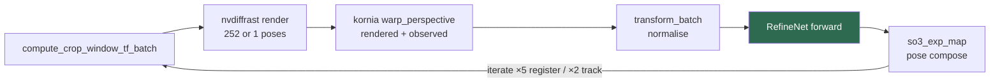

# ONNX → TensorRT for FoundationPose — study and plan

Status: **studied, measured, and declined.** Phase 0 ran on 2026-09-13 and
settled it: **do not build the engines.** The measurement, the arithmetic it
closes, and the cheaper work it promotes are in §8. Nothing in the MVP or in the
assessment claims depended on the outcome.

Context: `docs/R1_STATUS.md` retired risk R1 and established that upstream
FoundationPose ships no TensorRT at all — it loads PyTorch checkpoints. This
document asks the *different* question R1 never asked: **would putting the two
FoundationPose networks through ONNX and TensorRT buy anything worth having?**

§4 studies NVIDIA's `isaac_ros_foundationpose`, the downstream packaging R1
identified as the origin of the TensorRT premise. It answers more of this
document than the rest of the document does.

---

## 1. The decision, first

| | |
|---|---|
| **Decided, §8** | **No TensorRT engines.** fp32 — NVIDIA's only sanctioned precision — is arithmetically incapable of beating our autocast baseline at registration, and fp16 buys ~1.2× at best on either path against a real precision risk |
| **Promoted instead** | Async registration in our C++ `pose_agent`, then the 3.0 ms/frame of Python overhead Phase 0 exposed. Registration speed is no longer the thing to chase — see the next row |
| **What the check actually found, §7A** | **Registration fails grossly on ~1 in 30 frames at the incumbent 5 iterations** — 120 mm and 162° at frame 634 — and nothing downstream catches it. **`--register-iters` therefore ships at 6, the only value tested with zero failures**, at 15% against 5. `3` stays available for when registration latency matters. Unrelated to TensorRT, more important than it |
| **Kept, §4** | The refiner ONNX is published and **verified bit-identical to our checkpoint on this machine**. Nothing needs it now, but it is one `wget` away if this is ever revisited |
| **Ruled out** | A C++ TensorRT pose backend that removes the Python server; NVIDIA's `score_model.onnx`, which is a **different scorer** than ours |
| **Must not touch** | Printed objects → captures → ADD-S → fusion occlusion ablation |

The reasoning in one paragraph. Pose is the pipeline's dominant cost — 12.3 ms
per tracked object per view against 7.13 ms for everything else in the pair — so
there is a real prize. But TensorRT only accelerates the *network* forward, and
the refine loop spends unknown fractions of its time in nvdiffrast rendering,
kornia warps, and Python. The arithmetic in §2 establishes how much network math
there is and how much kernel headroom exists; it cannot apportion the measured
milliseconds between network and not-network. **That apportionment is the
entire decision, and it is one profiling run away.**

Two things moved since the first draft of this document, in opposite
directions. The refiner ONNX turns out to be free and verified (§4.2), which
removes most of the cost and most of the risk. And NVIDIA ships these engines
**fp32 only, explicitly because fp16 lost too much precision** (§4.4) — while
our PyTorch baseline already autocasts to fp16. That cuts the expected gain
sharply, and it is the single most important thing on this page.

There is also a strong chance Phase 0 finds cheaper wins first (§7), including
one that is free.

---

## 2. Where the time goes — what arithmetic settles and what it cannot

### 2.1 The measured envelopes

All from `docs/R1_STATUS.md` and `SystemCode/runtime/README.md`:

| Path | Work | Measured |
|---|---|---|
| `track_one` | 2 refine iterations, 1 hypothesis | **17.2 ms** in-process, full frame |
| pose via socket, 1 object | as above, ROI crop only on the wire | **12.3 / 11.2 ms** per view |
| `register` | 5 refine iterations × 252 hypotheses, then the scorer over 252 | **1258 ms**; **2.1 s** live |
| whole pair, real FoundationPose | 2 views, 1–2 objects | p50 **51.7 ms**, p95 78.2 ms |
| whole pair, mock pose, CUDA detector | detector 3.60 / 3.43 ms | total p50 **7.13 ms** |

The registration stall is not merely slow, it is **demo-visible**: the live run
logged `frames_dropped_since_last = 56` on the pair after registration and 554
ring-trimmed frames in the pairer.

### 2.2 The network workload, computed from the shipped checkpoints

Both networks take two 6-channel 160×160 crops (rendered vs. observed) and share
the same encoder topology. Refiner 17,043,797 parameters, scorer 15,986,512 —
read from `model_best.pth`, matching proposal §5.5. Multiply–accumulates per
hypothesis, from the layer shapes in `learning/models/`:

| Block | Shape work | GMAC |
|---|---|---|
| `encodeA`, per branch | 6→64 k7s2 @80²; 64→128 k3s2 @40²; 2 × ResBlock(128) @40² | 1.182 |
| `encodeA`, both branches | A and B are concatenated on the batch axis | **2.364** |
| `encodeAB` | 2 × ResBlock(256) @40²; 256→512 k3s2 @20²; 2 × ResBlock(512) @20² | **8.022** |
| refiner heads | 2 × TransformerEncoderLayer, d=512, seq=400, ff=512 | **1.586** |
| **refiner total** | | **11.97** |
| scorer self-attention | 1 × MultiheadAttention, d=512, seq=400 | 0.583 |
| **scorer total per hypothesis** | `encoderA` ×2 + `encoderAB` + self-att | **10.97** |
| scorer cross-attention | once over L=252, d=512 | 0.33 |

Sequence length is 400 because 160/2/2/2 = 20, and `PositionalEmbedding` is
built with `max_len=400` — exactly saturated, nothing dynamic.

So:

- **Track:** 2 iterations × 11.97 = **23.9 GMAC ≈ 47.9 GFLOP**
- **Register:** 5 × 252 × 11.97 + 252 × 10.97 + 0.33 = 15.08 + 2.76 = **17.85 TMAC ≈ 35.7 TFLOP**

### 2.3 What that implies — and the honest limit of it

Divide the network math by the measured envelope, i.e. ask what throughput the
GPU would be achieving *if the network were 100% of the time*. The fp16 matmul
peak on this card is 96.7 TFLOP/s (`gpu_test/test_sm120.py`):

| Path | Implied throughput | Fraction of fp16 peak |
|---|---|---|
| Register | 28.4 TFLOP/s | **29%** |
| Track | 3.9 TFLOP/s | **4.0%** |

**Register:** 29% of peak on batch-252 convolution work is roughly what a
well-behaved PyTorch autocast graph achieves. That is consistent with the
networks dominating registration, and it leaves the usual 1.5–2.5× of
TensorRT fusion headroom on the table. This path looks worth accelerating.

**Track:** 4% of peak cannot be explained by network math alone *unless*
batch-1 efficiency is catastrophically bad — which, for batch-1 160×160 convs,
it genuinely can be. So the refiner's share of the 12.3 ms is bracketed
somewhere between **14% and nearly 100%**, and arithmetic cannot narrow it.

That bracket is the whole problem. At the low end, a perfect engine buys 1.17×
on the track path and is not worth building. At the high end it buys 2× or more
and is the best available optimisation in the project.

**Phase 0 closed the bracket at 32.9%** — near the bottom. §8 has the
measurement and what it does to the rest of this document.

One correction to intuition worth stating once: the PyTorch baseline already
runs these convolutions **in fp16**, under `torch.cuda.amp.autocast` with
`amp = True` in both predictors (`predict_pose_refine.py:96`,
`predict_score.py:118`, both constructed with no arguments). A TensorRT fp16
engine is therefore *not* a precision win over the baseline. Every millisecond
must come from kernel fusion, better kernel selection, and the absence of
framework dispatch. Benchmarking a TRT fp16 engine against an fp32 PyTorch
baseline would overstate the gain by roughly the autocast speedup, and that is
the standard way this comparison is reported wrongly. §4.4 makes this worse
than a caveat.

---

## 3. No claim depended on this — and one proposal line overstated it

The ② assessment category ("ML / DL techniques") lists ONNX/TensorRT
deployment. **That claim is already discharged by the detector**, not by pose:
YOLOv8 exported to ONNX (opset 17, `1×4×640×640` → `1×7×8400`) and running
through the ONNX Runtime CUDA EP from C++ at 3.60 / 3.43 ms per view, with
C++/Python parity re-verified. Category ② is also carried independently by the
4-channel early-fusion stem, which is the project's own multimodal network.

So this work is **performance engineering, not claim insurance.** It can be cut
with no assessment consequence.

There is, however, a line to fix before 09-15. Proposal §4, category ②, ends:

> FoundationPose transformer-based pose refinement and scoring, itself an RGB-D
> multimodal network. **Both deployed via ONNX Runtime / TensorRT.**

FoundationPose is not deployed via either — it runs PyTorch checkpoints behind
the byte protocol. The proposal's own §5.3 table already says so correctly
("PyTorch checkpoints on sm_120 — upstream FoundationPose uses no TensorRT
(R1 retired)"), so the proposal currently contradicts itself. Its §5.6 stack
list, its §5.3 detector row and its Appendix B course-module mapping carry
TensorRT for the same reason and have the same problem.

**Edit applied 2026-09-13**, independent of this plan: the ONNX/TensorRT
deployment is now attributed to the detector explicitly, and the pose estimator
is described as PyTorch-checkpoint inference behind a byte protocol. That is both accurate and a
better story — it is the same honesty that made R1's retirement a finding rather
than a checkbox. Constraint 5 applies to capability claims as much as to metrics.

### 3.1 The full sweep

The same wording was carried in five more places, all predating R1's
retirement. **The three proposal sites are fixed** (2026-09-13); the two
internal docs are not yet:

| File | Line | Says | Reality |
|---|---|---|---|
| `ProjectReport/…Proposal.md` | §4 ② | "Both deployed via ONNX Runtime / TensorRT" | Detector only |
| `ProjectReport/…Proposal.md` | §5.3, §5.6, App. B | TensorRT in the stack and on the detector row | Nothing uses it; the detector is ONNX Runtime CUDA EP |
| `AGENTS.md` | 151 | `pose_agent` owns "TensorRT engine management" | It owns a Unix-socket client to a Python server |
| `AGENTS.md` | 160 | "R1 gate: TensorRT engines build and run on sm_120" | Retired on a false premise; `SystemCode/pose/README.md` already records it Met |
| `README.md` | 27, 173 | "ONNX Runtime / TensorRT — C++ inference deployment" | ONNX Runtime yes, TensorRT no |

`AGENTS.md:151` is the one worth correcting regardless of this plan: it
describes a responsibility `pose_agent` does not have and never had, which is
how a future reader ends up re-planning this study from scratch. While in
`README.md`'s stack list, the adjacent "ROS2 Jazzy — middleware" bullet is stale
for the same reason — one C++ process, decided 2026-09-06.

---

## 4. What NVIDIA already ships, and what it settles

Source: the `isaac_ros_foundationpose` package documentation and the Isaac ROS
performance tables. This is the packaging `docs/R1_STATUS.md` correctly named as
the origin of R1's TensorRT premise.

### 4.1 The published artifacts

Both ONNX files are on NGC, public, no authentication:

```bash
wget 'https://api.ngc.nvidia.com/v2/models/nvidia/isaac/foundationpose/versions/1.0.1_onnx/files/refine_model.onnx'
wget 'https://api.ngc.nvidia.com/v2/models/nvidia/isaac/foundationpose/versions/1.0.1_onnx/files/score_model.onnx'
```

| File | Bytes | SHA-256 (first 8) | Opset | Producer |
|---|---|---|---|---|
| `refine_model.onnx` | 68,161,611 | `dcc695a1` | 17 | pytorch 2.2.0 |
| `score_model.onnx` | 63,907,741 | `0bf1026c` | 14 | pytorch 1.13.1 |

Both take `input1`, `input2` as **NHWC** `[batch_size, 160, 160, 6]` — channels
last, with transposes inside the graph. The refiner emits `output1`, `output2`
at `[batch_size, 3]`; the scorer emits `output1` at `[1, batch_size]`.

### 4.2 Verified on this machine, not taken on trust

Downloaded and checked against our own checkpoints. Reproduce with
`training/pose/verify_ngc_onnx.py`, which fails loudly if any of this drifts:

```bash
~/venvs/the-eyes-r1/bin/python training/pose/verify_ngc_onnx.py --ngc-dir <downloads>
```

| Check | Result |
|---|---|
| Graph decomposition | Explicit `MatMul` / `Softmax` / `LayerNormalization`×4 — **no fused transformer op** |
| Conv count | **15 in each**, exactly the architecture's conv count, and no `BatchNormalization` nodes → BN folded |
| Structural match | Refiner has 4 `LayerNormalization` (two `TransformerEncoderLayer`s); scorer has none but has `Div`-scaled attention (plain `MultiheadAttention`). Both match `learning/models/` exactly |
| **Refiner weights** | **20 name-matched tensors bit-identical** to `weights/2023-10-28-18-33-37/model_best.pth`, worst deviation **0** |
| **Refiner end to end** | Run against our PyTorch `RefineNet` on a 2-hypothesis batch: `output1` matches `trans` to **9.5e-08**, `output2` matches `rot` to **1.2e-06** |
| **Scorer weights** | **Not ours.** 7 name-matched tensors deviate by up to **1.04** — a different checkpoint, not round-off |

So `refine_model.onnx` **is our refiner**, exported cleanly, and the output
order is `output1 = trans`, `output2 = rot`. The ONNX is gitignored like the
detector's; the script holds the hashes and the regeneration URL.

`score_model.onnx` is a different scorer. The older producer version (1.13.1)
points at the original 2023-vintage checkpoint; our `weights/` ships
`2024-01-11-20-02-45`. **It must not be substituted.** The scorer picks the
winning hypothesis and therefore determines the registered pose, so swapping it
changes registration and invalidates the §9 trajectory regression — this is true
even though the scorer's *score value* is nearly useless as a confidence
(`SystemCode/pose/README.md`: all 252 hypotheses within 80.84–81.02, top twelve
tied at 81.0156).

### 4.3 What this retires, and the one thing it adds

| Was | Now |
|---|---|
| E1 — `TransformerEncoderLayer` fast path may not export | **Retired.** NVIDIA's refiner graph contains explicit attention primitives |
| E2 — scorer's `L` is a Python int that reshapes batch→sequence | **Retired as a blocker.** Their scorer's output axis is dynamic `[1, batch_size]`, confirming `L` == batch size in the shipped path and that a dynamic export is achievable |
| E7 — BatchNorm must fold correctly | **Retired.** Already folded, and the fold is validated by the end-to-end agreement above |
| Phase 1, refiner | **Deleted.** Download, hash, run the parity check — done, ~20 minutes, above |
| Phase 1, scorer | **Still needed**, from our own checkpoint. Low risk now: the architecture is proven exportable and only plain `MultiheadAttention` is involved |
| — | **New, minor:** the boundary needs a `permute(0,2,3,1)`, because our A/B tensors are NCHW and these graphs are NHWC |

One correction to carry: NVIDIA's published `trtexec` command caps the refiner
at `maxShapes=input1:42x160x160x6`, with `optShapes` at batch 1. **Do not copy
it verbatim.** We refine all 252 hypotheses in a single call, so our refiner
engine needs `maxShapes` at 252; their profile is tuned for tracking (opt 1) and
implies they chunk registration. The scorer's published cap of 252 is right for
us as-is.

### 4.4 The finding that hurts: NVIDIA ships fp32, deliberately

> "FoundationPose TensorRT engines are running with FP32 precision in
> TensorRT 10.3+ versions due to FP16 precision loss."

This is E3 — fp16 drift compounding through an iteratively applied pose delta —
confirmed by the party that productionised these models, and it is why the
`trtexec` commands carry no precision flag.

Read together with §2.3 this is close to decisive against the easy version of
the plan. Our baseline already autocasts to **fp16**. On this card fp32 peak is
32.4 TFLOP/s against 96.7 for fp16 (`gpu_test/test_sm120.py`), so **the
sanctioned configuration starts a factor of ~3 in arithmetic behind what we
already run**, and fusion alone has to make that up before showing a profit.

That does not forbid trying fp16 ourselves — our targets are three known meshes,
not FoundationPose's unseen-object generality, and §9's A4 is exactly the test.
But the prior is now an informed negative rather than an open question, and any
fp16 engine that passes A4 must be reported alongside NVIDIA's statement.

### 4.5 The external anchor, and what it is not

Isaac ROS benchmark, pose estimation node, 720p input:

| Platform | Rate | Latency |
|---|---|---|
| x86_64 + RTX 5090 | 5.76 fps | 170 ms |
| **x86_64 + RTX 5070** | **3.11 fps** | **340 ms** |
| DGX Spark | 1.64 fps | 690 ms |
| AGX Thor T5000 | 2.21 fps | 460 ms |
| **AGX Orin** | **0.502 fps** | **3800 ms** |

340 ms on an RTX 5070 against our **1258 ms** registration on a 5070 Ti is
roughly 3.7× on comparable silicon — with fp32 engines. That says the headroom
is real.

It does **not** say the headroom is TensorRT's. Their `refine_iterations`
defaults to **3** against upstream's 5; the figure is a full ROS graph at 720p
rather than our ROI crop; their rendering path is theirs, not nvdiffrast driven
from Python; and it is not documented whether the node re-registers every frame.
The comparison bounds nothing and is marked **[VERIFY]**. It belongs in the
report as a target, not as a claim.

Three further usable facts:

- **AGX Orin at 3800 ms** effectively settles cut-order #1. The Jetson Orin Nano
  Super is well below an AGX Orin, so interactive FoundationPose on that target
  is not happening. Worth citing rather than re-testing.
- **~7 GB peak, 8 GB minimum** for their fp32 pipeline. We have 16 GB but
  already run two ONNX Runtime CUDA sessions plus torch in the same box.
- **Engine build takes 10–15 minutes** on Thor. Expect minutes here, not the
  1.5 s that `gpu_test/test_tensorrt_sm120.py` measured for a toy conv net —
  budget it into Phase 2 and cache engines by checkpoint hash.
- `refine_iterations: 3` as NVIDIA's default is independent support for §7.4.

---

## 5. The export surface

The boundary is one line in each predictor. `predict_pose_refine.py:190`:

```python
with torch.cuda.amp.autocast(enabled=self.amp):
    output = self.model(A, B)          # ← replace this
```

Everything after it — `tanh`, the `rot_normalizer` scaling, `so3_exp_map`,
`egocentric_delta_pose_to_pose`, the `mesh_diameter/2` denormalisation — is
small tensor algebra that stays in PyTorch. Everything before it — the crop
transform, nvdiffrast render, kornia `warp_perspective`, `transform_batch`
normalisation — stays in PyTorch too, and is exactly the part TensorRT does not
touch.



Only the shaded box becomes an engine. The loop around it does not.

### Engine inventory

| Engine | Inputs (NHWC) | Output | Batch | Source ONNX | Used by |
|---|---|---|---|---|---|
| `refiner_b1` | `input1/2`: 1×160×160×6 | `output1`=trans, `output2`=rot, 1×3 | 1, static | NGC, verified §4.2 | track, 2 calls/frame |
| `refiner_b252` | 252×160×160×6 | 252×3 | 252, static | NGC, verified §4.2 | register, 5 calls |
| `scorer_b252` | 252×160×160×6 | 1×252 | 252, static | **ours, to export** | register, 1 call |

Prefer **separate static engines over one profile spanning 1…252.** A
profile-spanning engine typically underperforms at both extremes, and the two
batch sizes here are fixed by construction, not by input. NVIDIA's published
command does the opposite (min 1 / opt 1 / max 42) because their node serves
both modes from one plan; we do not have that constraint.

---

## 6. Remaining export and engine risks

E1, E2 and E7 are retired by §4.3. What is left:

| # | Risk | Why it bites | Mitigation |
|---|---|---|---|
| E3 | fp16 drift into pose error | The refiner's output is a *delta* applied iteratively, 6× at registration (§7A). **NVIDIA hit this and shipped fp32** (§4.4) | Default to fp32. Try fp16 only as an ablation, and only if A4 passes; report NVIDIA's statement beside any fp16 result |
| E4 | Baseline chosen wrongly | Comparing a TRT engine against fp32 PyTorch overstates the win, because the baseline autocasts to fp16. With fp32 engines the honest comparison may show a **loss** | Baseline is **autocast-enabled PyTorch**, stated in every number reported. A negative result is reported, not buried |
| E5 | Checkpoint/engine drift | An engine is an opaque artifact; a stale one fails silently and looks like a pose regression. The scorer makes this sharper — there are now two scorers in the world and one of them is not ours | Engine filename carries the checkpoint SHA-256, verified at load. Assert the refiner ONNX hash is `dcc695a1…` and **reject** `0bf1026c…` wherever a scorer is expected |
| E6 | TensorRT 11 API | `BuilderFlag.FP16` and `platform_has_fast_fp16` are gone; strongly-typed networks replace them. Most examples target TRT 8/10, and NVIDIA's own instructions assume `trtexec` from a TRT 10.3 container | `gpu_test/test_tensorrt_sm120.py` already builds fp32 and fp16 against 11.2.1.2 on this box. Extend it; treat the published `trtexec` line as documentation, not a command to run |
| E8 | **NHWC boundary** | Our A/B tensors are NCHW `(B,6,160,160)`; these graphs take `(B,160,160,6)`. A silently wrong permute produces plausible-looking garbage poses | One `permute(0,2,3,1).contiguous()` at the call site, pinned by the parity test that already exists in the scratchpad |
| E9 | Hypothesis count baked into the engine | `refiner_b252` and `scorer_b252` hard-code 252, which comes from `make_rotation_grid(min_n_views=40, inplane_step=60)`. §7.3 proposes changing exactly that | Assert the batch dimension against the actual hypothesis count at load — a comment will not survive a grid change. If §7.3 lands, rebuild |
| E10 | Scorer licence and provenance | We must export our own scorer (§4.2). The NGC artifacts are NVIDIA-licensed model files | Engines and ONNX are gitignored and regenerated, as the detector ONNX already is; record the NGC URL and hash in the regeneration command. Nothing NVIDIA-licensed is redistributed in the submission ZIP |

---

## 7. The cheaper things — and what Phase 0 measured them at

These were listed as things that might make the TensorRT work unnecessary.
Phase 0 measured them, and one of them did exactly that — see §8's closing
table for the numbers each carries.

1. **`torch.cuda.empty_cache()` runs once per `predict()` call** —
   `predict_pose_refine.py:237` and `predict_score.py:217`. It releases the
   allocator's cached blocks to the driver, forcing fresh `cudaMalloc` on the
   next call, and it synchronises. In a 30 Hz tracking loop this is pure waste.
   **Free to remove, zero risk, and it is inside our own server's call path.**
2. **`torch.set_default_tensor_type('torch.cuda.FloatTensor')` per call** —
   `predict_pose_refine.py:155`. Deprecated global state mutation on every
   frame.
3. **Fewer hypotheses at registration.** 252 = 42 icosphere views × 6 in-plane
   steps. `inplane_step` 60 → 90 gives 168 (−33% of the dominant cost).
   Registration robustness must be checked, not assumed — but it is a one-line
   experiment against the mustard0 sequence.
4. **Fewer refine iterations at registration**, 5 → 3 — **considered and
   reversed**. The quality check in §7A confirmed 3 is 1.48× faster with no
   regression against 5, then found why that is the wrong question: 5 is itself
   unsafe. The setting went **up to 6**, not down to 3. `3` remains available
   behind `--register-iters` for when registration latency matters. NVIDIA's
   default of 3 (§4.5) should be read as a latency choice, not a quality one.
5. **Asynchronous registration in our C++ `pose_agent`.** This is the
   architecturally correct fix and it is *our* code, in C++, on the graded side
   of the boundary: register a newly detected object on a worker while tracking
   continues for already-registered objects, so the 2.1 s stall stops blocking
   the pair loop. It does not make registration faster; it makes it invisible,
   which is what the 56 dropped frames actually demand.

**If §7.5 lands, most of the case for the register engines evaporates** — the
stall stops being a demo defect. Combined with §4.4, that is now the most likely
outcome of this study, and an entirely acceptable one.

---

## 7A. The registration-quality check — and what it actually found

`training/pose/registration_quality.py`, run 2026-09-13, raw data in
`docs/results/registration_quality.json`. mustard0 ships no ground-truth poses,
so the check is self-referential: register independently at several iteration
counts on the same frame with the same mask, score every arm by **ADD-S against
the converged 8-iteration pose**, and then test whether any difference survives
downstream. mustard0 also ships only one mask, so for sampled frames the mask is
rebuilt the way `SystemCode/pose` builds one — an ROI box gated by depth
validity. That is optimistic about the detector, but identical across arms,
which is what a relative comparison needs.

```bash
~/venvs/the-eyes-r1/bin/python training/pose/registration_quality.py \
    --sample-frames 30 --arms 2,3,4,5,6 --incumbent 5 --target 3
```

### Lowering the count is safe — 30 independent registrations

Object diameter 196.5 mm, so `AGENTS.md`'s ADD-S < 10% acceptance is 19.6 mm.

| iters | median ADD-S | non-failing median | gross failures | median ms | vs 5 |
|---:|---:|---:|---:|---:|---:|
| 2 | 1.20 mm (0.61%) | 1.18 mm | 1/30 | 559 | 1.87× |
| 3 — available via `--register-iters` | 0.73 mm (0.37%) | 0.70 mm | 1/30 | 706 | 1.48× |
| 4 | 0.61 mm (0.31%) | 0.58 mm | 1/30 | 865 | 1.21× |
| 5 — incumbent | 0.98 mm (0.50%) | 0.98 mm | 1/30 | 1043 | 1.00× |
| **6 — shipped** | **0.52 mm (0.26%)** | **0.52 mm** | **0/30** | **1198** | **0.87×** |

**No arm fails on a frame where the incumbent succeeds.** Downstream, tracking
all 737 frames from a 3-iteration registration against the same from a
5-iteration one gives translation max **0.83 mm**, rotation max **1.18°**,
ADD-S max **1.11 mm (0.56%)** — an order of magnitude inside the tracker's own
frame-to-frame noise (R1: p95 11.5 mm, max 17.8 mm / 3.54°). The two are
indistinguishable.

Caveat stated plainly: this is 30 registrations on one sequence with one
failure event. It supports "no detectable regression", not "proven equivalent".

### …but the count was never the problem

**Registration lands in the wrong basin on roughly 1 in 30 frames, and it does
so at the incumbent setting too.** The single failure is frame 634, and it fails
at 2, 3, 4 *and* 5 iterations. Scored against the pose the validated tracker
holds at that frame — an independent reference, not the 8-iteration one:

| iters | ADD-S vs tracked | translation | rotation |
|---:|---:|---:|---:|
| 2 | 68.19 mm (34.7%) | 115.3 mm | 83.3° |
| 3 | 76.55 mm (39.0%) | 120.3 mm | 86.3° |
| 4 | 87.18 mm (44.4%) | 121.2 mm | 163.0° |
| 5 | 83.54 mm (42.5%) | 118.4 mm | 161.6° |
| **6** | **5.77 mm (2.9%)** | **7.6 mm** | **13.9°** |
| 8 | 0.81 mm (0.4%) | 0.7 mm | 0.6° |

All four low arms sit in the *same* wrong basin (pairwise 3–17 mm of each
other) while 6 and 8 sit in the right one. So this is not slow convergence —
it is hypothesis selection settling on a wrong pose that more refinement
escapes. The convergence sweep in Part A says the same thing from the other
side: past 2 iterations the pose wanders by ±0.9 mm without monotonically
improving, so iteration count beyond 2 buys basin escape, not precision.

**Nothing downstream catches it.** `config/fusion.yaml` gives
`association.max_distance_m: 0.15` and `disagreement_gate.max_translation_m:
0.05`, so a 120 mm error either splits into a phantom object or trips the gate —
and on a two-view conflict the gate keeps the higher-scoring view, while
`SystemCode/pose/README.md` records the FoundationPose score as degenerate
(0.82, identical on every frame). The tie-break is a coin flip.

### What shipped, and why it is not 3

**`--register-iters` defaults to 6** (2026-09-13). The change started as 5 → 3
for speed; the check turned it into 5 → 6 for correctness. A silent 1-in-30
pose error is worth more than 15% of a stage that §8 already established does
not need to be fast — async registration (§7.5) takes the stall off the
critical path entirely, and registration happens once per object, not per frame.

**`--register-iters 3` stays available** and is the right choice when
registration latency genuinely matters — a live demo, a throughput measurement.
It is 1.48× faster and carries exactly the failure rate the old default carried,
so choosing it is trading a known risk for known speed rather than gambling.

Read NVIDIA's default of 3 (§4.5) as a latency choice, not a quality one.

**Still open:** whether 6 is enough, or merely enough for mustard0. One failure
event across 30 registrations on one sequence cannot distinguish "6 is safe"
from "6 was lucky here". Re-run this check against the real captures once the
printed objects exist — the script takes a `--scene` and needs no changes.


## 8. Phases

### Phase 0 — the profile that decided — **RUN 2026-09-13**

`training/pose/profile_stages.py`, mustard0, 200 tracked frames after 10
warm-up, register 5 iterations / track 2. The real code paths are wrapped by
monkey-patching what `make_crop_data_batch` calls; nothing in FoundationPose is
edited. Raw numbers in `docs/results/pose_stage_profile.json`.

```bash
~/venvs/the-eyes-r1/bin/python training/pose/profile_stages.py \
    --frames 210 --warmup 10 --register-repeats 3
```

Syncs delimit every stage, so the instrumented totals run slightly long
(register 1039 ms against a 1047 ms uninstrumented envelope; track 11.09 ms mean
against 10.27 ms). Shares are of the envelope, so each column sums to 100%.

| stage | register ms | share | track ms (200 calls) | share |
|---|---:|---:|---:|---:|
| `crop_window` | 2.0 | 0.2% | 98.5 | 4.4% |
| `render` (nvdiffrast) | 131.9 | 12.7% | 303.1 | 13.7% |
| `warp` (kornia) | 70.1 | 6.7% | 353.1 | 15.9% |
| `normalise` | 68.2 | 6.6% | 100.7 | 4.5% |
| **`net_refine`** | **642.0** | **61.8%** | **730.7** | **32.9%** |
| **`net_score`** | **112.6** | **10.8%** | — | — |
| `empty_cache` | 11.2 | 1.1% | 31.2 | 1.4% |
| *(unattributed — Python, pose composition)* | 1.4 | 0.1% | 601.6 | 27.1% |
| **network share** | **754.6** | **72.6%** | **730.7** | **32.9%** |
| **Amdahl ceiling, free network** | | **3.65×** | | **1.49×** |

**Registration is network-bound (72.6%); tracking is not (32.9%).** That much
matched the §2.3 prediction. What kills the plan is the next step.

#### The arithmetic §2.3 could not close, now closed

Dividing §2.2's workload by the *measured network time* gives what the autocast
baseline actually achieves, and therefore what an engine has to beat:

| | network math | measured | achieved | of fp16 peak (96.7 TFLOP/s) |
|---|---:|---:|---:|---:|
| register, batch 252 | 35.70 TFLOP | 754.6 ms | 47.3 TFLOP/s | **48.9%** |
| track, batch 1 | 9.58 TFLOP | 730.7 ms | 13.1 TFLOP/s | **13.6%** |

The batch-1 inefficiency hypothesis was right — 13.6% against 48.9% — but the
consequence is the opposite of encouraging:

- **fp32 cannot win at registration, at any quality of engine.** 35.70 TFLOP at
  this card's *full* fp32 peak of 32.4 TFLOP/s takes **1102 ms**, against the
  754.6 ms autocast already costs. A perfect fp32 engine is **1.46× slower**.
  fp32 is the only precision NVIDIA ships (§4.4), so the sanctioned
  configuration is excluded by arithmetic, not by opinion.
- **fp16 has little room left.** At 48.9% of peak the autocast graph is already
  reasonably fused; 2× would require 97.8% of peak, which is not a thing. A
  realistic 1.5× network gives **1.32×** on registration, a 2× gives 1.57×.
- **Tracking is capped at 1.49× even with a free network**, and a realistic
  1.5–2× network gives **1.12–1.20×**. fp32 is not arithmetically excluded here
  (batch-1 autocast is inefficient enough to beat), but 1.2× on the path that is
  not the bottleneck does not justify an opaque build artifact and E3.

#### Gate outcome

| Criterion as written | Measured | Outcome |
|---|---|---|
| Refiner < 30% of track envelope → don't build | **32.9%** | Just above the line, but the 1.49× ceiling and 1.12–1.20× realistic gain settle it: **don't build** |
| Networks > 60% of register envelope → build | **72.6%** | Criterion met, then **overridden**: fp32 cannot win and fp16 buys ~1.3× for real precision risk |
| fp32 slower than the autocast baseline → stop | **1.46× slower, register** | **Stop.** This is the decisive row |

**Decision: no engines.** The gate was written before the fp32 constraint was
known; §4.4 and this measurement together make the 60% criterion insufficient,
and the honest reading is to stop rather than to build to the letter of a
superseded rule.

#### What Phase 0 promoted instead

The profile makes the cheap options concrete, and the best of them beats
anything TensorRT was offering:

| Change | Effect | Cost |
|---|---|---|
| ~~`refine_iterations` 5 → 3~~ → **5 → 6, see §7A** | 3 is 1.48× faster with no regression, but 5 fails grossly on 1 in 30 registrations and only 6 does not. Shipped **6** (~1198 ms), with `--register-iters 3` (706 ms) available when latency matters | One line in `foundationpose_server.py` |
| Async registration in C++ `pose_agent` (§7.5) | Removes the stall from the pair loop entirely — the 56 dropped frames | Our code, C++, graded side |
| The 27.1% unattributed on the track path | **3.0 ms per frame** of Python and pose composition — the largest addressable non-network cost in tracking, and no engine can touch it | Needs its own profile |
| Drop `torch.cuda.empty_cache()` (§7.1) | 11.2 ms of registration (1.1%), 0.16 ms per tracked frame (1.4%) | Free — but **smaller than this document originally suspected**, and it is recorded as such |

One more measured fact: **the first registration in a process costs 1241 ms
against 1047 ms warm, 1.19×.** The live runner's 2.1 s stall is larger than
either, so something outside the estimator — model load, socket setup, the
server's own first call — carries the rest. Worth a look when §7.5 is built.

### Phases 1–4 — **not executed**

Kept as the record of what building the engines would have required, and as the
route back if the fp32 constraint ever lifts or the workload changes. Phase 0
closed the gate ahead of them.

### Phase 1 — ONNX (refiner: done; scorer: ~2 hours)

The refiner needs no export: download from NGC, verify the hash, run the parity
check. **Already done in §4.2** — agreement 9.5e-08 / 1.2e-06 against our own
checkpoint.

The scorer must be exported from `weights/2024-01-11-20-02-45` by
`training/pose/export_onnx.py`, mirroring `training/detector/export_onnx.py`,
with `L` as a dynamic axis. NVIDIA's file proves the architecture exports; it is
simply not our weights.

### Phase 2 — engines and the honest benchmark (~half a day)

Extend `gpu_test/test_tensorrt_sm120.py`. Build **fp32 first** (§4.4). Report
against the **autocast** baseline (E4). Budget minutes per engine build and
cache by checkpoint hash.

### Phase 3 — wire into the server, behind a config flag (~half a day)

`estimator.backend: pytorch | tensorrt` in `config/pose.yaml`, defaulting to
`pytorch`. The flag is what makes this an ablation rather than a rewrite: both
arms stay runnable, so the report can quote a real A/B instead of a claim.

### Phase 4 — the trajectory regression (~2 hours)

§9, run on both arms.

Total, had every gate opened: **~1.5 days**. Actual spend: **Phase 0 plus §4's
verification** — under two hours, and it bought a decision instead of an
engine.

---

## 9. Acceptance criteria

| # | Criterion |
|---|---|
| A1 | Phase 0's apportionment table exists and is quoted in the report, whatever it says. **A negative result here is a deliverable**, exactly as the modality ablation was — **MET, §8**, and the result is negative |
| A2 | Every ONNX matches its PyTorch source on recorded crop batches, tolerance stated, before any engine is built. Refiner: **MET, 9.5e-08 / 1.2e-06**. Scorer: not exported, no engine built |
| A3 | mustard0 runs 737/737 frames on the TensorRT arm, as the PyTorch arm does — **not applicable**, no arm was built |
| A4 | Per-frame pose deltas against the validated PyTorch trajectory stay inside R1's own envelope — median 0.27 mm / 0.31°, p95 11.5 mm, max 17.8 mm translation and 3.54° rotation. **A backend swap must not move the trajectory more than the tracker's own frame-to-frame noise** |
| A5 | Rotations remain valid SO(3): ‖RRᵀ−I‖ and det(R) at least as tight as R1's 2.2e-06 and [0.999999, 1.000001] |
| A6 | Every reported speedup names the autocast PyTorch baseline it is against, and its precision |
| A7 | Engine files carry the checkpoint hash and are verified at load; the foreign scorer hash `0bf1026c…` is rejected explicitly |
| A8 | Both backends remain selectable and tested; no path becomes unrunnable |
| A9 | ADD-S on real captures, once it exists, is unchanged within its confidence interval |

A4 is the criterion that matters. A faster estimator that moves the poses is not
a faster estimator, it is a different one, and the fusion ablation sits
downstream of it.

---

## 10. What is deliberately not built

- **The engines themselves — the headline entry, decided by §8.** Not "not yet":
  fp32 cannot beat the autocast baseline at registration on this card, and fp16
  buys ~1.2× against a precision risk NVIDIA documents. Revisit only if the
  workload changes shape (many more objects, a larger hypothesis grid) or the
  fp16 constraint lifts upstream.
- **A C++ TensorRT pose backend replacing the Python server.** This is the
  version that would satisfy constraint 1 literally, and it is out of reach:
  the refine loop needs nvdiffrast rasterisation and kornia perspective warps
  per iteration, and neither has a C++ path here. Porting them is weeks, and
  `SystemCode/pose/README.md` already argues the out-of-process split correctly
  — FoundationPose is treated exactly as an engine would be. An engine inside
  that server changes nothing about our architecture.
- **NVIDIA's `score_model.onnx`.** Different weights (§4.2). Using it would
  change which hypothesis wins registration and invalidate A4.
- **Adopting `isaac_ros_foundationpose` itself.** It is a ROS2 package, and
  neither this project nor PM1 ships ROS2 code (verified 2026-09-08). Its value
  here is its published ONNX, its fp32 decision, and its benchmark table —
  all of which §4 has already extracted.
- **ONNX Runtime TensorRT EP as the route.** `gpu_test/README.md` records the
  trap: the EP is listed by `get_available_providers()` while silently falling
  back to CPU. For fixed-shape engines the TensorRT API is direct and its
  failures are loud.
- **INT8 or any calibrated quantisation.** Needs a calibration set, and fp16
  already lost this argument at NVIDIA (§4.4).
- **Engines for the unknown-object path.** `cluster_agent` is unbuilt, cut
  order #2.
- **Jetson deployment of the pose stage.** §4.5's AGX Orin figure of 3800 ms
  settles it; cut order #1 stays cut, now with a citation.
- **Touching the fusion or scene-graph modules.** Constraint 2. Nothing here
  goes near them.

---

## 11. Schedule fit

Deadlines: proposal **09-15**, first presentation **09-30**, final **10-31**.

The critical path is unchanged and this work is not on it: printed objects →
calliper verification → capture → real ADD-S → the fusion occlusion ablation,
which is never cut. Filament landed on the ~09-12 ETA and `docs/PRINT_PLAN.md`
starts the print queue today, 09-13.

**What actually happened, 2026-09-13.** The proposal edit landed (§3). Phase 0
ran the same day rather than after 09-15 — it needed no hardware and no rig
time, so it fitted between print jobs — and returned a decision instead of a
work item. Total spend under two hours, and no engine was built.

**What is left, and none of it is on the critical path:**

1. ~~`refine_iterations`, with a registration-quality check~~ — **done
   2026-09-13**. Went **up to 6** for correctness rather than down to 3 for
   speed, §7A. Re-run the check against real captures when the printed objects
   exist, to confirm 6 is safe there too and not just on mustard0.
2. Async registration in the C++ `pose_agent` (§7.5) — now the main lever on
   registration latency, since the iteration count is spoken for.
3. The two internal-doc wording fixes in §3.1 (`AGENTS.md:151`, `README.md`).
4. Optionally, a profile of the 27.1% Python overhead on the track path.

None of these is TensorRT, and all of them can wait behind captures, ADD-S and
the occlusion ablation. **This document is now a finding rather than a plan** —
§8's negative result and §4's fp32 constraint are what goes in the report, and
they cost nothing further to carry.
