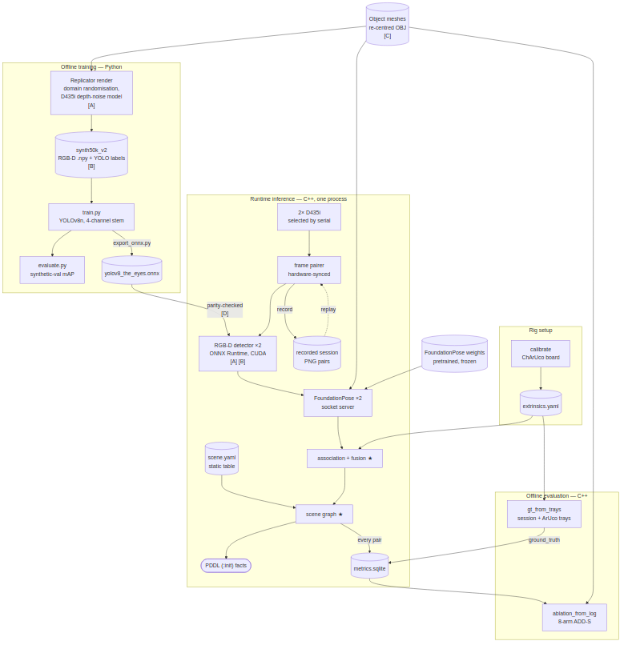
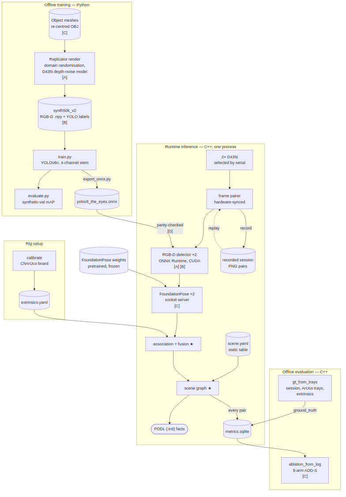

# Data-flow diagram — two versions for review

Proposal §5.2 currently carries **Version B**. Both versions describe the same
data flow; they differ only in how the shared artefacts are drawn. The images
below are pre-rendered (mermaid-cli 11.12), so they look the same whichever
Markdown previewer opens this file.

Delete this folder once a version is chosen.

---

## Version A — shared inputs drawn as arrows

Commit `8d6412c`. Source: [`dfd_A_arrows.mmd`](dfd_A_arrows.mmd)



- **For:** every flow is an arrow. The meshes visibly feed Replicator,
  FoundationPose and the ablation tool, and `extrinsics.yaml` visibly feeds
  `gt_from_trays`.
- **Against:** two arrows run through group titles — meshes → Replicator through
  "Offline training", and extrinsics → `gt_from_trays` through "Offline
  evaluation". The mesh arrows are also the longest lines in the diagram.

## Version B — shared inputs marked by tags (current)

Commit `97b6f9e`. Source: [`dfd_B_tags.mmd`](dfd_B_tags.mmd)



- **For:** no arrow crosses a title, another arrow or a node. Checked in
  mermaid 11.12 and 10.9 (the Pandoc filter's copy); both lay it out the same.
- **Against:** two flows become text instead of arrows. The meshes' use by
  FoundationPose and the ablation tool is shown by the **[C]** tag, and
  `gt_from_trays` lists extrinsics in its label.

---

## Switching the proposal to Version A

1. Replace the second ` ```mermaid ` block in proposal §5.2 with the contents of
   `dfd_A_arrows.mmd`.
2. Optionally, change the caption's "agree between training and inference —
   tagged [A]–[D] where they occur — and a mismatch" back to "agree between
   training and inference, and a mismatch". Version A shows the mesh sharing
   with arrows, so the tag note matters less there.
